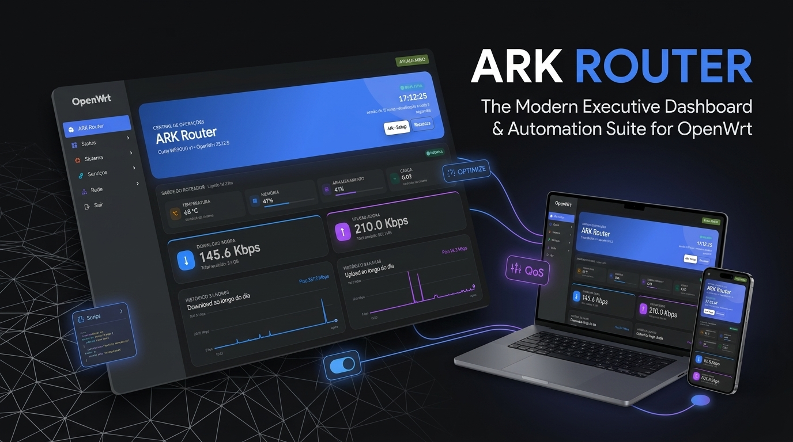
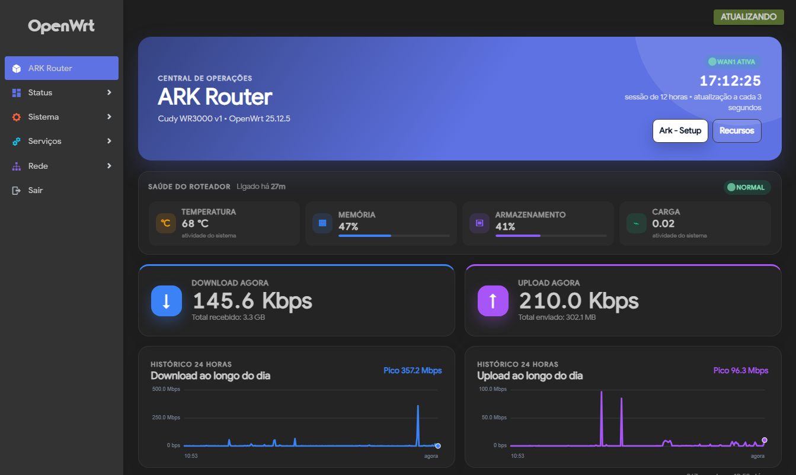
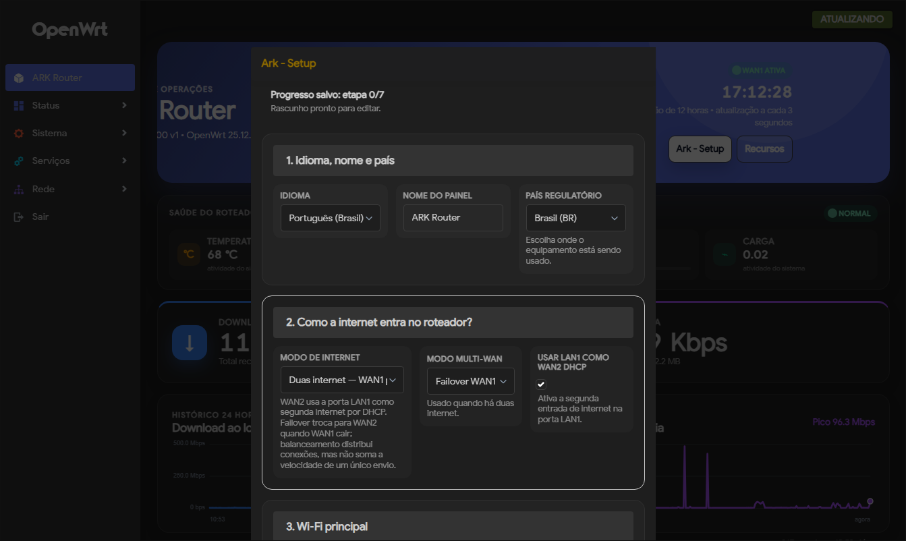
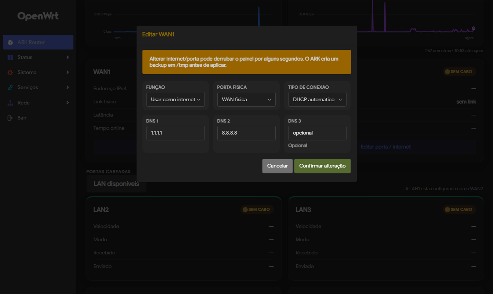
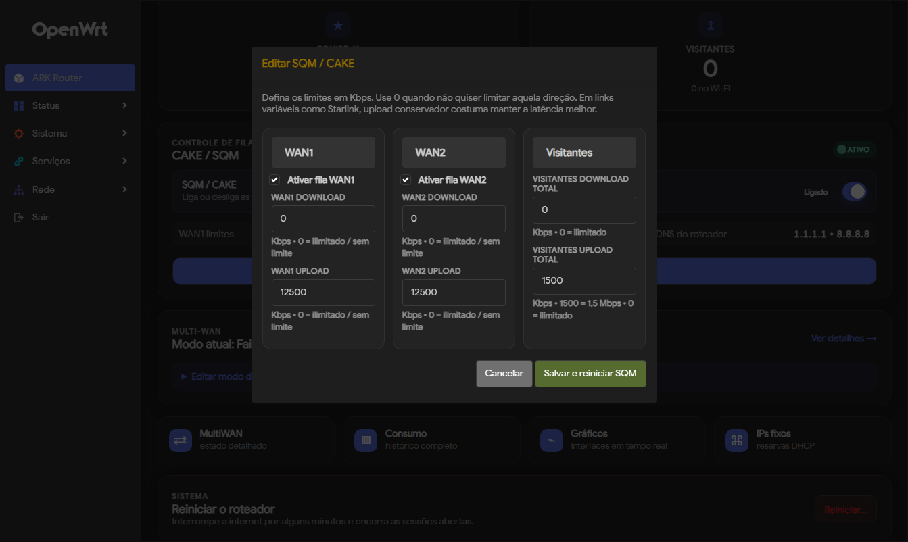
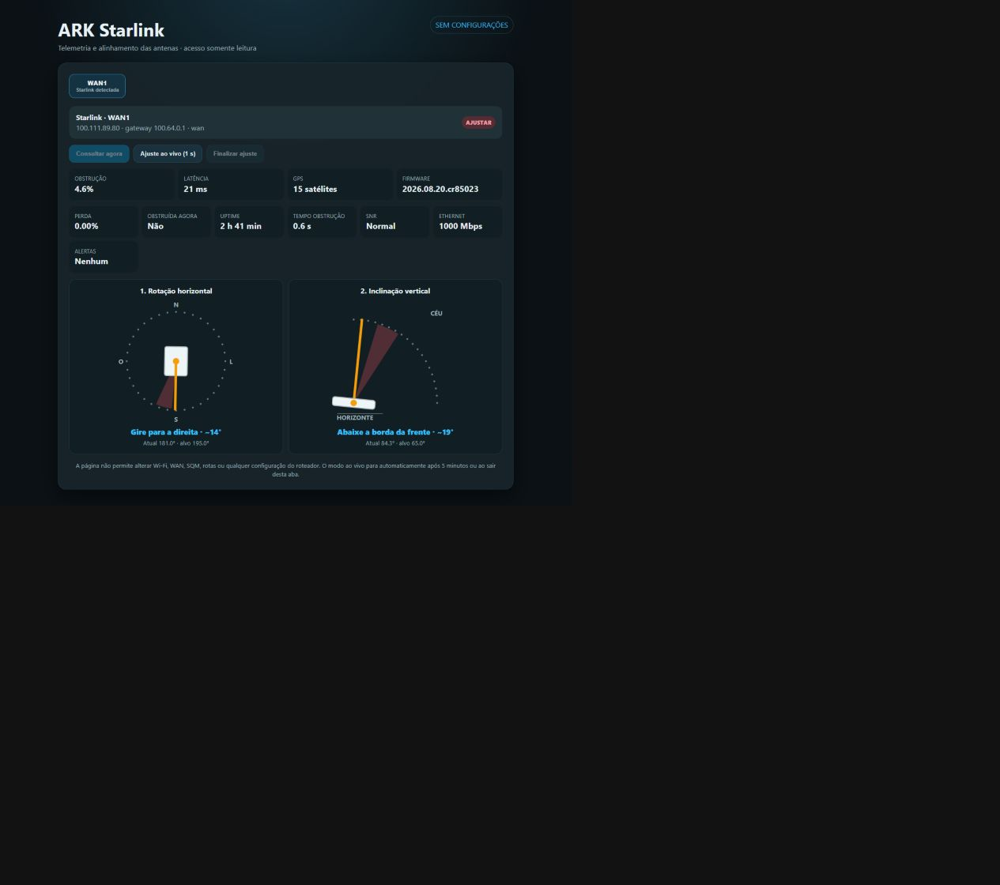
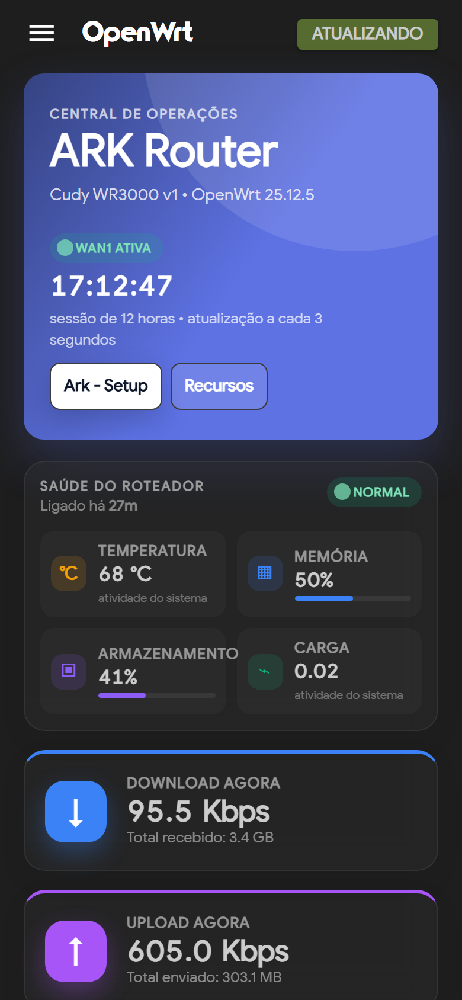
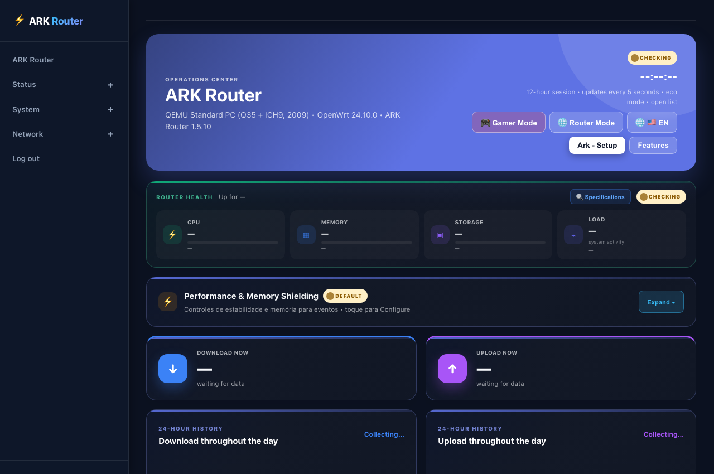

<p align="center">
  
</p>

# ARK Router

<p align="center">
  <a href="https://openwrt.org/"></a>
  <a href="https://github.com/Despensativo/ark-router/releases/tag/v2.0.1"></a>
  <a href="LICENSE"></a>
  
  
</p>

<p align="center">
  <b>🌐 Languages / Idiomas / Idiomas:</b><br>
  <a href="README.md">🇧🇷 <b>Português (Brasil)</b></a> &nbsp;•&nbsp;
  <a href="README.en.md">🇺🇸 <b>English</b></a> &nbsp;•&nbsp;
  <a href="README.es.md">🇪🇸 <b>Español</b></a>
</p>

---

**ARK Router** transforms **OpenWrt** devices into modern, executive-grade network operations centers. It replaces the default static LuCI interface with a clean, fast, modular, mobile-first control suite for home, gaming, office, event, field, Starlink, and multi-WAN setups.

The project does not replace OpenWrt or LuCI — it operates on top of LuCI as an advanced operations package (`luci-app-ark-router`) featuring real-time telemetry, zero bloat, anti-lockout safeguards, and pioneering memory and network shielding mechanisms.

> **Current Official Release**: **`v2.0.1`** (see [`VERSION`](VERSION) and [Releases](https://github.com/Despensativo/ark-router/releases)).

---

## 🌟 Key Highlights

1. **⚡ Unified Performance & Memory Shielding Center**:
   - High-visibility card on the overview dashboard featuring first-level interactive switches, dynamic counters of active optimizations, and instant runtime application without unnecessary service reboots.
2. **🗜️ Intelligent RAM Memory Compression (ZRAM / LZ4)**:
   - Doubles effective RAM multitasking capacity via an in-memory LZ4 compressed swap disk with zero Flash memory wear.
   - **5-Second Countdown Safety Lock**: On high-RAM routers ($\ge 512$ MB physical RAM), the switch enforces a 5-second timed confirmation modal to avoid wasting CPU cycles when memory is already abundant.
   - **Protected Mode for Single-Core CPUs (MIPS)**: Automatically detects modest single-core CPUs and caps allocation to 32 MB with `swappiness=15` to protect CPU throughput.
   - **Instant Activation**: On multi-core $\le 256$ MB routers (e.g. Cudy WR3000), dynamically allocates an optimal LZ4 pool (116 MB) to absorb heavy load.
3. **🎮 Automatic Port Forwarding (UPnP / IGD) with Safe Mode**:
   - Quick toggle with instant visual feedback:
     - **Safe Mode (Disabled - Default)**: Keeps external WAN ports fully protected; no ports are opened automatically without explicit firewall rules.
     - **Active Mode**: Enables dynamic port mapping for gaming consoles (Xbox, PlayStation, PC) with clear real-time security advisory toasts.
4. **🩺 ARK Doctor (Automated System Auditor & Self-Healing)**:
   - Live 10-layer runtime health diagnostic: Wi-Fi radios, network bridges, DHCP, firewall rules (pure fw4/nftables), ZRAM integrity (`Check 1b`), SQM, and hostapd syntax, with a 1-click automatic self-repair button (`ark-doctor --fix`).
5. **🛡️ Hybrid AdBlocker & Parental Control (RAM / Cloud Anycast)**:
   - **Full Profile ($\ge 512$ MB RAM)**: Full AdGuard Home engine running entirely in volatile RAM (`/tmp/adguardhome`) on port 3000 with 1M+ local rules, super-cache, native **HTTP/3 QUIC (`h3://`)** upstreams, and zero flash writes.
   - **Lite Profile (128 MB to 256 MB RAM)**: Cloud Anycast mode via `dnsmasq` with 9 specialized DNS security providers (Cloudflare Family, Quad9, CleanBrowsing, Control D, OpenDNS, NextDNS).
6. **🚫 0ms Local Domain Blacklist ("X or Y")**:
   - Instant domain and subdomain blocking directly in the dashboard, returning `0.0.0.0` in 0ms with zero extra RAM consumption in `dnsmasq`.
7. **⚡ Per-Device Rate Limiting with Local LAN Bypass (RFC 1918)**:
   - Precise individual download and upload bandwidth caps applied strictly to Internet traffic. Local transfers (NAS, Plex/Emby servers, network printers, PC file sharing) remain at full native speed (Gigabit, 2.5G, or Wi-Fi 6 at 1200+ Mbps).
8. **🛑 Per-Device Parental Filter & SafeSearch**:
   - Individual adult content filtering and enforced SafeSearch (Google, Bing, YouTube) per client device.
9. **📊 Real-Time Per-Device Traffic (Hardware DMA & Anti-Jitter)**:
   - Real-time rate tracking directly from the Wi-Fi driver (`iwinfo`) with an Exponential Moving Average (EMA) smoothing filter that prevents jumpy readings.
   - **Total Consumed** column (MB/GB) with interactive sorting.
10. **🚀 DNS Turbo, 1-Click Dual-DoH (`https-dns-proxy`) & Port 53/853 Shield**:
    - Real-time parallel latency testing comparing Cloudflare, Google, Quad9, OpenDNS, and AdGuard, 1-click **Dual-DoH (`https-dns-proxy`)** activation (`127.0.0.1#5053` + `#5054`), and full forced DNS shielding across Port 53 + DoT Port 853 (RFC 7858).
11. **🌐 Intelligent ZeroTier Remote Access**:
    - Native execution on devices with ample storage and seamless 0.3s RAM loader on compact 16 MB flash hardware.
12. **🛰️ Multi-Starlink Operations Center**:
    - Multi-dish diagnostics: 3D alignment compass, obstructions, packet loss, SNR, and unauthenticated read-only LAN viewer at `/starlink/`.
13. **🔄 Seamless Fastpath (Flow Offload / PPE) & SQM/CAKE Lifecycle**:
    - Strict mutual exclusion guardrail. Disabling SQM from the quick dashboard switch automatically restores hardware packet offloading (PPE/Flowtable).
14. **🛡️ Smart Auto-MTU & Baby Jumbo MTU 1500 on PPPoE (RFC 4638)**:
    - Live non-fragmenting ICMP PMTU discovery and automatic MTU 1508/1512 configuration on the underlying Ethernet port for true 1500-byte PPPoE tunnels, with persistent status badges.
15. **📱 V2 Architecture: Status-Only Cockpit, Feature Center & Mobile-First UX**:
    - Clean structural separation between the **Cockpit** (pure live telemetry) and the **Feature Center** (Native Services + Cautious Optional Plugin Lifecycle & **Developer Mode**), 100% responsive from 360px to 1440px+.
16. **🔀 1-Click Router to Dumb Access Point (Dumb AP) Mode**:
    - Converts interfaces into a single unified bridge (`br-lan`), disables DHCP, and provides permanent anti-lockout rescue IP access (`192.168.12.1` / `192.168.73.1`).
17. **🕸️ Wi-Fi 6/6E/7 Intelligence: Pure 802.11k/v Fast Roaming & MacBook `awdl0` Advisory**:
    - `bss_transition=1` + `rnr=1` roaming without `wnm_sleep_mode` multicast stalls, plus contextual **Apple MacBook (M1–M5)** `awdl0` diagnostics shown strictly on `160 MHz` to unlock `2400 Mbps` PHY (`1.4+ Gbps` real throughput).
18. **🌐 Safe Broad-Spectrum PBR BitTorrent Balancing (Dual-WAN)**:
    - Distributes P2P traffic over 64,500 ports between WANs while strictly protecting essential system ports (80, 443, 53) on the primary connection.
19. **⚡ Kernel SMB 3.1.1 (`ksmbd`), Wake-on-LAN & Decoupled WireGuard Client**:
    - High-speed in-kernel USB file sharing (`ksmbd`), 1-click Magic Packet Wake-on-LAN (`etherwake`), and instant `.conf` WireGuard tunnel import.
20. **🌎 Trilingual UI with 100% Audited Parity (Triple i18n — 4,423 Keys)**:
    - Strict 100% translation coverage across Portuguese (Brazil), English, and neutral Spanish.

---

## 📸 Screenshots

Real screenshots captured directly from a physical router (Cudy WR3000 v1 / OpenWrt 25.12.5):

| Performance & Memory Shielding (ZRAM / UPnP) | Main Dashboard Overview |
| :---: | :---: |
|  |  |

| Ark - Setup (First-Run Assistant) | WAN & Multi-WAN Controls |
| :---: | :---: |
|  |  |

| SQM / CAKE Bufferbloat Tuner | Live Multi-Starlink Telemetry |
| :---: | :---: |
|  |  |

| Mobile-First Responsive Layout | Ark Doctor Health Diagnostic |
| :---: | :---: |
|  |  |

---

## 🖥️ Validated Hardware

| Hardware | Architecture | Memory / Storage | OpenWrt Version | ARK Profile |
| :--- | :--- | :--- | :--- | :--- |
| **Cudy WR3000 v1** | MediaTek Filogic 820 (ARM64 Dual-Core) | 256 MB RAM / 16 MB SPI Flash | 25.12.5 / 24.x (`apk`) | Standard / Full |
| **Acer Predator Connect W6x** | MediaTek Filogic 830 (ARM64 Quad-Core) | 1 GB RAM / 512 MB Flash | 25.12.x / 24.x (`apk`) | Full |
| **D-Link DGL-5500** | Qualcomm Atheros QCA9558 (MIPS Single-Core) | 128 MB RAM / 16 MB Flash | 19.07 to 23.05 (`opkg`) | Lite |
| **VirtualBox x86_64 (`OpenWrt-ARK-Dev`)** | Intel/AMD x86_64 Multicore | 512 MB to 2 GB RAM | 24.10 / 25.x | Full / Dev |

---

## 📦 Quick Installation

ARK Router installs directly on any existing OpenWrt installation with LuCI. It **never overwrites your kernel** and does not alter network settings automatically.

### Method 1: Automated 1-Line Installer (Recommended)

Connect via SSH to your router and run:

```sh
wget -O- https://raw.githubusercontent.com/Despensativo/ark-router/main/scripts/install.sh | sh
```

The installer detects whether your router uses `apk` or `opkg`, inspects RAM and flash resources, and automatically selects the optimal package profile (**Lite**, **Standard**, or **Full**).

### Force a Specific Profile:
- **Lite Profile** (recommended for 128 MB to 256 MB RAM / 16 MB flash):
  ```sh
  wget -O- https://raw.githubusercontent.com/Despensativo/ark-router/main/scripts/install.sh | ARK_ROUTER_PROFILE=lite sh
  ```
- **Full Profile** (recommended for 512 MB+ RAM):
  ```sh
  wget -O- https://raw.githubusercontent.com/Despensativo/ark-router/main/scripts/install.sh | ARK_ROUTER_PROFILE=full sh
  ```

---

### Method 2: Manual Package Installation (`.apk` or `.ipk`)

Download pre-compiled binaries directly from the **[Releases](https://github.com/Despensativo/ark-router/releases)** page:

- **Modern OpenWrt (APK package manager)**:
  ```sh
  apk add ./luci-app-ark-router-2.0.1-r1.apk
  /etc/init.d/rpcd restart
  ```
- **Legacy OpenWrt (OPKG package manager)**:
  ```sh
  opkg install ./luci-app-ark-router-2.0.1-r1.ipk
  /etc/init.d/rpcd restart
  ```

---

## 🔄 Self-Updater

Once installed, check for new versions directly inside the UI:
**ARK Router → Features → ARK Router Update**.

The updater checks GitHub Releases, displays changelog notes, and downloads and installs the updated package with a single click, creating an automated configuration backup under `/tmp` beforehand.

---

## 🗑️ Clean Uninstallation

To uninstall ARK Router while preserving your device custom names and preferences:

```sh
wget -O- https://raw.githubusercontent.com/Despensativo/ark-router/main/scripts/uninstall.sh | sh
```

To purge all files, including saved configuration files:

```sh
wget -O- https://raw.githubusercontent.com/Despensativo/ark-router/main/scripts/uninstall.sh | PURGE=1 sh
```

---

## 📄 License

This project is licensed under the open-source **MIT License**. See [`LICENSE`](LICENSE) for details.
