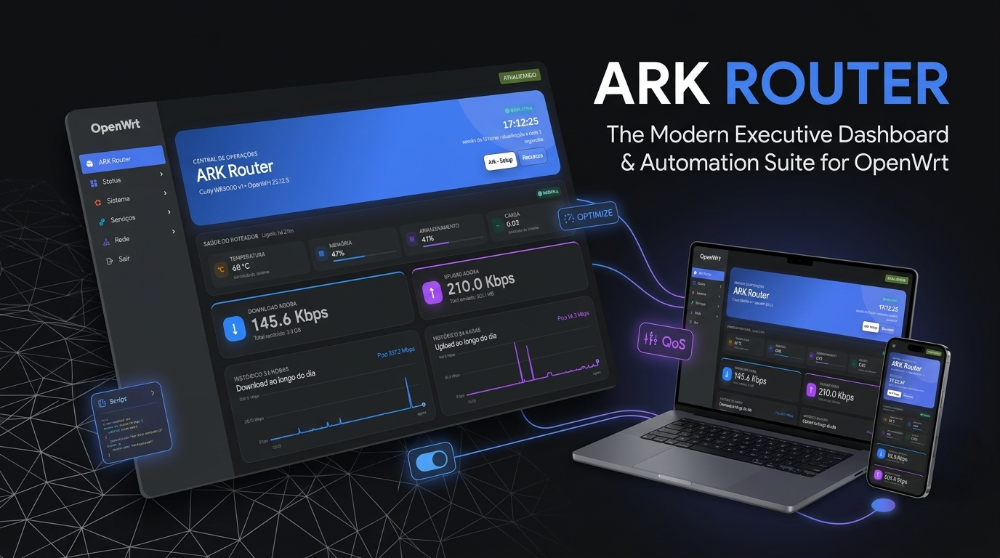
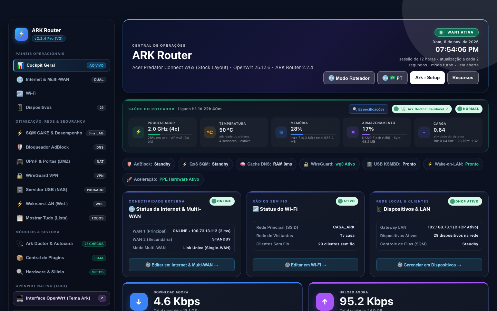
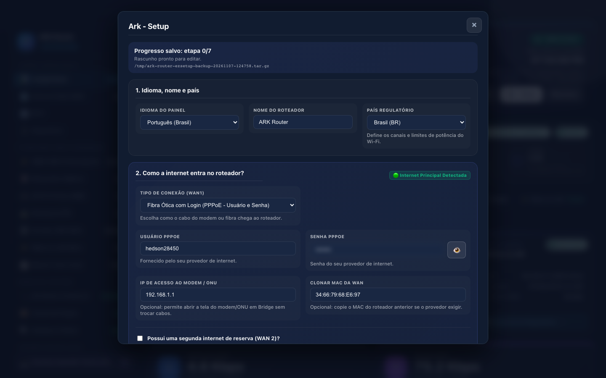
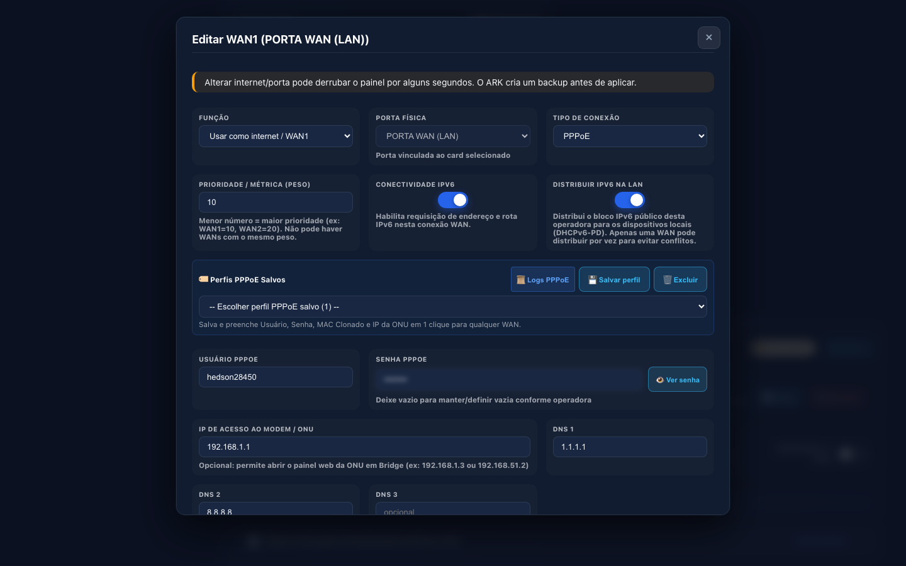
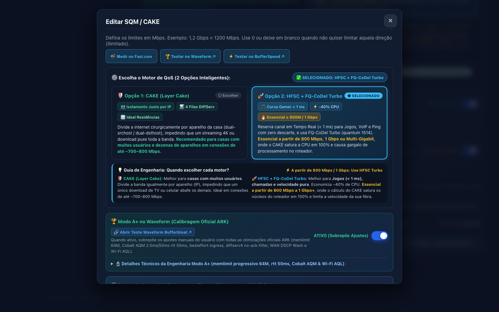
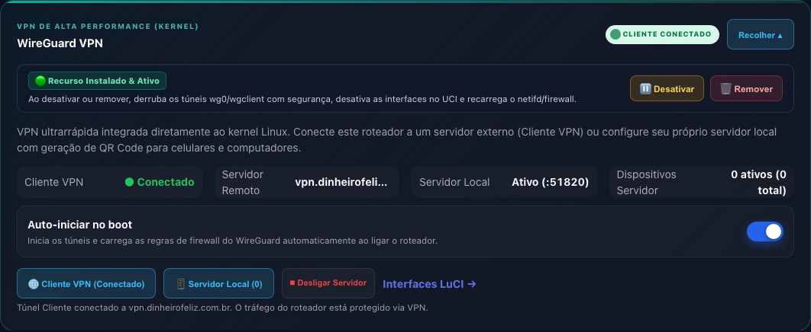
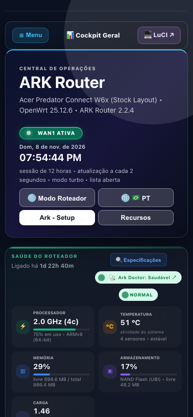
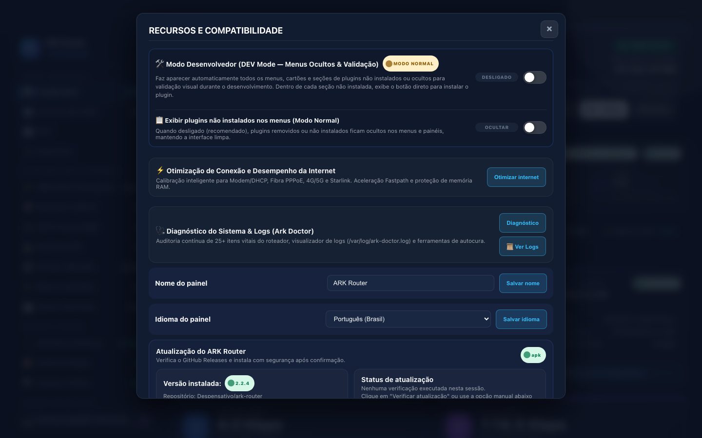

<p align="center">
  
</p>

# ARK Router — Optimización de Red, Control de Bufferbloat y LuCI Moderno para OpenWrt

<p align="center">
  <a href="https://openwrt.org/"></a>
  <a href="https://github.com/Despensativo/ark-router/releases/tag/v2.2.4"></a>
  <a href="LICENSE"></a>
  
  
</p>

<p align="center">
  <b>🌐 Idiomas / Languages / Idiomas:</b><br>
  <a href="README.md">🇧🇷 <b>Português (Brasil)</b></a> &nbsp;•&nbsp;
  <a href="README.en.md">🇺🇸 <b>English</b></a> &nbsp;•&nbsp;
  <a href="README.es.md">🇪🇸 <b>Español</b></a>
</p>

---

**ARK Router** es una suite de optimización de red, mitigación de bufferbloat y un tema LuCI ejecutivo moderno para **OpenWrt** (versiones 19.07 a 25.x, con soporte nativo tanto para `fw4`/nftables como para `fw3`/iptables).

Diseñado para eliminar el lag y la latencia bajo carga concurrente y transformar routers estándar en equipos de alta estabilidad para juegos en línea, comunicaciones de voz y teletrabajo, ARK opera como una aplicación LuCI oficial (`luci-app-ark-router`). No reemplaza el kernel de OpenWrt: añade telemetría en tiempo real, ajustes de bajo nivel en el kernel de Linux, bloqueo de anuncios en memoria RAM y una interfaz web 100% responsive para teléfonos móviles y ordenadores.

> **Versión Oficial Activa**: **`v2.2.4`** (consulte [`VERSION`](VERSION) y [Releases](https://github.com/Despensativo/ark-router/releases)).

---

## 🏆 Ingeniería Destacada (`v2.2.4`): QoS Dual-Engine y Calibración de Kernel

ARK Router reúne algoritmos avanzados de gestión de colas (Bufferbloat) integrados con calibraciones de red en el kernel de Linux (`BQL`, `RPS Multinúcleo Simétrico`, `NAPI`, `RFC 4638 Baby Jumbo 1500` y priorización `Voice` Ingress `u32`):

- **⚙️ Selección entre 2 Motores de QoS en el Panel**:
  - **🛡️ Opción 1 — `CAKE (Layer Cake / DiffServ4)`**: Motor clásico `sch_cake` con aislamiento automático de flujos por host (`dual-srchost` / `dual-dsthost`), `nat`, `wash` y `no-split-gso`. Recomendado para reparto equitativo de ancho de banda entre múltiples usuarios concurrentes.
  - **🚀 Opción 2 — `HFSC + FQ-CoDel Turbo (Gaming y Baja Latencia)`**: Motor `/usr/lib/sqm/ark_hfsc_fqcodel.qos` que une curvas de servicio jerárquico **HFSC (`Hierarchical Fair Service Curve`)** con **FQ-CoDel (`1024` flujos)**:
    - **Cola `1:10` Real-Time (`rt` curve `< 1 ms`)**: Curva de doble pendiente (`m1 = 40%` durante `8ms`, `m2 = 20%`) reservada exclusivamente para paquetes cortos (`<= 511 bytes` mediante clasificador `u32`) de juegos en línea (UDP), VoIP, WebRTC, ICMP Ping, DNS y paquetes de control TCP SYN/ACK. Los paquetes `UDP 443` (QUIC/HTTP3) permanecen en la cola `1:20` (`Best Effort`) para evitar reordenamiento en flujos web modernos.
    - **Cola `1:20` Interactive & Throughput**: Techo elástico de hasta el `100%` del ancho de banda (`ul rate 100%`), `quantum 1514` (un paquete Ethernet por ronda DRR) y soporte para ECN/L4S.
    - **Cola `1:30` Bulk Scavenger (`CS1`)**: Aísla descargas masivas y copias de seguridad (`m2 = 5%`), evitando saturar el enlace de subida.
- **📡 Perfiles Físicos con Overhead Precalculado**:
  - Parámetros exactos para cada tipo de conexión: `overhead 34, mpu 64, atm off` para GPON PPPoE; `overhead 38` para PPPoE sobre VLAN; `overhead 18` para cable DOCSIS y Starlink.
  - **Baby Jumbo Frames (RFC 4638)**: Configura MTU `1508` en la interfaz física base WAN, permitiendo un MTU `1500` íntegro en el túnel PPPoE sin fragmentación TCP (MSS 1460 intacto).
  - **Descubrimiento de PMTU por Capa de Paquete (RFC 4821)**: Activación de `tcp_mtu_probing=1` para evitar pérdidas silenciosas de paquetes.
- **🎮 Clasificación de Tráfico Gaming y Asignación Multinúcleo**:
  - Marcado bidireccional de QoS (`CS4` + `ct mark 0xa0`) para más de 80 títulos competitivos (Counter-Strike 2, Valorant, Call of Duty, Fortnite, EA FC, League of Legends, Rainbow Six Siege) y ecosistemas de consolas (PlayStation Network, Xbox Live, Nintendo Switch).
  - **Afinidad RPS Multinúcleo Simétrica**: Distribución equilibrada de interrupciones de red entre los núcleos Cortex-A53 (MediaTek Filogic MT7986/MT7981), eliminando cuellos de botella en enlaces de 1 Gbps+.
  - **BQL Físico Anti-Drop (512 KB)**: Calibración de límites mínimos en el anillo DMA del GMAC (`eth0`/`eth1`), eliminando descartes bajo PPPoE.
  - **Dimensionamiento Dinámico de Conntrack**: Ajuste adaptativo de `nf_conntrack_max` según la memoria RAM física (de 16.384 conexiones en 128 MB hasta 131.072 conexiones en 1 GB+ RAM), blindando routers compactos contra Kernel Panic por OOM.
- **⚡ Fast-Path de Caché en RAM en el Despachador (`equipe-dashboard-control`)**:
  - Respuesta directa desde memoria (`/tmp/ark-*-cache.json`) para rutas de telemetría intensiva, reduciendo la sobrecarga RPC hasta un 93% sin impacto en la CPU.

---

## 🌟 Capacidades Principales

1. **⚡ Centro de Rendimiento y Blindaje de Memoria**:
   - Ajustes de red de bajo nivel (TCP BBR, TCP Turbo, aceleración por hardware PPE, conntrack dinámico) aplicados en caliente sin reiniciar la conexión.
2. **🗜️ Compresión Inteligente de Memoria RAM (ZRAM / LZ4)**:
   - Expansión de RAM volátil mediante swap en memoria ultrarrápido comprimido con LZ4, protegido por límites seguros según arquitectura (32 MB en MIPS de 128 MB y 116 MB en routers de 256 MB) sin desgaste de flash.
3. **🎮 Gestión Segura de Puertos UPnP / IGD**:
   - Apertura bajo demanda para consolas y PC gaming con inspección y revocación instantánea de mapeos activos.
4. **🩺 ARK Doctor (Auditor de Integridad y Autocura)**:
   - Chequeo continuo en 28 puntos clave (radios Wi-Fi, puentes de red, sintaxis hostapd, reglas fw4/nftables, estado de daemons y memoria), con botón de reparación rápida en 1 clic (`ark-doctor --fix`).
5. **🛡️ Bloqueador de Publicidad y Protección DNS Híbrida**:
   - **Routers Full ($\ge 512$ MB RAM)**: AdGuard Home nativo ejecutándose en memoria RAM temporal (`/tmp/adguardhome`) en el puerto 3000, con soporte para millones de reglas y cero escrituras en memoria flash.
   - **Routers Lite (128 MB a 256 MB RAM)**: Modo Nube ultraligero mediante `dnsmasq` con proveedores Anycast de baja latencia (Cloudflare Familia, Quad9, CleanBrowsing, Control D).
6. **⚡ Límite de Ancho de Banda con Bypass Automático de LAN (RFC 1918)**:
   - Control de subida y bajada por dispositivo enfocado exclusivamente a Internet. Las transferencias locales (NAS, Plex, impresoras) operan a velocidad nativa de hardware (Gigabit / Wi-Fi 6).
7. **📊 Telemetría por Dispositivo en Tiempo Real**:
   - Medición directa desde el driver inalámbrico (`iwinfo`) y puertos cableados, con suavizado matemático anti-jitter e historial diario de consumo.
8. **🚀 DNS Turbo Paralelo y Dual-DoH (`https-dns-proxy`) en 1 Clic**:
   - Resolución paralela de alta velocidad (All-Servers), DoH nativo y bloqueo de secuestro de DNS en Smart TVs y dispositivos móviles (puertos 53 y 853).
9. **🌐 Multi-WAN Inteligente y Enrutamiento por Políticas (PBR)**:
   - Conmutación por fallo automática y balanceo de carga entre múltiples proveedores de Internet con reglas específicas para juegos, streaming y P2P.
10. **🔒 WireGuard VPN en Kernel y Almacenamiento SMB 3.1.1 (`ksmbd`)**:
    - Cliente y servidor WireGuard integrados en el espacio de kernel y compartición USB de alta velocidad con el módulo `ksmbd`.
11. **📱 Interfaz LuCI Mobile-First y Panel Cockpit**:
    - Navegación táctil por tarjetas plegables, diseño adaptado a pantallas desde 360px hasta 2560px (móviles, tablets y monitores panorámicos).
12. **🌎 Cobertura Nativa Trilingüe (i18n)**:
    - 100% de la interfaz traducida y auditada en Español (ES), Portugués (PT-BR) e Inglés (EN).

---

## 📸 Galería de Capturas de Pantalla (v2.2.4)

Capturas reales tomadas directamente en hardware físico de producción (**Acer Predator Connect W6x** — MediaTek Filogic 830 Quad-Core 2.0 GHz, 1 GB RAM, OpenWrt 25.x / 24.10):

| Vista General del Panel Cockpit | Rendimiento y Blindaje de Memoria |
| :---: | :---: |
|  |  |

| Asistente de Configuración Inicial (Ark - Setup) | Editor de Conexión WAN y Baby Jumbo |
| :---: | :---: |
|  |  |

| Editor de Colas QoS / SQM (Dual-Engine) | VPN WireGuard Integrada en Kernel |
| :---: | :---: |
|  |  |

| Interfaz Móvil Fluida (390px) | Auditoría y Autocura (Ark Doctor) |
| :---: | :---: |
|  |  |

---

## 🖥️ Matriz de Dispositivos y Requisitos

| Dispositivo | SoC / Plataforma | Memoria / Flash | Versión OpenWrt | Perfil ARK | Estado |
| :--- | :--- | :--- | :--- | :--- | :--- |
| **Acer Predator Connect W6x** | MediaTek Filogic 830 (MT7986 Quad-Core A53 2.0 GHz) | 1 GB RAM / 512 MB Flash | 24.10 / 25.x (`apk`) | Full | ✅ Validado en Producción |
| **Acer Predator Connect T7** | Qualcomm / Filogic Wi-Fi 7 BE11000 Multi-Gigabit | 1 GB+ RAM / Multi-Gig | 24.10 / 25.x (`apk`) | Full | ✅ Soportado |
| **Cudy WR3000 v1** | MediaTek Filogic 820 (MT7981B Dual-Core A53 1.3 GHz) | 256 MB RAM / 16 MB Flash SPI | 24.10 / 25.x (`apk` / `opkg`) | Standard / Full | ✅ Validado en Producción |
| **D-Link DGL-5500** | Qualcomm Atheros QCA9558 (MIPS Single-Core 720 MHz) | 128 MB RAM / 16 MB Flash | 19.07 a 23.05 (`opkg`) | Lite | ✅ Validado en Laboratorio |
| **Máquinas Virtuales x86_64 (UTM / VirtualBox)** | Intel/AMD x86_64 Multinúcleo (QEMU / KVM) | 512 MB a 2 GB RAM | 19.07 a 25.x | Full / Dev | ✅ Laboratorio Canónico |

### Requisitos Mínimos:
- **Perfil Lite**: 128 MB de RAM y 16 MB de Flash (OpenWrt con `opkg`, firewall `fw3` o `fw4`).
- **Perfil Full**: 256 MB a 1 GB+ de RAM y 32 MB+ de Flash (soporte completo para AdGuard Home en RAM, analítica y daemons de telemetría).

---

## 📦 Instalación Rápida

ARK Router se instala directamente sobre una instalación existente de OpenWrt con interfaz LuCI. **No sobreescribe el kernel** y no modifica sus contraseñas ni configuraciones de red previas.

### Método 1: Instalador Automático de 1 Línea (Recomendado)

Conéctese mediante SSH a su router OpenWrt y ejecute:

```sh
wget -O- https://raw.githubusercontent.com/Despensativo/ark-router/main/scripts/install.sh | sh
```

El instalador detecta automáticamente si el sistema utiliza `apk` (OpenWrt 25.x) u `opkg` (OpenWrt 19.07 a 24.x), revisa la memoria RAM disponible e instala el perfil óptimo (**Lite**, **Standard** o **Full**).

### Forzar un Perfil Específico:
- **Perfil Lite** (para routers con 128 MB a 256 MB de RAM):
  ```sh
  wget -O- https://raw.githubusercontent.com/Despensativo/ark-router/main/scripts/install.sh | ARK_ROUTER_PROFILE=lite sh
  ```
- **Perfil Full** (para routers con 512 MB a 1 GB+ de RAM):
  ```sh
  wget -O- https://raw.githubusercontent.com/Despensativo/ark-router/main/scripts/install.sh | ARK_ROUTER_PROFILE=full sh
  ```

---

### Método 2: Instalación de Paquetes Precompilados (`.apk` o `.ipk`)

Descargue los paquetes oficiales desde la página de **[Releases](https://github.com/Despensativo/ark-router/releases)**:

- **OpenWrt Moderno (`apk` — OpenWrt 25.x+)**:
  ```sh
  apk add --allow-untrusted ./luci-app-ark-router-full-2.2.4.apk
  /etc/init.d/rpcd restart
  ```
- **OpenWrt Tradicional (`opkg` — OpenWrt 19.07 a 24.10)**:
  ```sh
  opkg install ./luci-app-ark-router-full-2.2.4.ipk
  /etc/init.d/rpcd restart
  ```

---

## 🔄 Actualización desde la Interfaz Web

Las nuevas versiones pueden consultarse e instalarse directamente desde la interfaz web en:
**ARK Router → Recursos → Actualización del ARK Router**.

El actualizador compara la versión instalada con el repositorio oficial en GitHub, muestra las notas de la versión y, tras confirmación explícita, descarga e instala el paquete actualizado manteniendo su configuración en `/tmp`.

---

## 🗑️ Desinstalación

Para desinstalar la suite ARK Router manteniendo sus preferencias de red y nombres de dispositivos:

```sh
wget -O- https://raw.githubusercontent.com/Despensativo/ark-router/main/scripts/uninstall.sh | sh
```

Para una desinstalación completa, incluyendo archivos históricos y configuraciones personalizadas:

```sh
wget -O- https://raw.githubusercontent.com/Despensativo/ark-router/main/scripts/uninstall.sh | PURGE=1 sh
```

---

## 📄 Licencia

Publicado bajo la licencia de código abierto **MIT License**. Consulte el archivo [`LICENSE`](LICENSE) para los términos completos.
