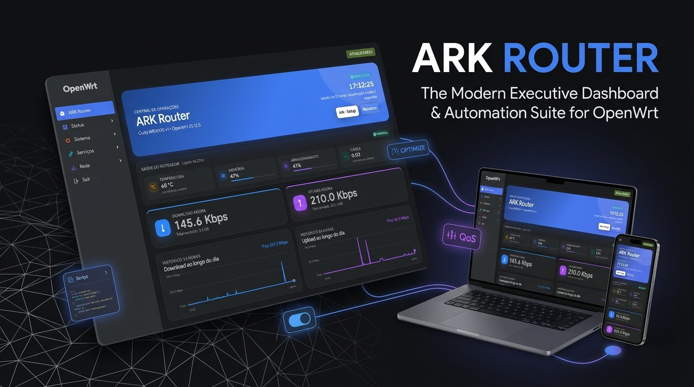
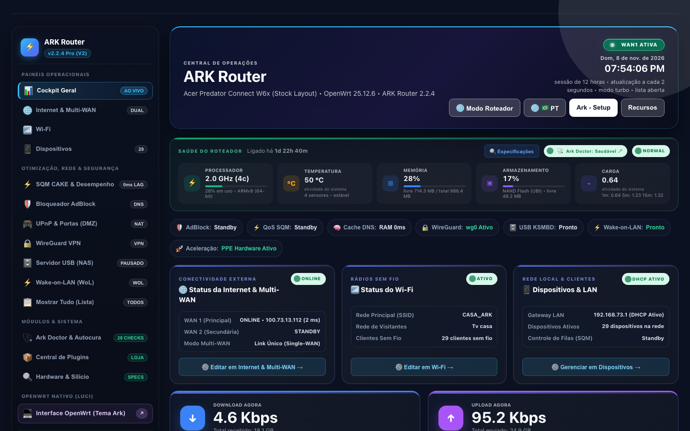
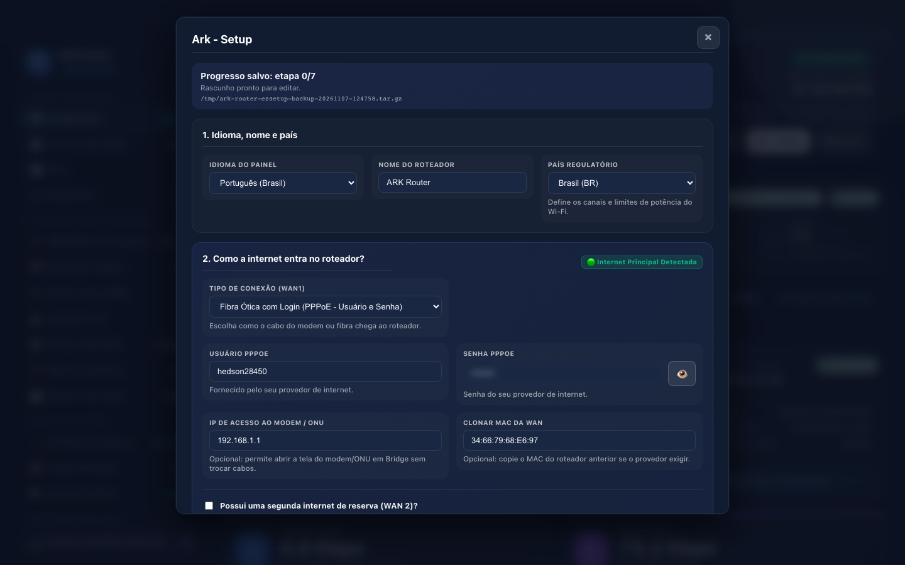
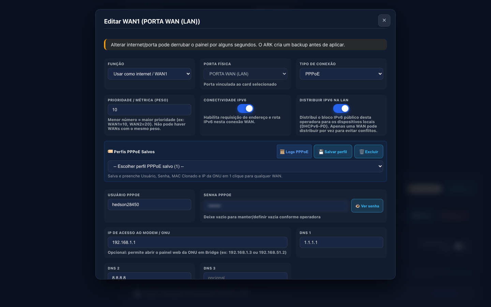
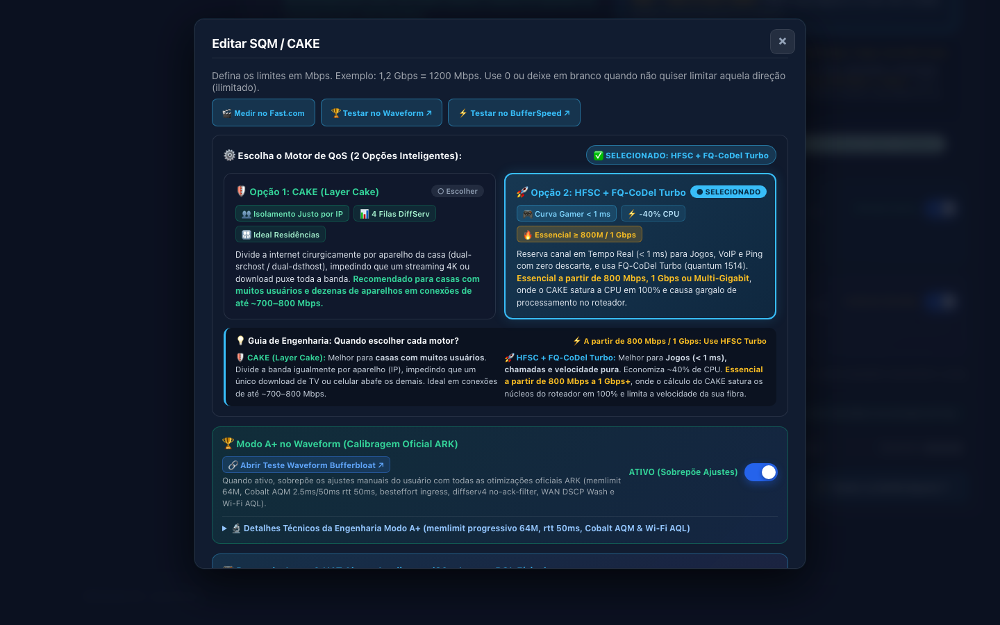
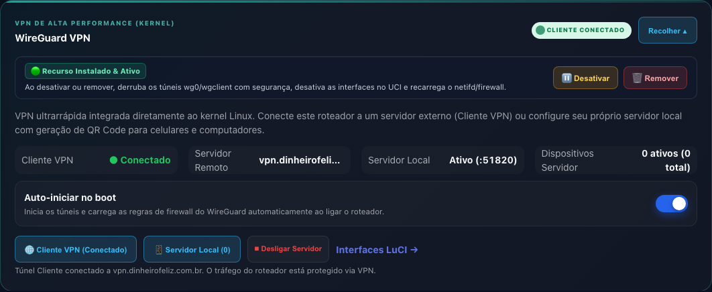
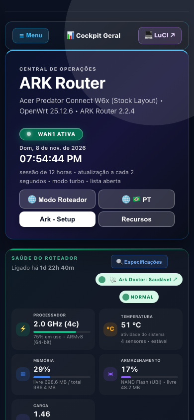
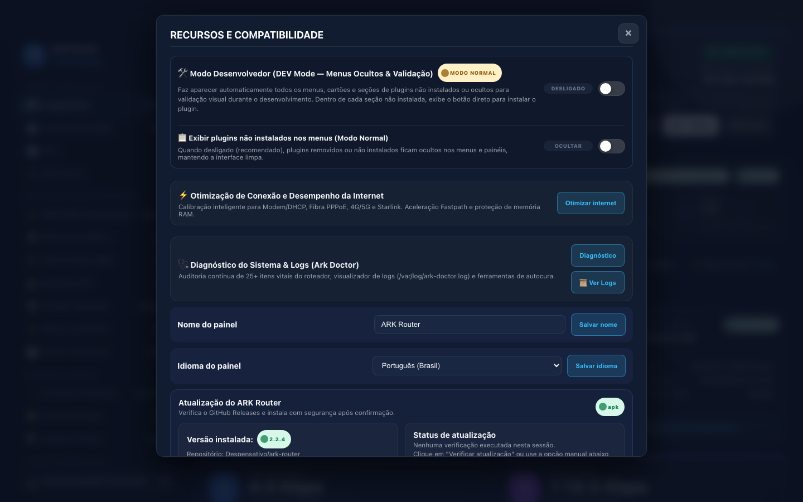

<p align="center">
  
</p>

# ARK Router

<p align="center">
  <a href="https://openwrt.org/"></a>
  <a href="https://github.com/Despensativo/ark-router/releases/tag/v2.2.1"></a>
  <a href="LICENSE"></a>
  
  
</p>

<p align="center">
  <b>🌐 Idiomas / Languages / Idiomas:</b><br>
  <a href="README.md">🇧🇷 <b>Português (Brasil)</b></a> &nbsp;•&nbsp;
  <a href="README.en.md">🇺🇸 <b>English</b></a> &nbsp;•&nbsp;
  <a href="README.es.md">🇪🇸 <b>Español</b></a>
</p>

---

O **ARK Router** transforma roteadores com **OpenWrt** em verdadeiras centrais de comando profissionais, substituindo a interface estática tradicional do LuCI por um painel executivo moderno, ultrarrápido, modular e 100% responsivo para smartphones e computadores.

Ele não substitui o OpenWrt nem o LuCI: ele opera como uma suíte avançada de controle (`luci-app-ark-router`) com telemetria em tempo real, zero bloatware, salvaguardas anti-lockout e recursos pioneiros de rede e blindagem de memória.

> **Versão Oficial Ativa**: **`v2.2.1`** (consulte [`VERSION`](VERSION) e [Releases](https://github.com/Despensativo/ark-router/releases)).

---

## 🏆 Destaque de Engenharia (`v2.2.1`): Arquitetura Dual-Engine de QoS & Kernel Networking

O **ARK Router v2.2.1** traz uma engenharia completa de **Controle de Filas e Latência (SQM Dual-Engine)** combinada a calibrações de baixo nível no Kernel Linux (`BQL`, `RPS Multi-Core`, `NAPI`, `IEEE 802.3x` e Promoção `Voice` Ingress `u32`), documentada integralmente em [`docs/ENCICLOPEDIA_MASTER_QOS_KERNEL_LINUX_ARK_2026.md`](docs/ENCICLOPEDIA_MASTER_QOS_KERNEL_LINUX_ARK_2026.md) e [`docs/ENGENHARIA_QOS_DUAL_ENGINE_E_MTU_2026_11.md`](docs/ENGENHARIA_QOS_DUAL_ENGINE_E_MTU_2026_11.md):

- **⚙️ Escolha Inteligente entre 2 Motores de QoS no Painel**:
  - **🛡️ Opção 1 — `CAKE (Layer Cake / DiffServ4)`**: Motor clássico `sch_cake` com isolamento automático por dispositivo (`dual-srchost` / `dual-dsthost`), `nat`, `wash` e `no-split-gso`, ideal para justiça de banda plug-and-play entre múltiplos usuários.
  - **🚀 Opção 2 — `HFSC + FQ-CoDel Turbo (Gamer & Gigabit Inteligente)`**: Motor `/usr/lib/sqm/ark_hfsc_fqcodel.qos` que une curvas matemáticas **HFSC (`Hierarchical Fair Service Curve`)** em 3 classes elásticas com **FQ-CoDel (`1024` fluxos hash)**:
    - **Fila `1:10` Real-Time (`rt` curve `< 1 ms`)**: Curva de duas inclinações (`m1 = 40%` por `8ms`, `m2 = 20%`) exclusiva para pacotes `<= 511 bytes` (`u32 match u16 0x0000 0xfe00 at 2`) de Jogos UDP, VoIP, WebRTC (`<= 256B`), Ping, DNS, `L4S ECT(1)` e TCP SYN/ACK — com guarda explícita anti-reordenação para `UDP 443` (QUIC/HTTP3) na `1:20` / `Best Effort`.
    - **Fila `1:20` Interactive & Speed (`FQ-CoDel Turbo`)**: `ls` elástico até `100%` da banda (`ul rate 100%`), `quantum 1514` (1 quadro Ethernet por rodada DRR) e suporte nativo a **`ce_threshold` (L4S RFC 9332)**.
    - **Fila `1:30` Bulk Scavenger (`CS1`)**: Isola torrents e backups no Upload (`m2 = 5%`), liberando `95%` da banda instantaneamente sem estrangular o Download quando provedores remarcam tráfego para `CS1`.
- **📡 Auto-Calibração por Perfil Físico da WAN (`xpon_bridge`, `xpon_vlan`, `dhcp_cable`, `mobile_starlink`)**: Ajusta automaticamente overhead L2 (`34B` GPON PPPoE, `38B` PPPoE+VLAN, `18B` Cabo DOCSIS/Starlink), `target`/`interval`/`ce_threshold`, **RFC 4638 Baby Jumbo Frames** (`eth1=1508` ➔ `pppoe-wan=1500` zero fragmentação), **RFC 4821 PLPMTUD** (`tcp_mtu_probing=1`) e MTU dinâmico de túneis WireGuard (`1412` / `1420` / `1380`).
- **🎮 Base BufferSpeed de 80+ Jogos, NAT Aberto Assistido (`180s`) & Escalonamento Multi-Core Simétrico (`[AL-ARK-100..103]`)**:
  - **80+ Jogos, Consoles & Promoção Ingress UDP `<= 256B` (`[AL-ARK-103]`)**: Marcação bidirecional (`CS4` + `ct mark 0xa0`) para PS5/PSN, Xbox Live, Nintendo Switch, CS2, Valorant, Call of Duty/Warzone, Fortnite, EA FC, League of Legends, Discord e Cloud Gaming, mais filtro Ingress `u32` pré-`ifb4*` que promove sondas de jogos/VoIP/WebRTC (`UDP <= 256B`) direto para a fila `Voice` (`9 µs` de atraso médio) mantendo `QUIC 443` na `Best Effort`.
  - **RPS Multi-Core Simétrico `7/3` + Orçamento NAPI `256/1200` (`[AL-ARK-100]`)**: Distribui portas LAN (`rps_cpus=7`) e WAN/Wi-Fi (`rps_cpus=3`) mantendo a `CPU3` (`IRQ 123`) 100% dedicada ao DMA RX (`0%` perda), reduzindo o atraso interno de Upload sob estresse simultâneo (`16 Down + 16 Up`) de `159 ms` para **`0.10–0.44 ms`**.
  - **BQL Físico `512 KB` Anti-Drop abaixo do PPPoE (`[AL-ARK-101]`)**: Calibra `limit_min=524288` (`512 KB`) e `fq_codel target 50ms interval 500ms quantum 1514 noecn` no GMAC (`eth0`/`eth1`), eliminando 100% dos descartes secundários em quadros PPPoE (`0x8864` não-ECN) e transferindo o controle AQM integralmente para o motor SQM.
  - **Isolamento de Tempestades de Pause Frames `IEEE 802.3x` (`[AL-ARK-102]`)**: Desativa `rx/tx flow control` (`ethtool -A`) nas portas LAN/WAN, impedindo que adaptadores USB-Ethernet de clientes pausem o switch físico do roteador.
- **⚡ Execução Ultra-Rápida em RAM (`15x` / `-93,4%` CPU), Coalescência `0ms` & Blindagem de Concorrência (`v2.2.1`)**:
  - **Fast-Path de Cache em RAM no Dispatcher (`equipe-dashboard-control`)**: As rotas críticas de polling respondem direto da RAM (`/tmp/ark-*-cache.json`) atualizando contadores voláteis (`/proc/stat`, `/proc/meminfo`, `nf_conntrack_count`) sem carregar bibliotecas `.sh` (~10.400 linhas), reduzindo o tempo de 20 chamadas RPC de `1.96 s` para **`0.13 s` (`6.5 ms/chamada`)**.
  - **Coalescência de Hotplugs em `0ms`, Posse Estrita de Lock & Ordem de Execução SQM**: Auditorias automáticas (`ark-doctor --auto`) e hotplugs de rede descartam interfaces virtuais/duplicatas em `0ms`, invalidação atômica de todos os caches antes de liberar `/tmp/ark_mutation.lock`, promoção ordenada de SQM/CAKE e mapa determinístico [`docs/CODE_MAP.md`](docs/CODE_MAP.md).

---

## 🌟 Destaques Principais

1. **⚡ Central de Desempenho & Blindagem de Memória**:
   - Card unificado na Visão Geral com switches interativos de primeiro nível, contadores dinâmicos de otimizações ativas e aplicação em tempo de execução sem recarregar serviços desnecessários.
2. **🗜️ Compressão de Memória RAM Inteligente (ZRAM / LZ4)**:
   - Duplica a capacidade efetiva da memória RAM através de um disco de swap ultrarrápido em LZ4 com zero desgaste da memória Flash.
   - **Trava de Segurança de 5 Segundos**: Em roteadores com $\ge 512$ MB de RAM física, o switch exige confirmação temporizada para evitar ciclos desnecessários de CPU.
   - **Modo Protegido para CPUs Mononúcleo (MIPS)**: Detecta processadores modestos e limita o disco a 32 MB com `swappiness=15`, evitando afogamento da CPU.
   - **Ativação Instantânea**: Em roteadores multicore $\le 256$ MB (como o Cudy WR3000), aloca dinamicamente 116 MB para absorver picos de tráfego.
3. **🎮 Abertura Automática de Portas (UPnP / IGD) com Modo Seguro**:
   - Alternância rápida com feedback visual imediato:
     - **Modo Seguro (Desligado - Padrão)**: Nenhuma porta externa na WAN é aberta sem permissão explícita no firewall.
     - **Modo Ativo**: Permite abertura sob demanda para jogos online (Xbox, PlayStation, PC), emitindo alerta de conscientização na tela.
4. **🩺 ARK Doctor (Auditor de Integridade e Autocura)**:
   - Diagnóstico contínuo do sistema em tempo de execução em 10 camadas críticas: rádios Wi-Fi, pontes de rede, DHCP, regras do firewall (fw4/nftables puro), integridade da ZRAM (`Check 1b`), SQM e sintaxe do hostapd, com botão de reparo automático de 1 clique (`ark-doctor --fix`).
5. **🛡️ Bloqueador de Anúncios & Controle Parental Híbrido (Local RAM / Nuvem)**:
   - **Roteadores Full ($\ge 512$ MB RAM)**: AdGuard Home nativo rodando direto na memória temporária (`/tmp/adguardhome`) na porta 3000, com mais de 1 milhão de regras locais, super-cache em RAM, suporte a **HTTP/3 QUIC (`h3://`)** e zero escrita na flash.
   - **Roteadores Lite (128 MB a 256 MB RAM)**: Modo Nuvem ultraleve via `dnsmasq` com 9 provedores Anycast especializados (Cloudflare Família, Quad9 Segurança, CleanBrowsing, Control D, OpenDNS e NextDNS).
6. **🚫 Lista Negra de Sites da Casa em 0ms**:
   - Bloqueio imediato de domínios específicos (apostas, cassinos, sites indesejados) com resposta `0.0.0.0` em 0ms e zero bytes de consumo adicional de memória.
7. **⚡ Limite de Banda Individual com Bypass Automático da LAN (RFC 1918)**:
   - Controle individual de download e upload por dispositivo. O limite se aplica com precisão cirúrgica exclusivamente à Internet — transferências locais para NAS, servidores Plex, impressoras e compartilhamento de arquivos continuam em velocidade nativa (Gigabit / Wi-Fi 6 a 1200+ Mbps).
8. **🛑 Filtro Parental e SafeSearch Individual por Dispositivo**:
   - Bloqueio de conteúdo adulto e imposição de SafeSearch (Google, Bing, YouTube) configurável por dispositivo (ex: tablets e celulares de crianças).
9. **📊 Tráfego por Dispositivo em Tempo Real (Hardware DMA & Anti-Jitter)**:
   - Medição instantânea via contadores diretos do driver Wi-Fi (`iwinfo`), sem atrasos e com filtro de decaimento suave (EMA) que elimina oscilações visuais bruscas.
   - Coluna de **Total Consumido** (MB/GB) e ordenação interativa estável.
10. **🚀 DNS Turbo, Dual-DoH (`https-dns-proxy`) 1-Clique & Escudo Portas 53/853**:
    - Benchmark de latência em tempo real comparando Cloudflare, Google, Quad9, OpenDNS e AdGuard, ativação 1-Clique de **Dual-DoH (`https-dns-proxy`)** (`127.0.0.1#5053` + `#5054`) e escudo completo contra bypass DNS em Smart TVs e Android (*Private DNS* `TCP/UDP 853`).
11. **🌐 Acesso Remoto ZeroTier Inteligente**:
    - Executa nativamente em roteadores com armazenamento amplo e auto-extrai na RAM (`/tmp`) em 0.3s em aparelhos compactos de 16MB SPI flash.
12. **🛰️ Central Multi-Starlink (Telemetria & Alinhamento)**:
    - Diagnóstico de múltiplas antenas Starlink: bússola 3D, obstruções, perda de pacotes, SNR e visualizador público `/starlink/` para a rede local sem necessidade de login.
13. **🔄 Ciclo Perfeito de Fastpath (Flow Offload / PPE) e SQM Dual-Engine (`CAKE` / `HFSC + FQ-CoDel Turbo`)**:
    - Trava de exclusão mútua estrita entre Fastpath e SQM. Ao desligar o SQM no switch rápido do dashboard, o Fastpath de hardware é reativado automaticamente pelo procd.
14. **🛡️ Auto-MTU Inteligente, Baby Jumbo MTU 1500 em PPPoE (RFC 4638) & PLPMTUD (RFC 4821)**:
    - Sondagem ICMP real sem fragmentação, configuração automática de MTU 1508/1512 na interface base física para garantir MTU 1500 pura no túnel PPPoE e descoberta de PMTU em camada de pacote (`tcp_mtu_probing=1`).
15. **📱 Arquitetura V2: Cockpit Status-Only, Central de Recursos & Mobile-First**:
    - Separação executiva entre o **Cockpit** (telemetria pura) e a **Central de Recursos** (ciclo de vida completo de Serviços Nativos e Plugins Opcionais + **Modo Desenvolvedor**), 100% contido em telas de 360px a 1440px+.
16. **🔀 Alternância 1-Click entre Modo Roteador e Modo Ponto de Acesso & Switch (Dumb AP)**:
    - Converte portas em ponte transparente (`br-lan`), desativa DHCP local e protege o acesso administrativo com IP de Resgate anti-lockout permanente (`192.168.12.1` / `192.168.73.1`).
17. **🕸️ Inteligência Wi-Fi 6/6E/7: Fast Roaming 802.11k/v Puro & Diagnóstico MacBook `awdl0`**:
    - Roaming `bss_transition=1` + `rnr=1` sem `wnm_sleep_mode`, aliado ao diagnóstico contextual para linha **Apple MacBook (M1 a M5)** exibido exclusivamente em `160 MHz` para destravar `2400 Mbps` PHY (`1.4+ Gbps` reais).
18. **🌐 Balanceamento PBR BitTorrent em Modo Amplo Seguro (Dual-WAN)**:
    - Distribui conexões P2P em mais de 64.500 portas entre as WANs, preservando portas de sistema (80, 443, 53) prioritárias na WAN primária.
19. **⚡ Servidor SMB 3.1.1 em Kernel (`ksmbd`), Wake-on-LAN & WireGuard Ultrarrápido**:
    - Compartilhamento USB de alta velocidade em kernel (`ksmbd`), despertar remoto via Magic Packet (`etherwake`) e importação instantânea de túneis WireGuard (`.conf`).
20. **🌎 Internacionalização Tripla com 100% de Paridade (i18n Triplo — 4.502 Chaves)**:
    - Cobertura integral, nativa e auditada em Português do Brasil (PT-BR), Inglês (EN) e Espanhol neutro (ES).

---

## 📸 Capturas de Tela

Capturas reais obtidas em ambiente de testes no roteador físico (Cudy WR3000 v1 / OpenWrt 25.12.5):

| Desempenho & Blindagem de Memória (ZRAM / UPnP) | Visão Geral do Dashboard |
| :---: | :---: |
|  |  |

| Ark - Setup (Assistente Inicial) | Controle de WAN e Multi-WAN |
| :---: | :---: |
|  |  |

| Otimização de SQM / CAKE | Telemetria Starlink em Tempo Real |
| :---: | :---: |
|  |  |

| Interface Mobile Fluida | Diagnóstico do Ark Doctor |
| :---: | :---: |
|  |  |

---

## 🖥️ Roteadores Validados

| Dispositivo | Arquitetura | Memória / Armazenamento | Versão OpenWrt | Perfil ARK |
| :--- | :--- | :--- | :--- | :--- |
| **Cudy WR3000 v1** | MediaTek Filogic 820 (ARM64 Dual-Core) | 256 MB RAM / 16 MB Flash SPI | 25.12.5 / 24.x (`apk`) | Standard / Full |
| **Acer Predator Connect W6x** | MediaTek Filogic 830 (ARM64 Quad-Core) | 1 GB RAM / 512 MB Flash | 25.12.x / 24.x (`apk`) | Full |
| **D-Link DGL-5500** | Qualcomm Atheros QCA9558 (MIPS Single-Core) | 128 MB RAM / 16 MB Flash | 19.07 a 23.05 (`opkg`) | Lite |
| **VirtualBox x86_64 (`OpenWrt-ARK-Dev`)** | Intel/AMD x86_64 Multicore | 512 MB a 2 GB RAM | 24.10 / 25.x | Full / Dev |

---

## 📦 Instalação Rápida

O ARK Router é instalado diretamente sobre qualquer instalação existente do OpenWrt com LuCI. Ele **não sobrescreve o kernel** nem altera suas configurações de rede automaticamente.

### Método 1: Instalador Automático de 1 Linha (Recomendado)

Conecte-se via SSH ao seu roteador e execute:

```sh
wget -O- https://raw.githubusercontent.com/Despensativo/ark-router/main/scripts/install.sh | sh
```

O instalador detecta automaticamente se o roteador utiliza `apk` ou `opkg`, analisa a memória RAM livre e o espaço disponível em disco, selecionando o melhor perfil (**Lite**, **Standard** ou **Full**).

### Forçar Perfil Específico:
- **Perfil Lite** (para roteadores com 128 MB a 256 MB de RAM e 16 MB flash):
  ```sh
  wget -O- https://raw.githubusercontent.com/Despensativo/ark-router/main/scripts/install.sh | ARK_ROUTER_PROFILE=lite sh
  ```
- **Perfil Full** (para roteadores com 512 MB ou mais de RAM):
  ```sh
  wget -O- https://raw.githubusercontent.com/Despensativo/ark-router/main/scripts/install.sh | ARK_ROUTER_PROFILE=full sh
  ```

---

### Método 2: Instalação Manual de Pacotes Locais (`.apk` ou `.ipk`)

Baixe os pacotes gerados diretamente na aba de **[Releases](https://github.com/Despensativo/ark-router/releases)**:

- **OpenWrt Moderno (gerenciador APK)**:
  ```sh
  apk add ./luci-app-ark-router-2.2.1-r1.apk
  /etc/init.d/rpcd restart
  ```
- **OpenWrt Tradicional / Legado (gerenciador OPKG)**:
  ```sh
  opkg install ./luci-app-ark-router-2.2.1-r1.ipk
  /etc/init.d/rpcd restart
  ```

---

## 🔄 Atualização Diretamente pelo Painel

Após instalado, você pode verificar novas versões diretamente pelo painel em:
**ARK Router → Recursos → Atualização do ARK Router**.

O atualizador verifica a versão mais recente publicada no GitHub, exibe as notas de lançamento e, após confirmação explícita do administrador, baixa e instala o pacote atualizado criando backup prévio automático das suas configurações em `/tmp`.

---

## 🗑️ Desinstalação Limpa e Segura

Para desinstalar o ARK Router preservando seus nomes amigáveis de dispositivos e preferências:

```sh
wget -O- https://raw.githubusercontent.com/Despensativo/ark-router/main/scripts/uninstall.sh | sh
```

Para remover completamente, incluindo arquivos de preferências e configurações salvas:

```sh
wget -O- https://raw.githubusercontent.com/Despensativo/ark-router/main/scripts/uninstall.sh | PURGE=1 sh
```

---

## 📄 Licença

Este projeto é disponibilizado sob a licença de código aberto **MIT License**. Consulte o arquivo [`LICENSE`](LICENSE) para mais detalhes.
