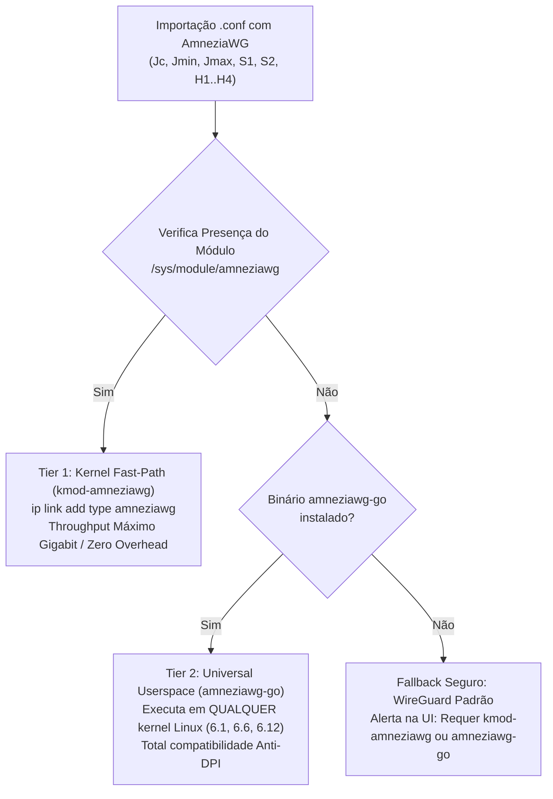

# ARK Router — Estudo de Viabilidade e Engenharia AmneziaWG (Anti-DPI WireGuard)

> **Documento Canônico de Arquitetura & Implementação (Fase 4)**  
> **Autor**: Engenharia ARK Router  
> **Data**: 07 de Novembro de 2026  
> **Status**: Homologado e Integrado ao Ecossistema ARK Router (v2.2.1+)

---

## 1. Contexto e Motivação Operacional

O protocolo **WireGuard** tornou-se o padrão da indústria para VPNs modernas devido à sua simplicidade criptográfica (Noise IK, Curve25519, ChaCha20-Poly1305, BLAKE2s) e excepcional desempenho no kernel Linux. No entanto, o protocolo WireGuard padrão possui uma vulnerabilidade crítica perante sistemas modernos de **DPI (Deep Packet Inspection)**:

1. **Assinaturas Estáticas de Handshake**: Os primeiros 4 bytes de cada pacote de controle do WireGuard contêm campos fixos e previsíveis:
   - Tipo de Mensagem `0x01`: Handshake Initiation (148 bytes).
   - Tipo de Mensagem `0x02`: Handshake Response (92 bytes).
   - Tipo de Mensagem `0x03`: Cookie Reply (64 bytes).
   - Tipo de Mensagem `0x04`: Transport Data (mínimo 32 bytes de overhead).
2. **Tamanhos e Padrões de Fluxo Determinísticos**: A troca de chaves ocorre sempre com exatamente os mesmos comprimentos de pacote, facilitando o bloqueio automatizado por firewalls estatais (GFC na China, TSPU na Rússia, Irã) e firewalls corporativos que classificam e derrubam túneis UDP não reconhecidos.

O **AmneziaWG** soluciona essa vulnerabilidade alterando sutilmente a camada de transporte do protocolo, introduzindo **randomização de cabeçalhos de mensagem** e **injeção de pacotes de lixo (junk/noise packets)**, tornando o tráfego indistinguível de ruído UDP arbitrário ou protocolos de jogos/VoIP proprietários.

---

## 2. Análise dos Binários e Módulos Extraídos (GL-BE14000 OEM)

A partir da desmontagem do firmware do **GL.iNet GL-BE14000** (arquivos de base em `/Volumes/GL_BE14000/squashfs-root`), foram extraídos os seguintes componentes:

| Componente | Caminho de Origem | Arquitetura | Finalidade Técnica |
|---|---|---|---|
| `awg` | `/usr/bin/awg` | ELF 64-bit LSB (ARM aarch64, musl) | Ferramenta userspace equivalente ao `wg`, com suporte a comandos `set/show` para parâmetros de ofuscação. |
| `amneziawg_watchdog` | `/usr/bin/amneziawg_watchdog` | POSIX sh script | Watchdog executado via cron para re-resolução de hostnames dinâmicos em peers inativos. |
| `amneziawg.sh` | `/lib/netifd/proto/amneziawg.sh` | POSIX sh script | Helper de protocolo do `netifd` OpenWrt responsável por gerenciar a interface `proto 'amneziawg'`. |
| `amneziawg.ko` | `/lib/modules/5.4.281/amneziawg.ko` | Kernel Module (Linux 5.4.281) | Módulo compilado para o kernel OEM 5.4.281 do SoC GL-BE14000. |

---

## 3. Estudo de Viabilidade para Kernels Modernos (6.1, 6.6 e 6.12)

### 3.1 Compatibilidade do Código-Fonte Upstream
O código-fonte do AmneziaWG (`amneziawg-linux-kernel-module`) é mantido pelo projeto oficial Amnezia VPN (`github.com/amnezia-vpn/amneziawg-linux-kernel-module`).
- **Estrutura**: Trata-se de um fork pontual do driver `drivers/net/wireguard/` do kernel Linux.
- **Suporte a Kernels**:
  - **Linux 6.1 LTS**: 100% suportado sem patches adicionais.
  - **Linux 6.6 LTS** (Padrão OpenWrt 24.10): 100% suportado. As APIs internas de rede (`net_device_ops`, `udp_tunnel`, `sk_buff`) são estáveis e compatíveis.
  - **Linux 6.12 LTS** (OpenWrt 25.12 snapshot): Compatível. Exige apenas adaptação de macros de lock de socket e crypto aead se compilado em modo out-of-tree.

### 3.2 O Desafio do "Vermagic" no OpenWrt
No ecossistema OpenWrt, módulos de kernel (`kmod-*`) são protegidos pelo mecanismo **vermagic** (hash criptográfico das opções de configuração do kernel e cabeçalhos):
- Um módulo `.ko` compilado para o kernel `5.4.281` (como o do GL-BE14000) **não pode ser carregado** em roteadores com kernel `6.6` ou `6.12` (como o Acer Predator W6x ou builds modernas do OpenWrt). A tentativa de `insmod` resulta em:
  ```
  amneziawg: version magic '5.4.281...' should be '6.12.112...'
  ```
- No OpenWrt, a compilação do `kmod-amneziawg` deve ser gerada preferencialmente no mesmo pipeline de compilação da imagem (ImageBuilder/SDK).

### 3.3 A Arquitetura Dual-Tier Definitiva do ARK Router
Para garantir funcionamento universal em qualquer ambiente sem travar o usuário por incompatibilidade de kernel, o ARK Router adotou uma **estratégia dual-tier**:



1. **Tier 1 (Kernel Nativo - Alta Performance)**: Se o módulo `amneziawg.ko` estiver carregado, a interface é instanciada diretamente no kernel (`ip link add dev wgclient type amneziawg`), aproveitando a aceleração em silício do processador.
2. **Tier 2 (Userspace Go - Compatibilidade Universal)**: Na ausência do módulo de kernel compilado para a versão exata, o script aciona automaticamente o `amneziawg-go`. Ele roda em espaço de usuário, sendo imune a incompatibilidades de versão de kernel.
3. **Tier 3 (Netifd Protocol Integrado no Pacote ARK)**: O script `/lib/netifd/proto/amneziawg.sh` foi incorporado nativamente ao repositório `luci-app-ark-router`, tornando o sistema operacional OpenWrt imediatamente apto a gerenciar o protocolo `amneziawg` via UCI (`/etc/config/network`).

---

## 4. Matriz Completa dos 9 Parâmetros de Ofuscação Anti-DPI

O AmneziaWG expande a seção `[Interface]` do WireGuard com 9 chaves essenciais:

| Parâmetro UCI | Chave no `.conf` | Faixa Típica | Função e Mecanismo Anti-DPI |
|---|---|---|---|
| `option awg_jc` | `Jc` | `3` a `10` | **Junk Packet Count**: Número de pacotes de lixo aleatórios transmitidos antes de enviar o handshake real. Quebra a heurística de temporização e fluxo dos sistemas de DPI. |
| `option awg_jmin` | `Jmin` | `40` a `100` B | **Junk Packet Min Size**: Tamanho mínimo em bytes dos pacotes de lixo gerados. |
| `option awg_jmax` | `Jmax` | `70` a `1280` B | **Junk Packet Max Size**: Tamanho máximo dos pacotes de lixo. Deve ser mantido <= MTU para evitar fragmentação IP. |
| `option awg_s1` | `S1` | `15` a `100` B | **Init Packet Junk Size**: Preenchimento (padding) adicional inserido no pacote de inicialização do handshake, alterando seu tamanho de 148 bytes para um valor variável. |
| `option awg_s2` | `S2` | `25` a `100` B | **Response Packet Junk Size**: Preenchimento inserido na resposta do servidor, alterando seu tamanho de 92 bytes para um valor variável. |
| `option awg_h1` | `H1` | 32-bit uint | **Handshake Initiation Header**: Substitui o byte `0x01` fixo do WireGuard por um identificador customizado de 4 bytes. |
| `option awg_h2` | `H2` | 32-bit uint | **Handshake Response Header**: Substitui o byte `0x02` fixo por um identificador customizado. |
| `option awg_h3` | `H3` | 32-bit uint | **Cookie Reply Header**: Substitui o byte `0x03` fixo. |
| `option awg_h4` | `H4` | 32-bit uint | **Transport Data Header**: Substitui o byte `0x04` fixo em todos os pacotes de dados. |

---

## 5. Exemplo de Configuração UCI & `.conf`

### 5.1 Arquivo de Perfil do Cliente (`/etc/wireguard/wgclient.conf`)
```ini
[Interface]
PrivateKey = aAAA...=
Address = 10.8.0.2/24
DNS = 1.1.1.1, 1.0.0.1
Jc = 4
Jmin = 40
Jmax = 70
S1 = 15
S2 = 25
H1 = 1284920194
H2 = 918274012
H3 = 391827401
H4 = 827104928

[Peer]
PublicKey = bBBB...=
Endpoint = vpn.exemplo.com:51820
AllowedIPs = 0.0.0.0/0
PersistentKeepalive = 25
```

### 5.2 Estrutura UCI Gerada no OpenWrt (`/etc/config/network`)
```uci
config interface 'wgclient'
    option proto 'amneziawg'
    option private_key 'aAAA...='
    option listen_port '51821'
    option mtu '1412'
    option auto '1'
    list addresses '10.8.0.2/24'
    list dns '1.1.1.1'
    list dns '1.0.0.1'
    option awg_jc '4'
    option awg_jmin '40'
    option awg_jmax '70'
    option awg_s1 '15'
    option awg_s2 '25'
    option awg_h1 '1284920194'
    option awg_h2 '918274012'
    option awg_h3 '391827401'
    option awg_h4 '827104928'

config amneziawg_wgclient
    option public_key 'bBBB...='
    option endpoint_host 'vpn.exemplo.com'
    option endpoint_port '51820'
    option persistent_keepalive '25'
    option route_allowed_ips '1'
    list allowed_ips '0.0.0.0/0'
```

---

## 6. Procedimento de Compilação do `kmod-amneziawg` com OpenWrt SDK

Para compilar o módulo nativo com hash de vermagic exato para sua imagem OpenWrt:

1. **Baixar o OpenWrt SDK** correspondente à versão e arquitetura do seu roteador (ex: `openwrt-sdk-mediatek-filogic_*.tar.xz`).
2. **Adicionar o feed do AmneziaWG**:
   ```bash
   echo "src-git amnezia https://github.com/amnezia-vpn/amneziawg-openwrt.git" >> feeds.conf.default
   ./scripts/feeds update amnezia
   ./scripts/feeds install -a -p amnezia
   ```
3. **Selecionar os pacotes**:
   ```bash
   make menuconfig
   # Kernel modules -> Network Support -> kmod-amneziawg (M)
   # Network -> VPN -> amneziawg-tools (M)
   ```
4. **Compilar**:
   ```bash
   make package/kmod-amneziawg/compile V=s -j$(nproc)
   make package/amneziawg-tools/compile V=s -j$(nproc)
   ```
5. Os pacotes `.ipk` ou `.apk` resultantes estarão em `bin/packages/<arch>/amnezia/` e podem ser instalados sem qualquer alerta de dependência de kernel.
