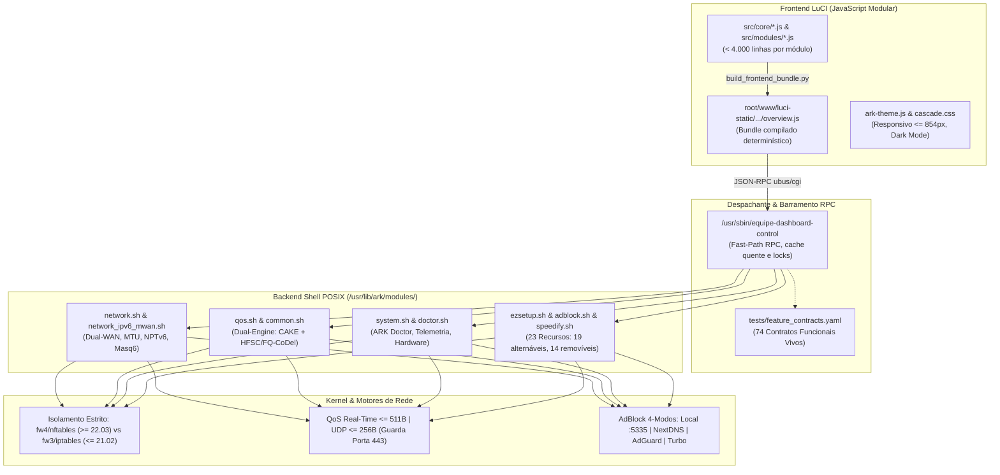

# ARK Router — Guia Canônico de Desenvolvimento Rápido e Eficiência Técnica

> **Versão Homologada**: `2.2.1` | **Status**: Ativo e Validado  
> **Finalidade**: Este guia é o ponto de entrada definitivo para desenvolvedores e agentes de IA operarem no repositório canônico sem desperdício de tempo ou contexto, concentrando o trabalho unicamente no que está homologado, funcional e comprovado por testes.

---

## 1. Visão Executiva: O Que Funciona na Versão Atual (`v2.2.1`)

O ecossistema ARK Router é composto por módulos e subsistemas estritamente validados por testes locais automatizados e matrizes de homologação em máquinas virtuais.



### 1.1. Os 74 Contratos Funcionais Vivos
- **Fonte de Verdade**: Definidos formalmente em `tests/feature_contracts.yaml` e documentados em [`docs/FEATURE_AUDIT_AND_REBOOT.md`](FEATURE_AUDIT_AND_REBOOT.md).
- **Cobertura**: 100% dos subsistemas (WAN, LAN, Wi-Fi 6/7, QoS CAKE/HFSC, IPv6, WireGuard, Speedify, AdBlock, Telemetria e Doctor).
- **Validação Contínua**: Auditados no Estágio 4 de `tests/run_local_tests.sh` com zero tolerância a desvios, contratos órfãos ou inconsistências de schema.

### 1.2. Os 23 Recursos do Sistema na UI (Endpoint RPC `features`)
- **19 Alternáveis em Tempo de Execução**: Ativação, desativação e pausa sem recarga de tela.
- **14 Removíveis com Desinstalação Destrutiva Real**: `sqm`, `mwan3`, `nlbwmon`, `upnp`, `adblock`, `wireguard`, `zerotier`, `speedify`, `usteer`, `irqbalance`, `zram`, `ksmbd`, `wol`, `htop`.
- **Validação de Ciclo de Vida**: Testados em VM isolada com expurgo físico de binários, limpeza de status opkg/apk, gravação de `user_removed=1` no UCI e rollback automático com restauração do snapshot em caso de falha de pacote ([`docs/LIFECYCLE_INSTALL_AND_UNINSTALL_GUIDE.md`](LIFECYCLE_INSTALL_AND_UNINSTALL_GUIDE.md)).

### 1.3. QoS Dual-Engine (CAKE + HFSC / FQ-CoDel Turbo)
- **Motores Homologados**: `CAKE` (simplicidade upstream e equidade automática) e `HFSC + FQ-CoDel Turbo` (alta capacidade multicore e mitigação extrema de bufferbloat).
- **Regras Real-Time Críticas**:
  - Promoção incondicional para Real-Time (`Voice` / `1:10`) de tráfego crítico `<= 511B` (TCP SYN/RST, DNS, NTP, ICMP/ICMPv6, L4S).
  - Promoção de `UDP <= 256B` protegida com guarda explícita para portas 443 (QUIC/HTTPS vai para Best Effort / `1:20`), evitando qualquer reordenação de pacotes.
  - Exclusão explícita de portas STUN (`3478-3480`, `19302-19309`) da lista de gaming ports, impedindo contaminação por super-pacotes GRO.

### 1.4. AdBlock 4-Modos Sincronizado
- **Modo 1 (Local :5335)**: Daemon local (AdGuard Home / Unbound), interceptação de portas e blacklist sinkhole (`0.0.0.0` para domínios de anúncios). Protegido por Circuit Breaker que preserva o DNS padrão caso o binário esteja ausente.
- **Modo 2 (Nuvem NextDNS)**: Resolutores protegidos `45.90.28.0` / `45.90.30.0`.
- **Modo 3 (Nuvem AdGuard DNS)**: Resolutores protegidos `94.140.14.14` / `94.140.15.15`.
- **Modo 4 (Desativado / DNS Turbo)**: Modo de alto rendimento com cache de 0ms em memória RAM e `allservers='1'` restaurado no dnsmasq.

### 1.5. Subsistema IPv6 Dual-WAN & NPTv6
- Suporte a Dual-WAN IPv6, NPTv6 inteligente (RFC 6296), prefixos ULA `/64` locais estáveis e higienização automática de entradas órfãs em `dhcpv6` e `wan6`.

### 1.6. Isolamento Dual-Generation de Firewall (`fw4` vs `fw3`)
- **OpenWrt Moderno (22.03 a 25.x+)**: Operação **100% pura em `nftables` e UCI firewall**. Terminantemente proibido invocar comandos legados `iptables`/`ip6tables`.
- **OpenWrt Legado (19.07 a 21.02)**: Retrocompatibilidade completa com `iptables` em hardware compacto (16MB Flash / 128MB RAM).
- **Detecção Centralizada**: Uso obrigatório de `ark_firewall_engine()`, `is_fw4()` e `is_fw3()` de `/usr/lib/ark/common.sh`.

### 1.7. Frontend LuCI Modular (< 4.000 linhas)
- Arquitetura desacoplada: fontes em `src/core/` e `src/modules/` mantidas estritamente abaixo de 4.000 linhas.
- Bundle único em `root/www/luci-static/resources/view/equipe-dashboard/overview.js` gerado deterministicamente por `scripts/build_frontend_bundle.py`.

### 1.8. Internacionalização Tripla (i18n)
- 100% de cobertura (5.064 chaves) em Português do Brasil (PT-BR nativo), Inglês (EN) e Espanhol neutro (ES), auditada por `scripts/audit_i18n.py --strict`.

---

## 2. Mapa Direto: Onde Mexer no Código

| Domínio da Tarefa | Arquivo Fonte Canônico para Editar | Arquivo Gerado (NUNCA EDITAR DIRETO) |
| :--- | :--- | :--- |
| **Interface LuCI (UI/Telas)** | `src/core/*.js` e `src/modules/*.js` | `root/www/luci-static/resources/view/equipe-dashboard/overview.js` *(gerado)* |
| **Estilos CSS & Mobile** | `root/www/luci-static/ark/cascade.css` | — |
| **Tema & Viewport Transform** | `root/www/luci-static/ark/ark-theme.js` | — |
| **Despachante RPC** | `root/usr/sbin/equipe-dashboard-control` | — |
| **Rede & Multi-WAN** | `root/usr/lib/ark/modules/network.sh` | — |
| **IPv6 & NPTv6** | `root/usr/lib/ark/modules/network_ipv6_mwan.sh` | — |
| **QoS, CAKE & HFSC** | `root/usr/lib/ark/modules/qos.sh` | — |
| **Recursos, Ciclo & AdBlock** | `root/usr/lib/ark/modules/ezsetup.sh` e `adblock.sh` | — |
| **Telemetria, LED & Hardware** | `root/usr/lib/ark/modules/system.sh` e `system_hardware_leds.sh` | — |
| **ARK Doctor (Auditoria)** | `root/usr/lib/ark/modules/doctor.sh` | — |
| **Funções Comuns & Firewall** | `root/usr/lib/ark/common.sh` | — |

---

## 3. Cheat Sheet: Comandos Rápidos de Execução

Execute estes comandos no terminal a partir da raiz do repositório (`GitHub/luci-app-ark-router`):

```bash
# 1. Compilar o bundle de frontend após alterar qualquer arquivo em src/
python3 scripts/build_frontend_bundle.py

# 2. Sincronizar o mapa determinístico de código após criar/mover funções ou rotas RPC
python3 scripts/generate_code_map.py

# 3. Auditar conformidade estrita de internacionalização (i18n triplo)
python3 scripts/audit_i18n.py --strict

# 4. Auditar documentação contra links quebrados, órfãos e inchaço do TASK.md
python3 scripts/audit_docs.py --strict

# 5. Auditar preservação de estado e regras anti-blind-restore
python3 scripts/audit_state_preservation.py --strict

# 6. Bateria completa de testes locais (5 estágios: Shell, JS, Testes WAN/QoS/Doctor, Contratos, Minificação)
bash tests/run_local_tests.sh

# 7. Validação em laboratório virtual isolado (UTM/QEMU no macOS / VirtualBox no Windows)
# No macOS (100% CLI nativo com proteção -snapshot):
./scripts/mac_vm.sh test
# No Windows (VirtualBox):
python3 tests/lab/test_vm_matrix_validation.py
```

---

## 4. Matriz de Leitura Seletiva (Economia Máxima de Contexto)

> [!IMPORTANT]
> **Como não perder tempo**: Para evitar estourar a janela de contexto com leituras inúteis, consulte **somente** os arquivos indicados para a sua área de atuação:

| Papel / Domínio de Trabalho | Documentos Obrigatórios para Ler | O Que NUNCA Ler Inicialmente |
| :--- | :--- | :--- |
| **Desenvolvedor Backend (Shell/RPC)** | [`docs/CODE_MAP.md`](CODE_MAP.md) (buscar linhas da função)<br/>[`docs/ARCHITECTURE.md`](ARCHITECTURE.md)<br/>[`docs/ARK_ROUTER_EXHAUSTIVE_COMMANDS_AND_SUBSYSTEMS_MANUAL.md`](ARK_ROUTER_EXHAUSTIVE_COMMANDS_AND_SUBSYSTEMS_MANUAL.md) | Não ler `overview.js`, lotes em `docs/audit/batches/` ou arquivos históricos de 10/2026. |
| **Desenvolvedor Frontend (LuCI JS/CSS)** | [`docs/UI_DESIGN_SYSTEM_AND_QA.md`](UI_DESIGN_SYSTEM_AND_QA.md)<br/>[`docs/ark-ui-rules.md`](ark-ui-rules.md)<br/>`src/core/` ou `src/modules/` específico | Não ler arquivos `.sh`, `overview.js` na íntegra ou enciclopédias de QoS. |
| **Engenheiro de QoS & Bufferbloat** | [`docs/ENGENHARIA_QOS_DUAL_ENGINE_E_MTU_2026_11.md`](ENGENHARIA_QOS_DUAL_ENGINE_E_MTU_2026_11.md)<br/>[`docs/TRATADO_DEFINITIVO_QOS_AQM_LINUX_OPENWRT.md`](TRATADO_DEFINITIVO_QOS_AQM_LINUX_OPENWRT.md)<br/>[`docs/QOS_TEST_PROTOCOL.md`](QOS_TEST_PROTOCOL.md) | Não ler módulos de Wi-Fi, templates LuCI ou relatórios de lotes antigos. |
| **Engenheiro de Redes, IPv6 & Wi-Fi** | [`docs/WPAD_UPGRADE_AND_WIFI6_ROAMING.md`](WPAD_UPGRADE_AND_WIFI6_ROAMING.md)<br/>[`docs/COMPATIBILITY_MATRIX.md`](COMPATIBILITY_MATRIX.md)<br/>[`PLAYBOOK.md`](../../../PLAYBOOK.md) (Seções 3, 4, 10 e 17) | Não ler código do frontend LuCI nem manuais de ONT não relacionados à tarefa. |
| **QA, Testes & Homologação em VM** | [`docs/MAC_UTM_TEST_ENVIRONMENT.md`](MAC_UTM_TEST_ENVIRONMENT.md) (macOS)<br/>[`docs/VIRTUALBOX_TEST_ENVIRONMENT.md`](VIRTUALBOX_TEST_ENVIRONMENT.md) (Windows)<br/>[`docs/LIFECYCLE_INSTALL_AND_UNINSTALL_GUIDE.md`](LIFECYCLE_INSTALL_AND_UNINSTALL_GUIDE.md) | Não ler arquivos de changelog completo ou estudos teóricos de BBR/TFO. |

---

## 5. Regras Inegociáveis de Sobrevivência no Repositório

1. **Zero Falso Positivo**: Nunca declare sucesso sem execução real e inspeção de saída. Mocks cegos e asserções forçadas são proibidos.
2. **Ambiente Virtual Obrigatório**: Mudanças destrutivas (remoção real de pacotes, reboot de infraestrutura) são executadas exclusivamente em VM isolada (`tests/lab/run_vm_all_tests.sh`). Roteadores físicos exigem autorização explícita do usuário.
3. **Preservação de Estado (Anti-Blind-Restore)**: Nunca reverta uma configuração para um valor hardcoded genérico. Consulte o snapshot prévio do usuário (`saved_*`).
4. **Isolamento de Motores de Firewall**: Nunca use comandos `iptables` em sistemas `fw4`. Use as condicionais `if is_fw4; then ... elif is_fw3; then ... fi`.
5. **Orçamento de Linhas do `TASK.md`**: O arquivo `TASK.md` deve permanecer **estritamente <= 60 linhas**. Finalizou uma etapa? Mantenha apenas o estado atual e arquive detalhes em `tasks/done/`.
6. **Sincronismo Contínuo de Mapas**: Adicionou ou alterou função no shell ou método no JS? Rode imediatamente `python3 scripts/generate_code_map.py` para atualizar `docs/CODE_MAP.md`.
