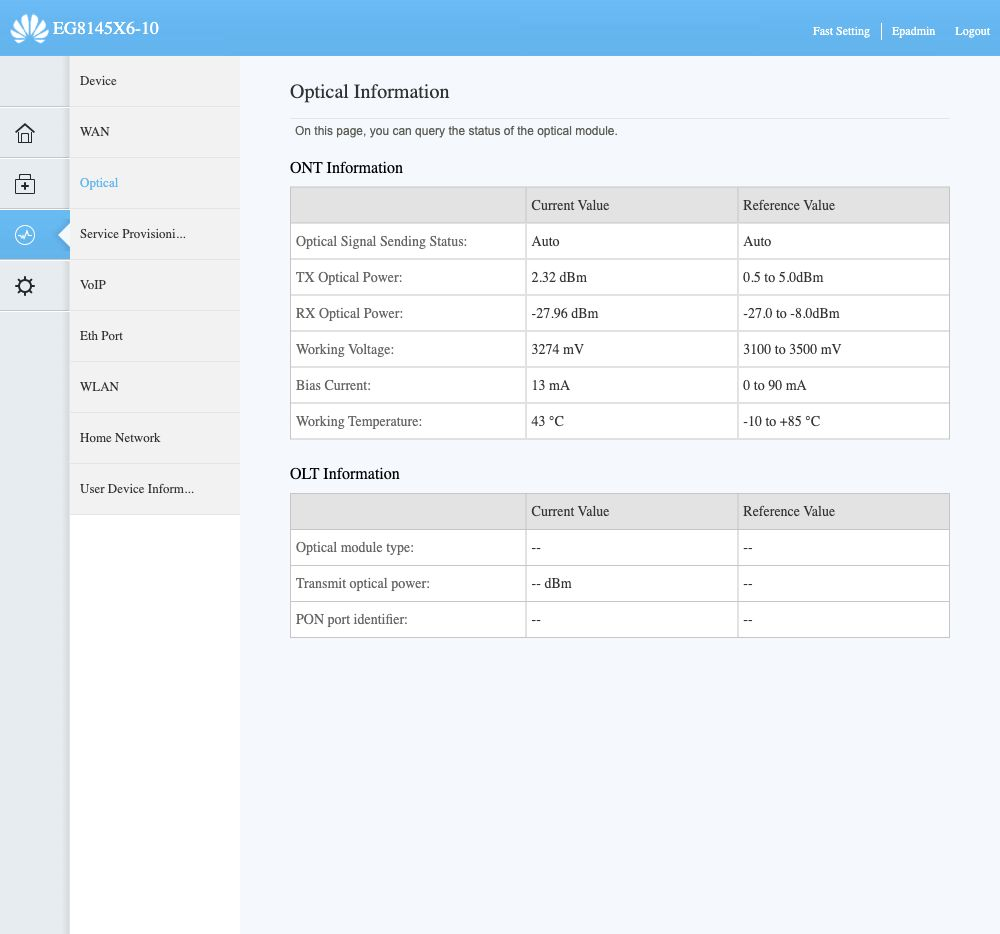
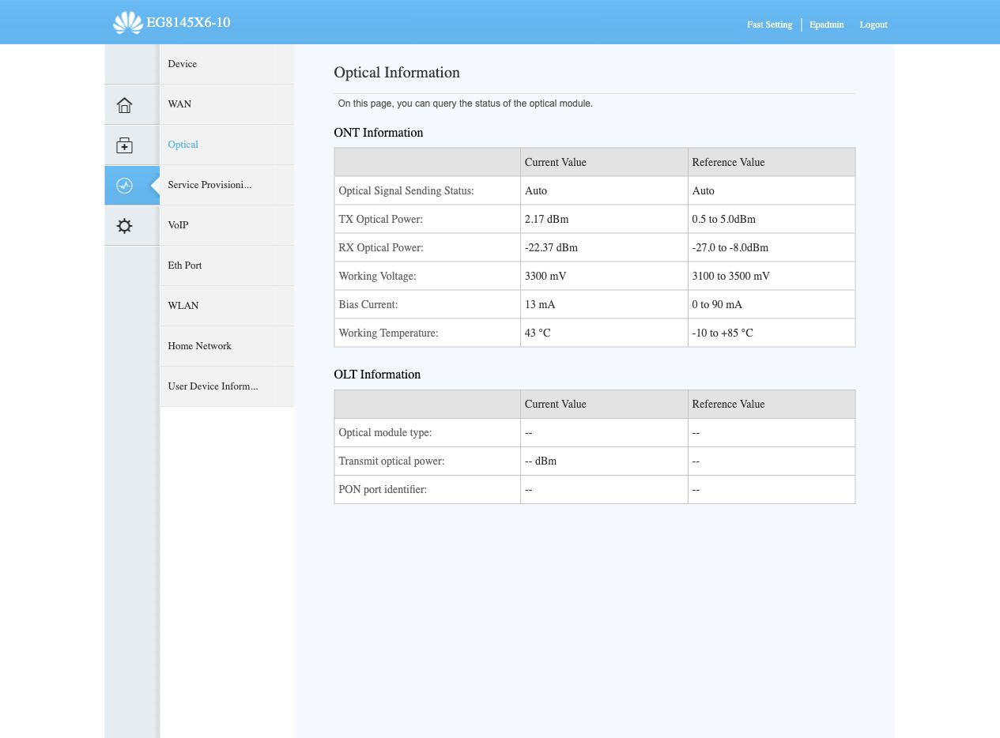

# ONT Huawei EG8145X6-10 — inspeção somente em leitura

Data da inspeção: 29/10/2026. Operadora informada: Simtelecom. Interface local: `192.168.18.1`. Consulta autenticada autorizada pelo usuário. Nenhuma configuração foi aplicada; sessão encerrada e retorno ao login confirmado.

## Resultado principal

**RX óptico atual de −27,96 dBm em duas leituras**, abaixo da referência apresentada pela própria ONT, **−27 a −8 dBm**. O log de debug existente contém **106 avisos** `UpPon RxPower is abnormal!`, com valores −27,70, −27,96 e −28,24 dBm. A leitura atual está 0,96 dB abaixo do limite inferior exibido.

É evidência direta de potência recebida fora da faixa indicada pelo equipamento. Não comprova, isoladamente, que ela causou os eventos de aproximadamente dois segundos medidos na WAN. Não houve correlação temporal entre erros ópticos/FEC e aqueles eventos. A telemetria deve ser confirmada por medição da operadora, incluindo o sentido ONT→OLT.

## Leituras verificadas

| Item | Resultado |
|---|---|
| Modelo / hardware | EG8145X6-10 / 343D.D |
| Firmware | V5R024C10S106 |
| Registro | O5 (Operation state), confirmado em duas consultas |
| CPU | 16% e 6%, amostras pontuais |
| Memória | 54% |
| Potência RX | −27,96 dBm nas duas consultas |
| Potência TX | +2,22 e +2,32 dBm; referência +0,5 a +5 dBm |
| Temperatura | 44 e 43 °C; referência −10 a +85 °C |
| Tensão | 3300 e 3274 mV; referência 3100 a 3500 mV |
| Bias | 13 mA; referência 0 a 90 mA |
| Informação óptica da OLT | Campos indisponíveis (`--`) |
| Ethernet | LAN4 Up, 1000 Mbit/s full-duplex; LAN1–3 Down |
| WAN | INTERNET, Bridge WAN, encapsulamento PPPoE, Enable WAN marcado |
| VLAN na WAN exibida | Enable VLAN desmarcado; status VLAN/Priority `-/-` |
| Binding | LAN1–4 marcadas |
| Estado WAN | Connected; duração exibida 17:06:01:15 (dias:horas:minutos:segundos) |
| Autenticação ONT | Password selecionado, modo ASCII; SN exibido e não registrado neste relatório |
| Campo de senha GPON | Vazio na interface; isso não prova ausência de segredo interno/provisionado |
| TR-069 | ACS e periodic informing habilitados, intervalo 43200 s; URLs/contas/segredos não extraídos |

VLAN desmarcada é constatação da configuração local mostrada. Não determina sozinha o mapeamento interno de VLAN/GEM na OLT nem autoriza escolher uma VLAN para a TP-Link.

## Limitações dos registros

O relógio da ONT mostrou `2011-08-26`, e os logs incluem datas de 1981/2011. **Não correlacionar esses timestamps diretamente com o relógio do Mac/W6x.** A duração WAN também não equivale a comprovação de ausência de interrupções de dados nesse período.

O User Log contém registros de energização/reset e entrada PON online. O Debug Log contém eventos históricos LAN4 Down/Up. Não foi possível relacioná-los aos ensaios WAN atuais. A busca literal por LOS/LOF no texto do Debug Log não encontrou ocorrências; isso não equivale a contadores ópticos zerados nem exclui degradação.

Não foram obtidos contadores FEC corrigido/incorrigível, BIP/HEC ou histórico óptico da OLT pelas páginas consultadas. A página Service Provisioning Status permaneceu em obtenção de status e exibiu `--` para OLT/EMS/ACS. Não interpretar esses campos como prova de falha de provisionamento, pois a Huawei estava operacional.

Não foram executados hardware fault detection, atualização, reset, reboot, exportação integral da configuração, espelhamento ou habilitação de novos logs. Não foram gravados credenciais, SN, identificadores de fabricação ou configurações integrais. O artefato de log preserva apenas avisos de potência e eventos de link Ethernet selecionados.

## TP-Link XZ005-G6

O usuário relatou LED verde na tentativa anterior, mesmo após copiar dados, mas não há leitura do estado O5 ou logs daquela tentativa. Não é possível apontar o campo que faltou. As camadas pendentes são registro/autorização óptica, provisionamento OMCI/GEM/T-CONT/VLAN e estabelecimento PPPoE no W6x.

A [ficha oficial TP-Link](https://static.tp-link.com/upload/product-overview/2024/202406/20240628/Datasheet-XZ005-G6.pdf) confirma RJ45 2.5 GbE, modo bridge, autenticação SN/senha e **sensibilidade GPON de −27 dBm**. A leitura da Huawei não mede a recepção da TP-Link, mas indica que trocar de ONT sem revisar o enlace não garante margem óptica adequada. A porta 2,5 GbE não corrige atenuação da fibra nem garante latência menor para 800/800 Mb/s.

## Próxima intervenção fundamentada

Solicitar à Simtelecom verificação da potência recebida na ONT e na OLT, perda óptica no trajeto, conectores/emendas/splitter e contadores FEC/BIP/LOS/LOF, correlacionando-os com sondas WAN simultâneas. Solicitar que avaliem a leitura fora da referência da Huawei e os avisos recorrentes. A causa física específica e a relação com as pausas WAN permanecem hipóteses.

Após corrigir ou explicar a margem óptica, repetir os mesmos ensaios ociosos e sob carga. Se os eventos persistirem, continuar o isolamento W6x/driver versus ONT/acesso. Uma comparação com a TP-Link deve usar provisionamento validado pela operadora e as mesmas sondas, sem presumir que copiar identificadores basta.

## Evidências

- [Avisos ópticos e eventos Ethernet selecionados](measurements/huawei-optical-2026-10-29.json).
- [Diagnóstico WAN anterior](DIAGNOSTICO_W6X_SONDAS_WAN_2026_10_29.md).

## Atualização após troca manual do cabo óptico

Ainda em 29/10/2026, o usuário informou ter trocado o cabo da fibra e solicitou nova checagem. **RX passou de −27,96 para −22,37 dBm**, confirmado em duas novas consultas, com ganho observado de **5,59 dB**. A leitura passou a ficar **4,63 dB acima do limite inferior** de −27 dBm exibido pela ONT. Registro O5 confirmado em duas consultas; TX +2,24/+2,17 dBm, temperatura 43 °C. Consulta sem alterações e sessão administrativa encerrada.

A melhora está associada temporalmente à substituição/reconexão feita pelo usuário. Não distingue defeito do cabo anterior, sujeira/contato de conector, curvatura ou efeito de reassentamento. O histórico de 106 avisos descreve a situação anterior; não deve ser apresentado como medição atual após a troca.

Sondas ICMP ociosas após a troca registradas em [diretório próprio](measurements/w6x-fibra-trocada-2026-10-29/). O resultado dessas sondas deve ser separado do ganho óptico e não valida bufferbloat sob carga ou estabilidade de longo prazo.

### Resultado das sondas após a troca

Janela ociosa de aproximadamente 220 s, 1100 sondas por destino a cada 200 ms, timeout 500 ms. Gateway W6x: **1100/1100**, média 1,036 ms, p95 1,39 ms, máximo 2,56 ms. Primeiro salto PPPoE, 1.1.1.1 e 8.8.8.8: **1078/1100 cada**, com as mesmas 22 sequências ausentes (336–346 e 801–811). Houve dois intervalos entre respostas de aproximadamente **2,4 s**, perto de **15:13:29–15:13:32** e **15:15:02–15:15:05**, horário de São Paulo, separados por aproximadamente **93 s**. O intervalo reforça o padrão observado anteriormente, sem identificar seu mecanismo nem comprovar comportamento permanente.

Uma sonda independente originada no W6x para 1.1.1.1 recebeu **146/150** respostas (quatro ausentes; 2,67% calculados, embora BusyBox imprima 2% por truncamento), com média 4,283 ms nas respostas. Portanto, a perda externa continuou também no próprio roteador. Não houve captura de pacotes, UDP, teste sob carga ou medição de CPU simultânea nesta repetição; não extrapolar para todos os protocolos ou atribuir a um equipamento específico.

**Conclusão atualizada:** a troca/reconexão melhorou a potência óptica, mas não eliminou as pausas WAN observadas. O cabo/sinal fraco não explica sozinho o conjunto dos sintomas. Manter a melhora e continuar isolamento W6x/driver versus ONT/acesso com ensaio comparativo controlado. Não apresentar a condição óptica anterior como causa-raiz comprovada. Dados e estatísticas em `measurements/w6x-fibra-trocada-2026-10-29/summary.json`.
