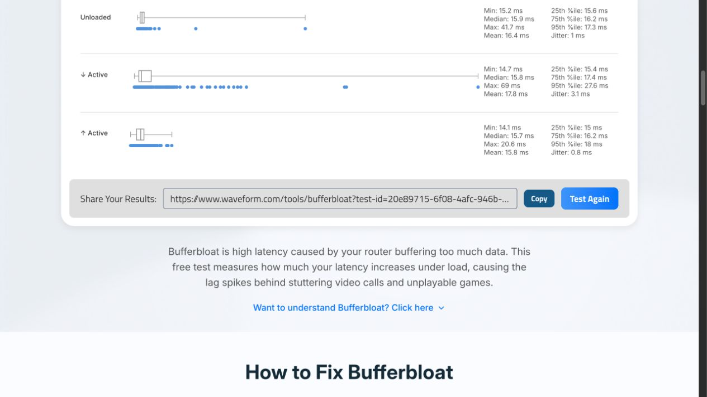

# W6x: localização dos timeouts com sondas do roteador e captura WAN

29/10/2026, America/Sao_Paulo. Continuação do [diagnóstico monitorado](DIAGNOSTICO_W6X_MONITORADO_2026_10_29.md). Leituras e tráfego de diagnóstico autorizados; nenhum parâmetro, serviço existente, pacote, firmware ou regra de firewall foi alterado.

## 1. Conclusão principal

**O evento de aproximadamente dois segundos também afeta tráfego originado no próprio W6x e se reproduziu sem Waveform e sem CPU ou filas altas.** Na captura da interface WAN, requisições continuaram aparecendo sem as respostas correspondentes, inclusive para o primeiro salto PPPoE.

Isso exclui Mac/navegador como causa exclusiva e enfraquece fortemente a hipótese de que os eventos longos sejam causados por AQL, Wi-Fi, BBR ou fila CAKE sob carga. O intervalo investigado está **após o ponto de captura da WAN**, incluindo caminho de transmissão/recepção do driver/NIC do W6x, enlace/ONT e operadora. Captura de saída no Linux não comprova a transmissão elétrica/óptica no fio; não é prova suficiente para responsabilizar a operadora.

Pressão de CPU durante download existe e merece um trabalho separado. Não deve ser confundida com a interrupção que também ocorre ociosa.

## 2. Método e alcance

- Sondas ICMP do W6x, explicitamente usando `pppoe-wan`, para primeiro salto PPPoE e dois destinos externos, a 1 Hz.
- Sondas ICMP do Mac para gateway/primeiro salto/dois destinos externos, a 5 Hz, timeout 1 s.
- Sonda UDP STUN do Mac independente do navegador, com intervalo nominal 200 ms e timeout 800 ms.
- Amostras de CPU e CAKE aproximadamente a cada segundo.
- Captura restrita, sem modo promíscuo, a ICMP/IPv4 desses três destinos encapsulado em PPPoE na interface `eth1`, snapshot de 96 bytes. Não foram capturados fluxos web, chaves, senhas ou conteúdo de aplicações.
- Todos os arquivos de coleta foram gravados no Mac; a captura foi encerrada verificando PID e tempo de início do processo criado para o diagnóstico.

O ping BusyBox instalado não aceitou intervalo 0,2 s; a tentativa falhou sem produzir medição e foi substituída por 1 s. Os arquivos da tentativa inicial foram preservados e não entram nas estatísticas.

As sondas do roteador atravessam políticas locais/saída diferentes das encaminhadas pelo Mac. A falha comum é evidência de caminho compartilhado, sem presumir tratamento idêntico de DSCP. Demais usuários/processos não foram isolados. A coleta tem custo pequeno, sem equivaler a ambiente de laboratório controlado.

## 3. Primeira comparação: falha confirmada no próprio roteador

Janela aproximada do monitor: 14:31:49–14:34:20; sondas do roteador iniciadas por volta de 14:32:40. Waveform iniciado às 14:32:48,636.

| Sonda originada no W6x | Respostas | Sequências sem resposta |
|---|---:|---|
| Primeiro salto PPPoE | 103/105 | 39 e 40 |
| 1.1.1.1 | 103/105 | 39 e 40 |
| 8.8.8.8 | 103/105 | 39 e 40 |

O Mac também perdeu respostas externas na mesma janela, aproximadamente **14:33:19–14:33:21**, enquanto recebeu **750/750** respostas do gateway. Houve timeouts UDP compatíveis com essa janela. Outro timeout UDP isolado também ocorreu às 14:33:04.

[Waveform dessa rodada](https://www.waveform.com/tools/bufferbloat?test-id=581a0880-8287-4b48-b437-05b5b1007bcc): **A**, 512,2/341,5 Mb/s, acréscimos +18/+0 ms, pico de download 1751,6 ms e p95 de download 36,6 ms.

### CPU e filas nessa rodada

- CPU0 atingiu 100% em amostras de download; média por núcleo na fase inferida: 84,4%, 23,5%, 4,2%, 42,2%.
- No intervalo de falha, a entrada praticamente parou, a fila IFB esvaziou e o uso de CPU caiu. Isso não demonstra que a interrupção tenha sido causada pela CPU alta anterior.
- Maior `pk_delay` IFB amostrado: 18,5 ms; incremento de drops IFB: 141.
- Qdiscs permaneceram com as mesmas taxas/identificadores, sem reinício observado na série.

## 4. Rodada com captura durante carga: limite documentado

[Waveform seguinte](https://www.waveform.com/tools/bufferbloat?test-id=20e89715-6f08-4afc-946b-adbd32ba1215): **A+**, 590,0/354,2 Mb/s, acréscimos +1/+0 ms. p95 de download 27,6 ms, máximo 69 ms; p95 de upload 18 ms.

A captura limitada a 2500 pacotes cobriu **14:36:37,986–14:37:41,786**, com zero drops reportados pelo capturador. Os novos timeouts ocorreram depois, por volta de **14:37:56–14:37:59**, com as mesmas sequências 79/80 ausentes nas três sondas originadas no W6x.

Essa captura não cobriu a falha. Ela não foi usada para concluir que requisições saíam durante aquele evento. Foi necessária uma terceira janela, sem carga, com duração suficiente.

## 5. Janela ociosa com captura cobrindo a falha

Monitor iniciado por volta de 14:39:48, sem iniciar novo Waveform, com 230 amostras do roteador. A falha se reproduziu perto de **14:41:02–14:41:05** e novamente perto de **14:42:35–14:42:38**.

| Evidência correlacionada | Observação |
|---|---|
| Requisições WAN sem resposta correspondente | **72** no total: **36 por evento**, sendo **12 por destino em cada evento** |
| Destinos | Primeiro salto PPPoE, 1.1.1.1 e 8.8.8.8 |
| Janelas de envio dessas requisições | **14:41:02,825–14:41:04,652** e **14:42:35,827–14:42:37,655** |
| Maior intervalo entre respostas observadas | Aproximadamente **2,20 s** nos três destinos |
| UDP STUN do Mac | Seis timeouts, três em cada janela |
| CPU por núcleo na janela | Máximo abaixo de 5% nas amostras adjacentes |
| Link físico | Carrier=1 nas amostras |
| Atraso IFB na janela | Dezenas/centenas de microssegundos, sem fila longa |

Os pares foram comparados por **destino + identificador ICMP + sequência**, usando timestamps dos pacotes. Os 72 pares ausentes incluem sondas originadas no Mac e no W6x vistas na WAN; não são testes independentes nem percentagem de perda geral da conexão.

Ao final: 8929 pacotes capturados, 8929 recebidos pelo filtro e **zero descartes pelo capturador**. Cada sonda do roteador recebeu 226/230 respostas, com sequências ausentes 74/75 e 167/168. O Mac recebeu 1150/1150 respostas do gateway e 1130/1150 de cada destino externo/primeiro salto. Foram 1133 sondas UDP, seis timeouts. O processo de captura criado para o ensaio foi encerrado e sua ausência foi verificada.

As sondas sustentam falta de resposta no prazo. Captura sem reply correspondente também pode refletir descarte/atraso no caminho de retorno ou no recebimento pelo driver; não demonstra sozinha em qual equipamento ocorreu a perda.

Os eventos anteriores sugeriram inicialmente um intervalo de aproximadamente 278 s. Os dois eventos ociosos ficaram separados por **93 s**: a hipótese de intervalo fixo de 278 s foi descartada. Alguns intervalos anteriores são próximos de múltiplos de 93 s, mas **periodicidade/temporizador de 93 s ainda não estão comprovados**; faltam mais ocorrências consecutivas e mecanismo causal. Não atribuir o comportamento a cron ou daemon por simples proximidade temporal. A busca textual direcionada no código ARK não encontrou um temporizador explícito de 90/92/93 s nos caminhos consultados.

## 6. Leituras complementares

- Link WAN 1000 Mb/s full-duplex; sem queda/renegociação PPPoE ou carrier registrada para os eventos nos logs filtrados disponíveis.
- Contadores Ethernet consultados: rx/tx errors e drops zerados, FCS/short/long/checksum/overflow zerados. Isso não comprova integridade de todos os elementos até a operadora.
- EEE da WAN: desativado.
- Pause/flow control RX/TX: desativado, inclusive no resultado negociado; contador de quadros recebidos de flow control zerado.
- Offload de fluxo permanece desativado; CAKE continua em 700 Mb/s de download/744 Mb/s de upload.
- Cron consultado mostra watchdog web por minuto e Doctor por hora; não foi encontrada evidência associando sua execução à falha. Nenhum deles foi executado manualmente pelo diagnóstico.

## 7. O que isso muda na otimização

**Informação posterior do usuário:** ONT em modo ponte e cabo WAN Cat7. São características informadas, sem inspeção da ONT ou certificação do cabo nesta sessão. Ponte elimina o roteamento/NAT do serviço, mas não implica ausência de buffers/agendamento da conversão Ethernet/PON; o [modelo GPON do Broadband Forum](https://www.broadband-forum.org/pdfs/tr-156-4-0-0.pdf) descreve filas e escalonamento em ONU/OLT. Isso não demonstra que a ONT tenha causado o evento observado, especialmente porque ele ocorreu sem carga.

Com carrier estável e contadores físicos zerados, cabo/terminações ficam em prioridade menor; a categoria comercial do cabo não confirma seu estado físico, mas não há evidência coletada que o condene. O próximo isolamento prioritário é comparar W6x/driver WAN versus ONT/acesso, mantendo a captura e sem atribuir antecipadamente o evento a buffers da ONT.

1. **Não tentar resolver esses dois segundos ajustando o Wi-Fi.** O evento existe em Ethernet e em sondas do roteador.
2. **Não reduzir upload nem alterar BBR/TFO/DNS como resposta a essa falha.** Ela aparece sem carga e com CPU/fila baixas.
3. **Separar o trabalho de vazão/CPU do trabalho de estabilidade WAN.** CPU0 a 100% durante download merece ensaio controlado próprio; não explica automaticamente o evento ocioso.
4. Para separar W6x de ONT/operadora, o próximo isolamento material é comparar o mesmo acesso com outro equipamento/cliente direto, ou comparar o W6x em outro acesso, além de verificar cabo/porta e telemetria da ONT. Isso exige intervenção física/configuração separada; não foi feito.
5. Não trocar bootloader, firmware, domínios regulatórios ou presets de fila para “testar tudo”. Há evidência suficiente para concentrar o diagnóstico na WAN antes de mexer em parâmetros de rádio.

## 8. Evidências locais

### Identificação das ONTs e alternativa de comparação

O usuário identificou a ONT atual como **Huawei EG8145X6-10**, acessível em `192.168.18.1`. A página de login consultada exibiu esse modelo; não houve autenticação nem leitura de telemetria óptica. O modo ponte foi informado pelo usuário. A alternativa foi corrigida pelo usuário para **TP-Link XZ005-G6**, em vez de Intelbras.

A [especificação oficial da XZ005-G6](https://service-provider.tp-link.com/gpon/xz005-g6/) confirma **porta RJ45 2.5 GbE**, GPON/EPON, OMCI e autenticação baseada em SN/senha, além de modos de VLAN. Portanto, os 2,5 Gb/s neste modelo se referem também à interface Ethernet. Isso não transforma o acesso GPON em XGS-PON nem garante menor latência.

A tentativa anterior sem funcionamento ainda não tem causa identificada. Para investigá-la, separar: registro óptico/autorização na OLT; provisionamento OMCI/serviço e VLAN; estabelecimento PPPoE no roteador. Compatibilidade declarada com padrões não comprova provisionamento na operadora específica. Operadora, revisão/firmware da unidade e estado observado na tentativa anterior permanecem desconhecidos. Não copiar identificadores, alterar VLAN, trocar ONT ou atualizar firmware como parte deste diagnóstico documental.

A comparação com a TP-Link só será conclusiva depois de acesso funcional e repetição das mesmas sondas. Uma porta de 2,5 GbE pode remover um limite Ethernet acima de 1 Gb/s, mas não explica nem resolve por si só os eventos ociosos de aproximadamente dois segundos. A prioridade continua sendo obter telemetria da Huawei e isolar a falha WAN observada.

- [Comparação Mac/roteador](measurements/w6x-2026-10-29-comparacao/).
- [Captura durante carga, que encerrou antes da falha](measurements/w6x-2026-10-29-captura-com-carga/).
- [Captura e sondas ociosas que cobriram a falha](measurements/w6x-2026-10-29-captura-ocioso/).

Diagnóstico de localização, sem atribuição definitiva de causa-raiz e sem mudança funcional. Uma futura alteração deve seguir o laboratório e a confirmação física exigidos pelo workspace.

## 9. Inspeção posterior da ONT

A consulta autenticada à Huawei revelou RX de −27,96 dBm em duas leituras e 106 avisos de potência fora da referência no Debug Log. A bridge foi confirmada. Ver [relatório específico da ONT](DIAGNOSTICO_ONT_HUAWEI_2026_10_29.md). Esse achado prioriza a verificação óptica pela Simtelecom, sem comprovar a causa das pausas WAN. O relógio inválido da ONT impede correlação direta dos logs com os ensaios.
