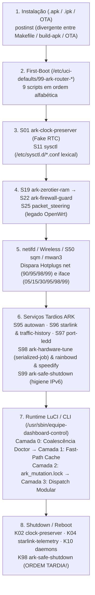

# ARK Router Panel (`v2.2.16`) — Super Manual Técnico, Estudo de Fontes Primárias & Auditoria de Ordem de Execução

> **Versão Auditada**: `2.2.16` (`branch main`) | **Data do Estudo**: `2026-11-25`  
> **Natureza**: Estudo técnico estático completo (somente leitura do código-fonte + pesquisa em fontes primárias oficiais de OpenWrt `19.07`–`25.12`, Linux Kernel `v6.12`, RFCs IETF e projetos upstream). **Nenhuma mutação** foi aplicada em código, VM ou hardware durante este levantamento.  
> **Objetivo**: Servir como **enciclopédia viva de consulta e revisão** para responder, com evidência exata (`arquivo:linha` + fonte primária), a cinco perguntas sobre cada um dos **74 contratos funcionais (`ARK-*`)**:
> 1. **O que o recurso faz hoje no código real** (UCI, `sysctl`, `nft`/`iptables`, `tc`, pacotes e daemons)?
> 2. **Como e quando usar** (pré-requisitos, cenários recomendados e ordem correta de configuração)?
> 3. **O que mudou no ecossistema (2025–2026)** (OpenWrt `24.10`/`25.12`, Kernel `6.12`, `apk`, `fw4`, `dnsmasq 2.90`, `odhcpd`, `Jool 4.1`, `cake_mq`, `mwan3-nft`, `ksmbd`, `usteer`, Wi-Fi 7 MLO, Starlink gRPC)?
> 4. **Estamos executando na ordem correta** (boot `uci-defaults` → `sysctl.d` → `init.d` → hotplugs → RPC/locks)?
> 5. **Onde existem conflitos reais, bugs silenciosos, opções obsoletas ou violações de preservação de estado**?

---

## Sumário Navegável

- [Resumo Executivo & Mapa de Maturidade dos 8 Domínios](#resumo-executivo--mapa-de-maturidade-dos-8-domínios)
- [Parte I — Ordem Mestra de Execução, Boot, Hotplugs, Locks e Precedência](#parte-i--ordem-mestra-de-execução-boot-hotplugs-locks-e-precedência)
- [Parte II — Matriz Mestre de Conflitos e Interações Cruzadas](#parte-ii--matriz-mestre-de-conflitos-e-interações-cruzadas)
- [Parte III — Estudo Completo por Domínio (Todos os 74 Recursos)](#parte-iii--estudo-completo-por-domínio-todos-os-74-recursos)
  - [Domínio 1 — Núcleo, UI/Tema, EZ-Setup, OTA, NTP, Ark Doctor, Watchdog, Histórico & Speedtest](#domínio-1--núcleo-uitema-ez-setup-ota-ntp-ark-doctor-watchdog-histórico--speedtest)
  - [Domínio 2 — WAN, PPPoE, Baby Jumbo (RFC 4638), Auto-WAN, Multi-WAN (`mwan3`), TCP Turbo & ONU Bridge](#domínio-2--wan-pppoe-baby-jumbo-rfc-4638-auto-wan-multi-wan-mwan3-tcp-turbo--onu-bridge)
  - [Domínio 3 — LAN, Switch DSA vs `swconfig`, DHCP/RFC 1123, IGMP Snooping & Pilha IPv6 (Dual-Stack, Relay, NPTv6, Jool NAT64/DNS64, CLAT)](#domínio-3--lan-switch-dsa-vs-swconfig-dhcprfc-1123-igmp-snooping--pilha-ipv6)
  - [Domínio 4 — Firewall (`fw4`/`fw3`), Cone NAT, Controle Parental, Limites por Dispositivo, DMZ, HTTPS/CA & UPnP](#domínio-4--firewall-fw4fw3-cone-nat-controle-parental-limites-por-dispositivo-dmz-httpsca--upnp)
  - [Domínio 5 — QoS/SQM (`CAKE`, `cake_mq`, `HFSC+FQ-CoDel`), Ingress Trust Boundary, Hardware/Silício, RPS/IRQ/NAPI, Conntrack, ZRAM & LED HAL](#domínio-5--qossqm-cake-cake_mq-hfscfq-codel-ingress-hardware-rpsirqnapi-conntrack-zram--led-hal)
  - [Domínio 6 — Wi-Fi 5/6/6E/7, DFS/UNII-3/6 GHz, IoT 2.4 GHz, Roaming `802.11k/v/r`, `usteer`, `wpad-mbedtls`, Mesh `802.11s`, WPS, WED & MLO](#domínio-6--wi-fi-566e7-dfsunii-36-ghz-iot-24-ghz-roaming-80211kvr-usteer-wpad-mbedtls-mesh-80211s-wps-wed--mlo)
  - [Domínio 7 — DNS Cache RAM (`dnsmasq`), DNS Turbo, Dual-DoH, DoT/Interceptação & AdBlock / AdGuard Home](#domínio-7--dns-cache-ram-dnsmasq-dns-turbo-dual-doh-dotinterceptação--adblock--adguard-home)
  - [Domínio 8 — WireGuard, AmneziaWG, ZeroTier RAM, Speedify Bonding, Starlink, USB NAS (`ksmbd`), Wake-on-LAN & Safe Shutdown](#domínio-8--wireguard-amneziawg-zerotier-ram-speedify-bonding-starlink-usb-nas-ksmbd-wake-on-lan--safe-shutdown)
- [Parte IV — Backlog Priorizado de Correções e Modernizações (P0 a P3)](#parte-iv--backlog-priorizado-de-correções-e-modernizações-p0-a-p3)
- [Parte V — Índice Consolidado de Fontes Primárias & Referências](#parte-v--índice-consolidado-de-fontes-primárias--referências)

---

## Resumo Executivo & Mapa de Maturidade dos 8 Domínios

O ecossistema ARK Router (`v2.2.15`) compreende **74 contratos funcionais** (`tests/feature_contracts.yaml`), **14 módulos de domínio shell** em `root/usr/lib/ark/modules/`, **11 bibliotecas/daemons auxiliares** em `root/usr/lib/ark/` e `root/usr/sbin/`, **11 serviços `init.d`**, **12 hooks `hotplug.d`**, **9 scripts `uci-defaults`** e uma SPA modular LuCI compilada em `overview.js` + tema `< 60 KiB` gzip (`52,69 KiB` verificados).

| # | Domínio | Contratos `ARK-*` | Pontos Fortes Verificados | Principais Gaps / Riscos Reais Encontrados | Atualizações Upstream Relevantes (2025–2026) |
|---|---|---:|---|---|---|
| **1** | Núcleo, Boot, UI, EZ-Setup, OTA, NTP, Doctor, Watchdog, Histórico, Speedtest | 14 | Fast-Path em RAM, `ark-doctor --auto` 100% observacional, tema `< 60 KiB` unificado, `serialized-job.sh` fail-closed. | Fast-path do Doctor olha `/tmp` enquanto lock real está em `/var/lock`; `ARK_MUTATION_LOCK_HELD` vaza para subshells BG; `postinst` diverge entre `Makefile`, `build-apk-mac.py` e OTA; fallback Speedtest dá falso 4000 Mbps; `equipe-traffic-history` conta `wan6` dobrado e usa `pgrep -c`. | OpenWrt `25.12` migrou totalmente para **`apk`**; **`owut`** (OpenWrt Upgrade Tool) consolidou ASU no CLI; `uhttpd` + ACME para HTTPS confiável sem CA manual. |
| **2** | WAN, PPPoE, Baby Jumbo, Auto-WAN, Multi-WAN (`mwan3`), TCP Turbo, ONU & Probe | 11 | Suporte a RFC 4638 com checagem `maxmtu` (`ag71xx`/`fec`), perfis PPPoE, acesso isolado a ONU bridge, regras sticky no `mwan3`. | **5 definições divergentes** de "WAN ativa"; sonda de Baby Jumbo em `05-ark-pppoe-babyjumbo` sem flag DF + bug de lock; conflito `99-ark-performance.conf` vs `ark-hardware-tune`; `tcp_turbo=0` sem `saved_*`; `ark-probe-disconnect` injeta args em `python3 -c`. | **`mwan3-nft`** nativo para `fw4` (substituindo `iptables-nft`); **BBRv3** em convergência upstream (Linux 6.12 ainda carrega BBRv1 no módulo `bbr` padrão). |
| **3** | LAN, DSA/`swconfig`, DHCP/RFC 1123, IGMP & Pilha IPv6 (Jool/NPTv6/CLAT) | 9 | Higiene Apple SLAAC (`other-config`), `ra_pref64` RFC 8781, Option 108 RFC 8925 por dispositivo, detecção `ark_jool_instance_running`. | **Lockout de DHCPv4** ao migrar `ipv6_only → ipv4_only`; `ark_ipv6_prefix_hygiene` quebra em prefixos com `::`; DNAT DNS64 per-device quebra com origem ULA; fallback `464xlat` do `ipv6_clat` inalcançável quando WARP API falha; `nptv6` implementa NAT66 (`masq6=1`), não RFC 6296 stateless; `swconfig` com porta `5`/`0t` hardcoded. | `odhcpd` suporta nativamente **`ra_pref64`** (RFC 8781) e `list ra_flags` (substituindo `ra_management`); **Jool 4.1** pleno no Linux 6.12; `464xlat` (`kmod-nat46`) nativo. |
| **4** | Firewall (`fw4`/`fw3`), Cone NAT, Parental, Limites, DMZ, HTTPS, UPnP | 7 | Detecção dinâmica `is_fw4`/`is_fw3`, proteção `ark_migrate_upnp_variant`, `15-ark-dscp-priority.nft` preservando bits superiores do `mwan3`. | **`flow_offloading` contorna limites de banda `nftables`**; limites inoperantes em `fw3`; `ark_cone_nat` mascara UDP até em túneis VPN (`wg*`/`zt*`); `sed -i` no template do sistema `zone-masq.uc`; parental AdGuard falha silenciosamente sem `python3`; sem gerador real da CA local. | `miniupnpd-nftables` nativo no `fw4` (com `ext_perform_stun` contra CGNAT/double-NAT); `nftables` `masquerade persistent` ≠ Full-Cone estrito sem EIM. |
| **5** | QoS/SQM (`CAKE`, `cake_mq`, `HFSC`), Silício, RPS/IRQ, Conntrack, ZRAM, LED | 9 | Orçamento `memlimit` escalonado por RAM, fronteira ingress `pedit`+`csum`+`ctinfo`, `hw-tune.sh` com piso `CONFIG_HZ=100` (`netdev_budget_usecs`), guarda térmica CPUFreq, LED HAL 3 topologias. | Regex `memlimit` no `doctor.sh` quebra com unidade `K`; `sqm.sh` vaza `BQL`/`AQL`/`ethtool`/`dev_weight` ao desativar; `ark_gaming_ports` promove quase **todo UDP LAN** para CS4; 4 escritores conflitantes de `sysctl`; Doctor religa Flow Offload em modo AP/HUB; WED sem check no Doctor; bug Rainbow vs WAN LED no AW21018. | **`cake_mq`** backportado no OpenWrt `25.12` (Kernel 6.12, 700-01..701-02); **`cake-autorate`** e **`qosmate`** consolidados; Linux kernel desencoraja `vm.drop_caches` em produção. |
| **6** | Wi-Fi 5/6/6E/7, DFS, IoT, Roaming `k/v/r`, `usteer`, `wpad-mbedtls`, Mesh, WED, MLO | 11 | Regra anti-FT-SAE com WPA3, `usteer` consultivo (`local_mode=1`) evitando SSID banda-única em `ssid_list`, salvaguarda UNII-3 `160→80`, blindagem QCA QSDK. | `wifi-roaming-sync` chamado pelo Smart Enhancer **não existe** (no-op); `doctor.sh` trata `radio0`/`phy0-ap0` como 2.4 GHz mesmo se invertido para 5 GHz + `wifi reload` duplicado; `multicast_to_unicast` em ping-pong no modo AP; `wifi_mlo_toggle` inclui APs não-SAE/2.4G em `mld0`; `ark_tune_wifi_aql` ignora `wifi6_accel=0`. | `wpad-mbedtls` / `wpad-mesh-mbedtls` obrigatórios p/ 802.11s SAE no 24.10/25.12; **`background_radar`** no `mt76`; **`mesh11sd`** para mesh multi-nó; MLO (`option mlo 1`) em evolução rápida no 25.12. |
| **7** | DNS Cache RAM, DNS Turbo, Dual-DoH, DoT & AdBlock / AdGuard Home | 3 | Circuit breaker anti-ressurreição no AdGuard Home, logs em tmpfs, preservação `saved_*` na ativação, `use-stale-cache=3600` (RFC 8767). | **SQM/Doctor destroem AdBlock Nuvem** ao desligar `https-dns-proxy`; `adblock_restore_dns` religa DoH ignorando `dns_doh_enabled=0` e SQM; regex `$important` quebrada na releitura de whitelist; `adblock_apply_rules` envia `raw_blacklist` não sanitizado para YAML; whitelist `server=/d/1.1.1.1` fura AdGuard/DoH; `network_capacity_save` sobrescreve `cachesize=10000` com AdGuard ativo. | **`dnsmasq 2.90`** tem teto rígido **`cache-size=10000`** (acima disso trunca silenciosamente!) e `--use-stale-cache`; AdGuard Home v0.107.x consome ~90–100 MB RAM e não sintetiza DNS64 nativamente. |
| **8** | WireGuard, AmneziaWG, ZeroTier RAM, Speedify, Starlink, `ksmbd`, WoL, Shutdown | 10 | Proteção anti-flash para ZeroTier (<=16 MB), Speedify (tmpfs logs/lastGood), Starlink (buffer circular 25h RAM→Flash), guarda anti-flash USB no `ksmbd`. | **CGI Starlink altera UCI/rotas via `GET` sem auth** + JSON injection; download de `starlink-dish` sem SHA-256 + `--no-check-certificate`; **`ksmbd` permite abrir WAN TCP 445 com `guest_ok=1` e `force_root=1`** + dados mockados `64 GB` hardcoded; DNAT Starlink `9201..9204` sem filtro de destino; `du -sb` quebra JSON no BusyBox; `pkill -9 -f speedify` pode matar o próprio controle; `ark-wireguard-wan-sync` ignora AmneziaWG; `wgclient` retorna `configured=true` mesmo ausente. | **Starlink** removeu GPS/localização da API gRPC local (`192.168.100.1:9200`) em Gen3/Mini; **`ksmbd`** no kernel 6.12 **não suporta SMBv1** (`smbv1_legacy` é no-op); **AmneziaWG** segue fora do feed oficial OpenWrt (mantido em feeds comunitários 24.10/25.x); **ZeroTier 1.14+** usa seção `global` + `network`. |

---

## Parte I — Ordem Mestra de Execução, Boot, Hotplugs, Locks e Precedência

Para auditar se *"estamos fazendo as coisas certas nas ordens corretas"*, é indispensável enxergar toda a linha do tempo do roteador — do primeiro boot até um clique na interface LuCI.

### 1.1 Ordem Exata de First-Boot (`/etc/uci-defaults/`, ordem lexical)

| Ordem | Script (`root/etc/uci-defaults/`) | O que Executa | Risco de Ordem / Divergência de Empacotamento |
|---:|---|---|---|
| 1 | `99-ark-router-dhcp-sanitize` | Sanitiza hostnames RFC 1123, `dhcp.lan.force=1`, blindagem Apple RA, `cachesize`/`use-stale-cache`, patch AdGuard/mwan3, limpeza `swconfig`, wrapper `wget`, limpa `nptv6` em Single-WAN, sanitiza SQM/CAKE + desliga Flow Offload se SQM ativo. | **Bugs:** seta `dhcp.lan.force=1` sem checar modo AP/HUB (`:18`); regride SQM `> 500 Mbps` para `diffserv4+nat+ingress` (`:399-413`); regex `memlimit` não casa `K` (`:407,424`); **não executado** pelo `Makefile` `postinst`. |
| 2 | `99-ark-router-doctor` | Agenda cron horário `0 * * * * /usr/sbin/ark-doctor --auto` e `equipe_dashboard.doctor.auto_heal='1'`. | **Não executado** no `postinst` de `Makefile` nem `build-apk-mac.py` (só roda no próximo reboot). |
| 3 | `99-ark-router-leds` | Sobrescreve `/etc/hotplug.d/{iface,net}/99-ark-led-wan`, calibra curvas AW21018, aplica preset `smart`, atualiza LED WAN. | **Duplicação:** sobrescreve arquivos já empacotados em `root/etc/hotplug.d/` com leve diferença de variável (`:7-28`). |
| 4 | `99-ark-router-mwan3` | Remove `mwan3.lua` sem Lua; liga `mwan3` se `>= 2` WANs ativas ou desliga se `< 2`. | **Não executado** em `postinst` de `Makefile` / `build-apk-mac.py`. |
| 5 | `99-ark-router-ntp-clock` | TZ `America/Sao_Paulo` (`<-03>3`), `ntp.br` + Cloudflare/Google, `firewall.ark_ntp_intercept`, ativa `ark-clock-preserver`. | **Não executado** em `postinst` de `Makefile` / `build-apk-mac.py` — por isso `ntp-intercept-toggle` falha silenciosamente antes de um reboot (`system.sh:1523`). |
| 6 | `99-ark-router-theme` | Registra tema ARK, silencia aviso ASU, habilita `ark-safe-shutdown` e `ark-hardware-tune`, sanitiza `wan6`/DHCPv6, aplica políticas de features e idioma `pt-br`. | Corretamente adia `ark-hardware-tune start` e Wi-Fi factory quando `99-ark-router-wifi` ainda existe (`:59,68`), mas **não roda** no `build-apk-mac.py`. |
| 7 | `99-ark-router-uhttpd` | Garante `ubus_prefix='/ubus'`, corrige `ubus_socket`, cria symlink `ubus.sock`, remove `ubus_cors`. | **Bug linha 33:** `elif [ -S /var/run/ubus.sock ] && [ ! -e /var/run/ubus.sock ]` é sempre falso (deveria testar `/var/run/ubus/ubus.sock`). |
| 8 | `99-ark-router-upnp` | Define `use_stun=1`, `stun.cloudflare.com:3478`, `external_iface=wan`, banda `128000` KB/s, `enabled=0` se vazio. | **Nenhum `postinst`** (`Makefile`, `build-apk-mac.py`, OTA) executa este script na instalação a quente. |
| 9 | `99-ark-router-wifi` | Ativa rádios, `country=BR`, renomeia `OpenWrt`, canais 2.4/5/6G + salvaguarda UNII-3 + Wi-Fi 6 + blindagem sono + regra `mwan3.iot_alexa_mqtt`, **e inicia `ark-hardware-tune`** (`:242`). | Boa sincronização com `99-ark-router-theme`, mas **não executado** no `postinst` do `Makefile` / `build-apk-mac.py`. |

> [!WARNING]
> **Desalinhamento Crítico de Pós-Instalação**: `Makefile:140-168` (SDK), `scripts/build-apk-mac.py:78-137` (empacotador macOS) e `ezsetup.sh:2095-2096` (OTA) habilitam **conjuntos diferentes de `init.d`** e executam **subconjuntos diferentes de `uci-defaults`**. Em especial, o `Makefile` sobrepõe o `default_postinst` do OpenWrt sem rodar todos os `uci-defaults` e esquece `chmod +x /etc/init.d/ark-rainbowd` no perfil `-full` (`Makefile:158`).

### 1.2 Ordem Exata de Serviços `init.d` (`START` e `STOP`)

| `START` | `STOP` | `USE_PROCD` | Serviço | Papel e Avaliação da Ordem |
|---:|---:|---:|---|---|
| `01` | `02` | `0` | `ark-clock-preserver` | **Correto:** restaura Fake RTC (`/etc/ark-clock.epoch`) antes de logs, TLS e `sysntpd`; salva logo no início do shutdown (`K02`). |
| `19` | — | `0` | `ark-zerotier-ram` | **Correto:** extrai ZeroTier para `/tmp` bem antes de `/etc/init.d/zerotier` (`START=90`). |
| `22` | — | `1` | `ark-firewall-guard` | **Ordem prematura (`START=22`):** verifica `AdGuardHome` (`START=95/99`) antes de ele subir, gerando falso aviso (`:30`), e aplica `sed -i` em `/usr/share/firewall4/templates/zone-masq.uc` + `fw4 reload` no meio do boot. |
| `95` | `10` | `1` | `ark-autowan` | **Correto** no boot (após `network`/`mwan3`), mas daemon não usa o `LOCK_FILE` declarado (`ark-autowan-daemon:8`). |
| `96` | `04` | `1` | `starlink-telemetry` | **Correto:** `K04` faz flush do buffer de 25h para flash antes da desmontagem de FS e da rede. |
| `96` | `10` | `1` | `equipe-traffic-history` | **Correto** na ordem; bug de contagem dupla de `wan6` e `pgrep -c` incompatível com BusyBox (`:18,:152`). |
| `97` | `10` | `1` | `ark-port-ledd` | **Correto** (após switch/netdevs subirem). |
| `98` | — | `0` | `ark-hardware-tune` | **Correto** no boot (sobrescreve `S11sysctl`, desabilita `S25packet_steering`, roda pós-`S50sqm` via `ark_serialized_job`). |
| `98` | `10` | `1` | `ark-rainbowd` | **Correto** (ucode `uloop` leve); porém morto indevidamente por `ark_led_update_wan_status` no AW21018 (`led.sh:624-634`). |
| `98` | `10` | `0` | `ark-speedify` | **Correto** (`sleep 25` em BG para aguardar WANs estabilizarem). |
| `99` | `98` | `0` | `ark-safe-shutdown` | **`STOP=98` TARDIO DEMAIS:** no OpenWrt, `K*` roda em ordem crescente; `K98` executa **depois** de outros daemons e rede já terem sido encerrados, e `ark_safe_storage_reboot()` nem sequer inclui `ksmbd`, flush do Starlink ou `mount -o remount,ro` (`common.sh:1192-1208`). Ideal: `STOP=05`. |

### 1.3 Ordem Exata de Hotplugs e Hooks de Rede

- **`/etc/hotplug.d/iface/` (`netifd`)**: `05-ark-pppoe-babyjumbo` → `15-ark-ipv6-hygiene` → `30-wireguard-wan` → `95-ark-cache-invalidate` → `98-ark-hardware-tune` → `99-ark-doctor` → `99-ark-led-wan`.
- **`/etc/hotplug.d/net/` (`kernel netdev`)**: `90-ark-rps-tune` → `95-ark-cache-invalidate` → `98-ark-mlo-bridge` → `99-ark-doctor` → `99-ark-led-wan`.
- **`/etc/hotplug.d/firewall/`**: `99-ark-doctor` (somente observacional).
- **`/etc/ppp/ip-up.d/`**: `99-ark-mtu` (força `1492` se não for `device_mtu=1508 && mtu=1500` — **quebra MTUs manuais `> 1492`**).
- **`/etc/odhcp6c.user.d/`**: `10-ark-ipv6-hygiene` (concorre sem lock com `iface/15-ark-ipv6-hygiene` em reconexões PPPoE).

### 1.4 Arquitetura de Locks & Fast-Path (`/usr/sbin/equipe-dashboard-control`)

| Camada | Código | Problema Real Encontrado |
|---|---|---|
| **0. Coalescência Doctor (0 ms)** | `equipe-dashboard-control:21-38` | Checa `${ARK_LOCK_DIR:-${ARK_ROOT}/tmp}/ark-doctor.lockdir` **antes** de carregar `common.sh`, mas `common.sh:712` seta `ARK_LOCK_DIR=/var/lock` → `doctor.sh:2920` trava em `/var/lock/ark-doctor.lockdir`. **O fast-path 0 ms falha no roteador real**, carregando ~10k linhas desnecessariamente. |
| **1. Fast-Path Cache RAM** | `equipe-dashboard-control:42-95` | Muito bem desenhado (`fp` 120s, `stations` 10s, `mwan` 3s, `perf`/`hw` 30s com injeção live de `/proc`, `doctor` sem TTL). Invalidado por `95-ark-cache-invalidate` e `ark_release_mutation_lock`. |
| **2. Lock Global de Mutação** | `common.sh:2842-2959` | Exporta `ARK_MUTATION_LOCK_HELD=1`, que **vaza para subshells `(...) &` em background** (`ezsetup.sh`, `network.sh`, `devices.sh`). O pai libera o lock ao retornar à UI enquanto o filho continua mutando UCI/serviços sem proteção. Além disso, `05-ark-pppoe-babyjumbo:131` chama `ark_acquire_mutation_lock` sem `_ark_has_mut_lock=1` (nunca libera!) e causa deadlock de 12s quando invocado por `network.sh:1826` ou `doctor.sh:499`. |
| **3. `ark_serialized_job`** | `root/usr/lib/ark/serialized-job.sh` | Robusto e fail-closed (código `75` para contendores, `.pending` garante re-execução). Usado hoje apenas pelo `ark-hardware-tune`. |

### 1.5 Matriz "Quem Vence?" (Precedência Efetiva em Runtime)

| Subsistema | Sequência de Escritores | Quem Vence Hoje | Divergência / Conflito Confirmado |
|---|---|---|---|
| **RPS (`rps_cpus`)** | `S25 packet_steering` → `90-ark-rps-tune` → `S98 ark-hardware-tune` (`hw-tune.sh`) → `sqm.sh:120-145` (`ark_promote_cake_mq`) → `system_hardware_leds.sh:1259-1271` | `hw-tune.sh` no boot; mas após `sqm-toggle`/`sqm-save-v2` (sem Gaming Ports) vence o código **legado** de `sqm.sh:125-138`! | **Sim:** `sqm.sh:125-138` e `system_hardware_leds.sh:1259` ignoram `hw-tune.sh` (aplicam `f` em WAN física/multi-queue e ignoram isolamento CPU3 DMA). |
| **Wi-Fi AQL** | `ark-hardware-tune:225` (`24000` 5G / `15000` 2.4G) → `ark-hardware-tune:456` → `sqm.sh:311-317` (`4000` em **todos** os PHYs) | Se `sqm=1 && gaming_ports=1`: **vence `sqm.sh` (`4000 us`)**. | **Sim:** `4000 us` (AC2 `1000/2000`) mata agregação 80/160 MHz e estrangula 2.4 GHz; **nunca é restaurado** ao desligar SQM/Gaming (`sqm.sh:322-337`); `ark_tune_wifi_aql` também ignora `wifi6_accel=0`. |
| **Sysctls TCP / Backlog / Budget** | `S11sysctl` (`99-ark-conntrack.conf` → `99-ark-hardware-tune.conf` → `99-ark-performance.conf`) → `S98 ark-hardware-tune` → `sqm.sh:276` | **`ark-hardware-tune`** vence no boot (`tcp_ecn=2`, `cca=bbr`, backlog por RAM); com SQM+Gaming, `sqm.sh:276` força `dev_weight=256`, `budget=1200` até em roteador Low-Spec. | **Sim:** 4 escritores diferentes com valores incompatíveis (`tcp_ecn` `1` vs `2`, `dev_weight` `64` vs `256`, `bbr3` sobrescrito por `bbr`). |
| **Conntrack Timeouts** | `99-ark-conntrack.conf` (`7200`, UDP `30/120`) → `99-ark-hardware-tune.conf` (`7440` ou `1200` mwan3) → `sqm.sh:372-373` (UDP `60/240`) | No `S11`, `99-ark-hardware-tune.conf` vence alfabeticamente sobre `99-ark-conntrack.conf`; em SQM+Gaming, `sqm.sh` vence nos timeouts UDP. | **Sim:** `system_perf_save` (`system.sh:1079`) e `network_capacity_save` (`system.sh:977`) reescrevem `99-ark-conntrack.conf` apagando as linhas UDP. |
| **IRQ Affinity vs `irqbalance`** | `irqbalance` vs `S98 ark-hardware-tune` (`hw-tune.sh:414`) | Em SoCs com `ark_has_native_hw_queues=true`, `irqbalance` é bloqueado/morto (`hw-tune.sh` vence). Em NICs single-queue multicore com `irqbalance=1`, **`irqbalance` sobrescreve** `hw-tune.sh`. | **Parcial:** falta desligar pinagem manual quando o usuário habilita `irqbalance` em hardware elegível (x86/ARM genérico). |
| **Flow Offloading** | `sqm.sh` / `network.sh` / `system_hardware_auto_tune` / `doctor --fix` | Último comando; `doctor --fix` religa `flow_offloading=1` e `_hw=1` quando `!sqm && mwan<2 && !user_disabled`. | **Sim:** `doctor.sh:563` ignora modo AP/HUB e ignora limites de banda por dispositivo (`nftables`). |
| **Qdisc `eth*`/`lan*`** | `S50 sqm` → `S98 ark-hardware-tune` (`mq+fq_codel`) → `sqm.sh:290` (`target 50ms`) & `sqm.sh:943` (`lan*` root `fq_codel`) | Em `lan*` com SQM, `sqm.sh:943` destrói a árvore `mq` criada 2 linhas antes pelo `ark-hardware-tune:432`. | **Sim:** duas políticas contraditórias rodam na mesma execução de `ark-hardware-tune`. |
| **DNS / DoH / AdBlock** | `adblock.sh` vs `system.sh` vs `sqm.sh:73` vs `doctor.sh:2468` | Último a rodar. | **Sim:** `sqm.sh` e `doctor.sh` apagam `https-dns-proxy` e `dnsmasq.server` do **AdBlock Nuvem**; `adblock_restore_dns` religa DoH ignorando SQM e `dns_doh_enabled=0`. |

---

## Parte II — Matriz Mestre de Conflitos e Interações Cruzadas

Legenda: ✅ **Compatível** | ⚠️ **Compatível com ressalva / perda parcial** | ❌ **Incompatível (exclusão mútua no kernel/OpenWrt)**

| Recurso A × Recurso B | Verdade Técnica (Kernel / OpenWrt) | Tratamento Atual no ARK (`v2.2.15`) | Status de Conformidade |
|---|---|---|---|
| **SQM (`CAKE`/`HFSC`) × Hardware Flow Offload (PPE)** | ❌ **Incompatível**: PPE pula CPU e `net/sched`; SQM deixa de enxergar pacotes ([OpenWrt Flow Offloading](https://openwrt.org/docs/guide-user/firewall/firewall_configuration)). | `sqm.sh:820-930` desliga `flow_offloading*`, remove `nft flowtable ft` e pausa QSDK ECM, salvando snapshot em `sqm.ark_offload_snapshot`. | ✅ **Correto** (ressalva: `doctor.sh:563` pode religar em AP/HUB). |
| **SQM (`CAKE`/`HFSC`) × Software Flow Offload (SFO)** | ⚠️ **Degradação / bypass parcial**: dependendo da versão e da direção, fluxos em flowtable podem pular hooks netfilter/DSCP e afetar `ctinfo`. | ARK trata SFO e HFO igualmente (desliga ambos com SQM ativo). | ✅ **Conservador e seguro** (preserva `ctinfo` e `nlbwmon`). |
| **SQM (`CAKE`/`HFSC`) × WED (MediaTek Filogic)** | ❌ **Incompatível**: WED desvia tráfego Wi-Fi direto ao PPE, exigindo `flow_offloading_hw=1` e contornando SQM + AQL ([OpenWrt Filogic WED](https://openwrt.org/docs/techref/hardware/soc/soc.mediatek)). | `hw-tune.sh:694-697` apenas sinaliza `ARK_WED_CONFLICT_SQM` em telemetria; **não é auditado no `doctor.sh`** nem bloqueado ao ligar SQM. | ⚠️ **Lacuna ativa** (falta check no Doctor e aviso/guard no toggle). |
| **Flow Offloading (SW/HW) × `mwan3` (Multi-WAN)** | ❌ **Incompatível**: fluxos acelerados pulam `mwan3_hook` e quebram failover/sticky ([OpenWrt mwan3](https://openwrt.org/docs/guide-user/network/routing/mwan3)). | `doctor.sh:531` e `system_hardware_leds.sh:1214` desligam `flow_offloading*` quando `>= 2` WANs. | ⚠️ **Parcial**: há **5 definições divergentes** de "WAN ativa" entre módulos. |
| **Flow Offloading (SW/HW) × `nlbwmon` e Contadores Firewall** | ⚠️ **Subnotificação severa**: fluxos offloaded pulam contadores netfilter/conntrack. | Não avisa nem desliga Flow Offload quando `nlbwmon` está ativo. | ⚠️ **Documentar claramente** para o usuário (trade-off throughput vs telemetria). |
| **Flow Offloading (SW/HW) × Limites por Dispositivo (`nftables`)** | ❌ **Incompatível**: `ark_device_limits` opera em `hook forward` (`devices.sh:695`), que é pulado pelo `flowtable`/PPE! | **Nenhum tratamento**: `devices.sh` não desliga offload e `doctor.sh:563` ainda religa offload! | ❌ **Bug crítico ativo** (limites por dispositivo param de funcionar com offload ligado). |
| **SQM × Dual-DoH (`https-dns-proxy`) × AdBlock Nuvem** | ✅ **Tecnicamente compatíveis** (DNS usa banda irrisória; a política de desligar DoH no SQM é escolha de latência do ARK). | `sqm.sh:73-111` e `doctor.sh:2468` matam `https-dns-proxy` e sobrescrevem `dnsmasq.server` sem checar se AdBlock Nuvem está usando o proxy! | ❌ **Conflito destrutivo** (SQM quebra AdBlock Nuvem; desativar AdBlock religa DoH com SQM ligado). |
| **AdGuard Home (`:5335`) × `dnsmasq` (`:53`) × `cachesize`** | ⚠️ **Cache duplo desperdiça RAM** se ambos mantiverem cache grande. | `adblock.sh` zera `dnsmasq.cachesize=0` (correto), mas `network_capacity_save` (`system.sh:991`) sobrescreve de volta para `10000`. | ⚠️ **Conflito de escritores**. |
| **IPv6 Puro (Jool NAT64/DNS64) × AdGuard Home / DoH / Whitelist** | ⚠️ **Bypass inevitável sem DNS64 local**: Cloudflare `::64` responde direto ao cliente ou via DNAT, pulando AdGuard Home (que não tem síntese DNS64 nativa). | Clientes `ipv6_only` vão direto para `2606:4700:4700::64`. Em per-device, DNAT com origem ULA falha sem `masq6`. | ❌ **Bug no per-device ULA** + limitação arquitetural (solução moderna: Unbound/SmartDNS como sintetizador DNS64 local atrás do AdGuard). |
| **WPA3-SAE × 802.11r (FT-SAE)** | ❌ **Quebra com `ft_psk_generate_local=1`** ([OpenWrt Wireless Docs](https://openwrt.org/docs/guide-user/network/wifi/stubs/wireless)): SAE não deriva PMK estática de passphrase. | `wifi.sh:1592-1607` remove 802.11r em `*sae*|*owe*` e mantém apenas em WPA2 puro 5G/6G. | ✅ **Correto e seguro** (alternativa avançada futura: `ft_psk_generate_local=0` + `r0kh`/`r1kh`). |
| **`usteer` (`local_mode=1`) × SSID Banda-Única** | ❌ **Zera `rrm_nr_set`** em APs secundários se SSID de banda única entrar na `ssid_list`. | `common.sh:2964-3093` filtra `ssid_list` apenas para SSIDs multi-banda (`uniq -d`). | ✅ **Correto** (`[AL-ARK-004]`). |
| **Speedify Bonding × `mwan3` × `wgclient`** | ❌ **Disputa de rota default** e regras de política. | Speedify pausa `mwan3` com snapshot (`mwan3_previous`), mas **não checa conflito** com `wgclient` (`route_allowed_ips=1`) e zera `ipv6`/`delegate` nas WANs sem backup. | ⚠️ **Parcial**. |
| **`ark-hardware-tune` RPS × `packet_steering` × `irqbalance`** | ❌ **Sobrescrita mútua** de `rps_cpus` e `/proc/irq/*/smp_affinity`. | `ark-hardware-tune` desliga `packet_steering`; `irqbalance` é bloqueado em hardware com filas nativas. | ⚠️ **Parcial**: `sqm.sh:125` e `system_hardware_leds.sh:1259` ainda sobrescrevem `rps_cpus` fora do `hw-tune.sh`. |

---

## Parte III — Estudo Completo por Domínio (Todos os 74 Recursos)

---

### Domínio 1 — Núcleo, UI/Tema, EZ-Setup, OTA, NTP, Ark Doctor, Watchdog, Histórico & Speedtest

#### 1.1 Inventário dos Recursos (14 Contratos)
| ID | Recurso | Arquivos Principais | RPCs / Daemons | Estado Atual |
|---|---|---|---|---|
| `ARK-UI-001` | Painel LuCI Overview & Telemetria Real-Time | `src/core/*`, `src/modules/*` → `overview.js` | `features`, `feature-*`, `card-state-*` | Funcional |
| `ARK-UI-002` | Tema ARK Responsivo Mobile-First & Guias Lazy | `ark-theme.js`, `ark-guides.js`, `cascade.css`, `mobile.css` | `header.{ut,htm}`, `footer.{ut,htm}` | Funcional (`52,69 KiB < 60 KiB`) |
| `ARK-UI-003` | Seletor de Temas, Modo Escuro & Cores | `ezsetup.sh:2148-2212`, `99-ark-router-theme` | `theme`, `appearance` | Funcional |
| `ARK-SYS-001` | Aliases / Nomes Amigáveis de Dispositivos | `devices.sh`, `src/modules/devices.js` | `rename`, `device-status` | Funcional |
| `ARK-SYS-002` | Reinicialização Segura em 2 Fases (Trava Visual) | `devices.sh:1771-1780`, `system.js:1020` | `reboot-prepare`, `reboot-confirm` | Funcional (token POSIX sem `$RANDOM`) |
| `ARK-SYS-003` | Assistente EZ-Setup (7 Etapas Idempotentes) | `ezsetup.sh:1308-1635`, `src/modules/ezsetup.js` | `ez-setup-{status,save,apply,reset,install-modules}` | Funcional (ressalvas em WAN2/SQM/senha) |
| `ARK-SYS-004` | Perfis de Pacote (Lite vs Full) & Ocultação Modular | `ezsetup.sh:200-450,1694-1980,2228-2265` | `features`, `profile`, `feature-{hide,toggle,dev-mode,menu-policy}` | Funcional |
| `ARK-SYS-005` | Atualização OTA & Upload Manual (`.apk`/`.ipk`) | `ezsetup.sh:542-801,1982-2147`, `system.js` | `self-update-*`, `manual-update-start`, `asu-check-toggle` | Funcional (sem SHA-256 em OTA) |
| `ARK-SYS-006` | Idioma Triplo (`pt-br`/`en`/`es`) & Branding | `ezsetup.sh:1326`, `src/core/i18n/loader.js`, `po/*/ark.po` | `language`, `title` | Funcional (100% 5.116 chaves) |
| `ARK-SYS-007` | Sonda HTTP Local (`ark-web-watchdog`) & `uhttpd` | `ark-web-watchdog`, `99-ark-router-uhttpd` | CLI manual (órfão!) | Implementado (não agendado) |
| `ARK-SYS-008` | NTP Inteligente, Fake RTC & Interceptação UDP 123 | `ark-clock-preserver`, `99-ark-router-ntp-clock`, `system.sh:1375` | `ntp-{status,sync-browser,configure-smart,intercept-toggle}` | Funcional (bug fuso ≥10h e `reload system`) |
| `ARK-HIST-001` | Histórico 24h & Acumulador Diário (`nlbwmon`) | `equipe-traffic-history`, `init.d/equipe-traffic-history` | Daemon 5s + `nlbwmon-action` | Funcional (conta `wan6` dobrado) |
| `ARK-DIAG-001` | Ark Doctor (18 Blocos: Observacional vs `--fix`) | `doctor.sh`, `ark-doctor`, `99-ark-router-doctor` | `doctor-{status,run,fix,log}`, cron horário | Parcial (`--auto` ok; `--fix` não transacional) |
| `ARK-DIAG-003` | Medidor de Velocidade WAN (Speedtest) | `devices.sh:501-655,1000-1325`, `speedtest.js` | `speedtest-{start,status,result,apply}` | Funcional (bug no fallback sem `speedtest-go`) |

#### 1.2 Como Usar & Ordem Correta de Operação
1. **Primeiro acesso pós-instalação**: defina senha `root`, configure fuso/NTP (`NTP Inteligente` antes de qualquer download TLS/OTA ou WireGuard) e rode o **EZ-Setup** (`ARK-SYS-003`) ou configure manualmente na ordem: **LAN → WAN(s) → IPv6 → Wi-Fi → DNS/AdBlock → SQM/Offload → VPN → Ark Doctor (`doctor-run`)**.
2. **Tema & Visual**: `ark-theme.js` é o dono único de navegação, dropdowns, modal e tecla `Escape` (lazy-load de `ark-guides.js` somente em rotas nativas do LuCI). Preserva `theme_customized=1` e `user_theme` em upgrades.
3. **Ark Doctor**: use `doctor-run` (100% somente leitura) para diagnóstico. Só acione `--fix` consciente de que alguns reparos alteram UCI/serviços de forma não-transacional ([`DOCTOR_SAFETY_MODEL.md`](DOCTOR_SAFETY_MODEL.md)).
4. **Atualizações**: em OpenWrt `25.12+` (`apk`), prefira o pacote `.apk` compatível com o perfil do hardware (`full` se ARM64 + RAM ≥ 480 MB + `/overlay` ≥ 35 MB; senão `lite`). Para upgrades de firmware OpenWrt preservando pacotes, use **Attended Sysupgrade / `owut`**.

#### 1.3 Fontes Primárias & Atualizações do Ecossistema (2025–2026)
- **OpenWrt `25.12` (*Dave's Guitar*)**: transição definitiva de `opkg` para **`apk`** (`/etc/apk/repositories.d/`, `apk update` / `apk add`), Linux Kernel **`6.12`** e **`firewall4`** padrão ([OpenWrt 25.12 Release Notes](https://openwrt.org/releases/25.12/start), [Managing Packages](https://openwrt.org/docs/guide-user/additional-software/managing_packages)).
- **Attended Sysupgrade & `owut`**: `owut` substitui `auc` como ferramenta oficial CLI no OpenWrt `24.10+`/`25.12` para reconstruir imagens no servidor `sysupgrade.openwrt.org` preservando pacotes instalados ([OpenWrt ASU/owut](https://openwrt.org/docs/guide-user/installation/sysupgrade.cli)). O ARK silencia `login_check_for_upgrades` no LuCI (`99-ark-router-theme`) e oferece toggle `asu-check-toggle`, o que está alinhado.
- **`nlbwmon`**: lê contadores de netlink/conntrack; incompatível com medições precisas quando Flow Offloading (SW/HW) está ligado ([OpenWrt nlbwmon](https://openwrt.org/docs/guide-user/services/network_monitoring/nlbwmon)).

#### 1.4 Auditoria "Estamos Fazendo Certo?" — Achados do Domínio 1
- ✅ **Acertos**: `ark-clock-preserver` em `START=01` resolve TLS em roteadores sem bateria RTC; `ark-doctor --auto` e `doctor-run` travam `_auto_fix=0` (DEC-009); `ark-theme.js` unificado com `< 60 KiB` gzip e `ark-guides.js` lazy; tokens de reboot sem `$RANDOM`.
- ❌ **Bugs & Riscos a Corrigir**:
  1. **Fast-path Doctor olha path errado (`equipe-dashboard-control:25` vs `common.sh:712`/`doctor.sh:2920`)**: checa `/tmp/ark-doctor.lockdir` em vez de `/var/lock/ark-doctor.lockdir`.
  2. **Vazamento de `ARK_MUTATION_LOCK_HELD=1` para subshells BG (`equipe-dashboard-control:109`)**: processos em background de OTA, EZ-Setup, WAN e Speedtest executam sem lock depois que o processo pai sai.
  3. **OTA sem validação SHA-256 (`ezsetup.sh:628,2054-2080`)**: usa `apk add --allow-untrusted` e permite fallback TLS inseguro sem validar checksum contra `sha256sums` da release.
  4. **EZ-Setup grava senha `root` em texto claro em Flash (`ezsetup.sh:1345-1346,1421`)**, grava `device`+`ifname` juntos ignorando `swconfig` (`:1549-1550`) e passa nome lógico `wan` em vez de `pppoe-wan` para `ensure_sqm_section` (`:1604`).
  5. **Speedtest fallback falso positivo (`devices.sh:576,593,613,643-655`)**: passa `--bind-address` incompatível com `uclient-fetch` e não checa exit code — se falhar em `< 0.2s`, relata **4000 Mbps DL / 160 Mbps UL**.
  6. **`equipe-traffic-history`**: conta **`wan6` em dobro** (`:18`), apaga dias anteriores na virada da meia-noite (`:99,130`) e usa `pgrep -c rpcd` incompatível com BusyBox (`:152`).
  7. **`doctor.sh:2261-2265`**: grava `/etc/ark-clock.epoch` na Flash mesmo com `auto_fix=0` (`--auto`), violando o contrato read-only.
  8. **NTP**: `ntp_sync_browser` (`system.sh:1454-1471`) gera POSIX TZ inválido para offsets `>= 10h`, trunca fusos `:30` e não recarrega `/etc/init.d/system`; `ntp_intercept_toggle` (`system.sh:1523`) falha silenciosamente se `99-ark-router-ntp-clock` não rodou.
  9. **Vazamento de `/state/mwan3_running` na raiz Flash (`ezsetup.sh:224,354,357`, `common.sh:411`)** quando `ARK_ROOT=""`.
  10. **`ark-web-watchdog` órfão** (nenhum cron/procd o chama) e **`99-ark-router-uhttpd:33`** com condição sempre falsa.

---

### Domínio 2 — WAN, PPPoE, Baby Jumbo (RFC 4638), Auto-WAN, Multi-WAN (`mwan3`), TCP Turbo & ONU Bridge

#### 2.1 Inventário dos Recursos (11 Contratos)
| ID | Recurso | Arquivos Principais | RPCs / Daemons | Estado Atual |
|---|---|---|---|---|
| `ARK-WAN-001` | Configuração WAN Física Primária & VLAN 802.1Q | `network.sh:18-107,288-586`, `network.js` | `wan-save` | Funcional (commit parcial em erro) |
| `ARK-WAN-002` | Perfis PPPoE & Logs `pppd` | `network.sh:1892-1997` | `pppoe-profiles-list`, `pppoe-profile-{save,delete}`, `pppoe-log` | Funcional |
| `ARK-WAN-003` | Baby Jumbo Frames (RFC 4638: `1508/1500`) & Auto-MTU | `05-ark-pppoe-babyjumbo`, `99-ark-mtu`, `common.sh:1632-2037`, `network.sh:1365-1872` | `wan-optimize-{status,set}` | Funcional (sonda sem DF + bug lock) |
| `ARK-WAN-004` | Auto-WAN Dinâmico (Conversão Porta LAN↔WAN) | `ark-autowan-daemon`, `init.d/ark-autowan`, `network.sh:1034-1357` | `autowan-{toggle,policy-set,can-convert-wan,wan-to-lan}` | Funcional (hardcode `lan1..4`/`5`/`0t`) |
| `ARK-WAN-005` | Motor Multi-WAN (`mwan3`) & Políticas | `network_ipv6_mwan.sh:1791-2279`, `99-ark-router-mwan3`, `network.sh:161-280,764-1033` | `mwan`, `mwan3-toggle`, `mwan-status-fast`, `mwan-rule-*`, `mwan-torrent-toggle` | Corrigido (5 definições de WAN ativa) |
| `ARK-WAN-006` | Failover Dual-WAN de Sub-Segundo | `network.sh:764`, `network_ipv6_mwan.sh` | `mwan failover`, `rpc-disconnect-test` | Funcional |
| `ARK-DIAG-002` | Testador de Desconexão & Resiliência em Alta Resolução | `root/usr/sbin/ark-probe-disconnect` | `ark-probe-disconnect` | Funcional (exige `python3` + risco injection em `-c`) |
| `ARK-WAN-007` | Balanceamento Dual-WAN (Sessões & Grupos) | `network.sh:764-935`, `network_ipv6_mwan.sh` | `mwan balanced`, `mwan balanced_devices` | Funcional |
| `ARK-WAN-008` | Acesso Isolado a ONU/Modem em Bridge | `network.sh:109-154` | `wan-save modem_ip=...` | Funcional (bug `sysctl` com VLAN `.`) |
| `ARK-WAN-009` | TCP Turbo (Buffers, BBR/Cubic, TFO, ECN) | `network.sh:1551-1634`, `ark-hardware-tune:105-140` | `wan-optimize-set tcp_turbo=0\|1` | Funcional (conflito sysctl + sem `saved_*`) |
| `ARK-WAN-010` | Monitor de Latência & Alvos de Ping Dinâmicos | `network.sh:1998-2054` | `ping-target-set` | Funcional |

#### 2.2 Como Usar & Ordem Correta de Operação
1. **WAN Primária PPPoE (Fibra GPON/XPON em Bridge)**:
   - Configure `wan-save` com `proto=pppoe`, VLAN se exigida pelo provedor (`type=8021q` em DSA ou `switch_vlan` em `swconfig`), e opcionalmente `modem_ip` (ex.: `192.168.18.1` para ONT Huawei, garantindo não colidir com a `/24` da LAN).
   - Ative **Baby Jumbo (`baby_jumbo=1`)** somente após confirmar que o driver Ethernet aceita `1508` (`ark_dev_supports_mtu`) e que a ONT + BRAS suportam RFC 4638 (evita fragmentação e eleva payload útil de `1492` para `1500` bytes).
2. **Multi-WAN (`mwan3`) e Auto-WAN**:
   - **Regra de ouro**: só ative `mwan3` quando houver `>= 2` WANs reais configuradas com métricas únicas (`metric=10`, `20`, ...). Em Single-WAN, `mwan3` deve permanecer parado/desabilitado para economizar CPU e liberar Flow Offloading (quando SQM estiver desligado).
   - No modo **Balanceado**, serviços sensíveis a troca de IP (SSH, bancos/HTTPS, WhatsApp, jogos, MQTT Alexa) precisam de `sticky=1`.
   - Se usar **Speedify Bonding**, o `mwan3` deve ficar pausado (o ARK já gerencia isso automaticamente via `mwan3_previous`).
3. **TCP Turbo**:
   - Ative apenas para tráfego originado/terminado no próprio roteador (proxies, VPNs, downloads locais, LuCI) — lembre-se que `tcp_congestion_control`, `tcp_notsent_lowat` e `tcp_fastopen` atuam em **sockets do roteador**, não em pacotes apenas encaminhados (routed/forwarded) da LAN para a WAN!

#### 2.3 Fontes Primárias & Atualizações do Ecossistema (2025–2026)
- **RFC 4638 (PPPoE MTU > 1492)**: exige porta física/VLAN em `1508` bytes (`1512` com tag 802.1Q no frame Ethernet) e interface `pppoe-*` em `1500` bytes negociada via tag `PPP-Max-Payload` (0x0120) no PADI/PADO/PADR/PADS ([RFC 4638](https://www.rfc-editor.org/rfc/rfc4638)).
- **`mwan3` vs `mwan3-nft` no OpenWrt `24.10`/`25.12`**: o `mwan3` oficial ainda depende de `iptables-nft`/`ip6tables-nft` ([OpenWrt mwan3](https://openwrt.org/docs/guide-user/network/routing/mwan3)). Existe um port nativo comunitário **`mwan3-nft`** (`table inet mwan3`, sem iptables, com `ucode`, [dl12345/mwan3](https://github.com/dl12345/mwan3)), ainda não substituindo o pacote padrão do feed oficial, mas importante acompanhar para `25.12+` puro `fw4`.
- **TCP BBR v1 / v2 / v3, `tcp_notsent_lowat` & TFO (RFC 7413)**:
  - No Linux `6.12` mainline (OpenWrt `25.12`), o módulo `tcp_bbr` ainda é **BBRv1** (BBRv3 está no branch `google/bbr` fora do mainline até fechamento da série 6.12; BBRv1 pode ser agressivo contra fluxos CUBIC em buffers rasos, mas requer `fq` ou `cake` para pacing).
  - `tcp_notsent_lowat=16384` e `tcp_fastopen=3` (RFC 7413) são boas práticas válidas do kernel Linux para baixa latência de sockets locais (Nginx/uHTTPd/DoH proxy).

#### 2.4 Auditoria "Estamos Fazendo Certo?" — Achados do Domínio 2
- ✅ **Acertos**: checagem `maxmtu` contra `ag71xx`/`fec` evita queda de link em MIPS legado; acesso ONU em interface separada com `defaultroute=0, delegate=0, ipv6=0`; `mwan3` com regras `sticky=1` para bancos/HTTPS/WhatsApp/MQTT e `mwan3_sync_lifecycle` respeitando pausa do Speedify.
- ❌ **Bugs & Riscos a Corrigir**:
  1. **Sonda de Baby Jumbo sem Don't Fragment (`05-ark-pppoe-babyjumbo:167`)**: `ping -4 -s 1472` no BusyBox não passa `-M do` — pacotes fragmentados dão falso positivo de suporte a 1500B. Deve usar `traceroute -4 -F` (como `common.sh:1867`).
  2. **Deadlock + leak de lock em `05-ark-pppoe-babyjumbo:131,136`**: chama `ark_acquire_mutation_lock` sem `_ark_has_mut_lock=1` (nunca libera) e trava 12s quando chamado por `network.sh:1826` ou `doctor.sh:499`.
  3. **`99-ark-mtu:9-15` + `network.sh:1759-1765`**: `99-ark-mtu` derruba para `1492` qualquer MTU manual PPPoE `> 1492`; e `network.sh` grava `device_mtu=$manual_mtu` em vez de `+ 8` quando `manual_mtu > 1500`.
  4. **5 definições divergentes de "WAN ativa"** (`99-ark-router-mwan3:12`, `mwan3_toggle:178`, `mwan3_sync_lifecycle:2254`, `active_wan_networks` `common.sh:2192`, `99-ark-router-dhcp-sanitize:347`) — unificar em 1 único helper canônico em `common.sh`.
  5. **Transação incompleta no `wan-save` (`network.sh:415-575`)**: commita `sqm` antes de validar métrica duplicada e `apply_wan_proto`, podendo deixar `/tmp/.uci/network` sujo; grava `option ifname` obsoleto em DSA (`:484`); força `peerdns=0` mesmo com DNS vazio (`:95`).
  6. **Bug VLAN no Modem Access (`network.sh:143`)**: `sysctl -w net.ipv6.conf.eth1.10.disable_ipv6=1` falha por causa do `.` no nome da VLAN (usar `/proc/sys/net/ipv6/conf/${dev}/disable_ipv6`).
  7. **Conflito Sysctl + falta de `saved_*` no TCP Turbo (`network.sh:1561-1593` vs `ark-hardware-tune:105-140`)**: `ark-hardware-tune` sobrescreve `tcp_ecn=1 → 2` e `bbr3 → bbr` no boot; `tcp_turbo=0` aplica valores hardcoded destruindo ajustes de hardware.
  8. **Auto-WAN**: `LOCK_FILE` nunca usado (`ark-autowan-daemon:8`); hardcode `lan1..4` e `swconfig` porta `5`/`0t` (ignorando `/etc/board.json`); `autowan-toggle 0` (`network.sh:1083-1139`) força `failover` destruindo modo Multi-WAN anterior e apaga `switch_vlan > 2`.
  9. **Multi-WAN `mwan3`**: `mwan3-ensure` (`network.sh:1030`) não faz `uci commit mwan3`; `uci reorder mwan3.default_rule_v4=99` (`network_ipv6_mwan.sh:1836`) quebra se o arquivo passar de 99 seções; `ping-target-set` chama `mwan3 restart` ignorando Speedify; `mwan_status_fast` retorna `enabled:true` hardcoded (`network.sh:237`).
  10. **Segurança em `ark-probe-disconnect:31-70,103-199`**: interpola argumentos shell diretamente em `python3 -c "..."` (risco de command/code injection) e depende de `python3` inexistente em OpenWrt padrão.

---

### Domínio 3 — LAN, Switch DSA vs `swconfig`, DHCP/RFC 1123, IGMP Snooping & Pilha IPv6

#### 3.1 Inventário dos Recursos (9 Contratos)
| ID | Recurso | Arquivos Principais | RPCs / Hooks | Estado Atual |
|---|---|---|---|---|
| `ARK-LAN-001` | Sub-rede LAN & Servidor DHCPv4 Central | `network.sh:587-763`, `common.sh:2242` | `lan-status`, `lan-save` | Funcional |
| `ARK-LAN-002` | Bridges LAN, VLANs 802.1Q, DSA vs `swconfig` & IGMP Snooping | `common.sh:2331-2499`, `network.sh:374-476,637-667`, `network_ipv6_mwan.sh:202-447` | `lan-igmp-toggle`, `system-network-mode-*`, `autowan-*` | Funcional (`swconfig` com hardcodes em Auto-WAN/AP) |
| `ARK-LAN-003` | Sanitização de Hostnames DHCP (RFC 1123) | `99-ark-router-dhcp-sanitize:1-14`, `common.sh:2227`, `devices.sh` | First-boot + `lan-save` / `device-save` | Funcional (regex BRE quebrada em `devices.sh`/`system.sh` + permite `_`) |
| `ARK-LAN-004` | Reservas Estáticas & IPs Secundários | `devices.sh:1352-1420,1557-1667` | `device-reserve-{quick,secondary}`, `device-save` | Funcional |
| `ARK-LAN-005` | Limpeza de Leases Estagnados (Flush Stale Leases) | `devices.sh:18-91` | `flush-stale-leases` | Funcional (`SIGHUP` não recarrega leases no `dnsmasq`!) |
| `ARK-IPV6-001` | IPv6 Dual-Stack, Seletivo, IPv6 Puro (Jool NAT64/DNS64) & CLAT | `network_ipv6_mwan.sh:522-1789`, `common.sh:1272-1591`, `15-ark-ipv6-hygiene`, `10-ark-ipv6-hygiene` | `ipv6-{status,mode-set,device-toggle}`, `sync-ipv6-firewall` | Funcional (bug lockout `ipv6_only → ipv4_only` + prefixos `::`) |
| `ARK-IPV6-002` | Modo IPv6 Relay / NDP Proxy Híbrido | `network_ipv6_mwan.sh:1580-1621` | `ipv6-relay-toggle` | Funcional |
| `ARK-IPV6-003` | Desativação Completa IPv6 (IPv4 Estrito) | `network_ipv6_mwan.sh:1727-1789` | `ipv6-disable-full` | Funcional |
| `ARK-WAN-011` | Modo NPTv6 / NAT66 Multi-WAN & Sincronização ULA | `network_ipv6_mwan.sh:1159-1177`, `doctor.sh:1195-1347` | `ipv6-mode-set nptv6` | Funcional (usa `masq6=1` NAT66, não RFC 6296 stateless) |

#### 3.2 Como Usar & Tabela Decisória dos 6 Modos IPv6 + Relay
| Modo IPv6 no ARK Panel | Quando Usar | O que Ativa no OpenWrt | Atenção / Pré-Requisito |
|---|---|---|---|
| **`dual_stack`** *(Padrão)* | Provedor entrega prefixo delegado (`PD` `/56` ou `/60`/`/64`) e rede doméstica mista. | `wan6=dhcpv6/@wan`, `lan.ip6assign=64`, `ula_prefix`, `odhcpd` (`ra=server`, `ra_slaac=1`, `ra_flags=other-config` para iOS/macOS, `dhcpv6=server`), DNSv6 anuncia ULA local. | Melhor compatibilidade geral com Apple iOS, Android, Windows e consoles. |
| **`relay`** *(Toggle sobre Dual-Stack)* | Provedor entrega **apenas `/64` sem PD** (ex.: ONT em modo roteador, 4G/5G sem delegação). | `dhcp.lan.{ra=relay,ndp=relay,dhcpv6=server}`, `dhcp.wan.{ra=relay,ndp=relay,master=1}`. | Híbrido inteligente: evita vazar `fe80::1` como DNS, mas exige bloqueio em `nptv6`/`ipv4_only`/`ipv6_only`. |
| **`selective`** | Quer manter IPv6 ligado apenas para dispositivos explicitamente autorizados (ex.: evitar problemas em TVs/IoT antigos). | `table inet ark_ipv6_selective` (`fw4`) ou `ARK_IPV6_SEL` (`fw3`) rejeitando `forward` + `nd-router-solicit`/`DHCPv6`/`DNSv6` de MACs fora de `@allowed_macs`. | Em `fw3`, o filtro cobre apenas `FORWARD` (não bloqueia `INPUT` RS/DHCPv6/DNS). |
| **`nptv6`** | **Multi-WAN (`>= 2` WANs)** precisando de failover/balanceamento IPv6 sem reendereçar a LAN. | Ativa `firewall.<wan>.masq6=1` (NAT66) na zona WAN e exige `relay=0`. | **Automaticamente revertido** para `dual_stack` em Single-WAN (`doctor.sh:1330`). Não é NPTv6 stateless RFC 6296 puro (é `masq6` stateful). |
| **`ipv4_only`** | Provedor com IPv6 quebrado/sem rota ou rede industrial puramente IPv4. | `disable_ipv6=1` (sysctl), para/desabilita `odhcpd`/`odhcp6c`, `filter_aaaa=1`, `AdGuard aaaa_disabled=true`, remove `wan6` e regras IPv6 salvando `saved_ula`. | **Cuidado**: se vier de `ipv6_only`, conferir `dhcp.lan.ignore` (ver bug crítico #1 abaixo). |
| **`ipv6_only` (Global ou Per-Device)** | Rede moderna *IPv6-mostly* (iOS/macOS/Android/Linux com CLAT nativo via RFC 8781/8925). | **Global**: desliga DHCPv4 (`dhcp.lan.ignore=1`), sobe **Jool NAT64** (`ark_nat64`, `pool6 64:ff9b::/96`), anuncia `ra_pref64=64:ff9b::/96` + DNS64 Cloudflare (`::64`/`::6400`). **Per-Device**: envia **DHCPv4 Option 108 (`108,1800`)** só ao MAC, sobe Jool e cria DNAT DNS64 (`prerouting_dns64`). | Requer `kmod-jool-netfilter` + `jool-tools-netfilter` e WAN IPv4 ativa para o NAT64 traduzir saídas para destinos IPv4-only. Clientes `ipv6_only` **bypam** AdGuard Home local. |
| **`ipv6_clat`** | Provedor entrega **WAN somente IPv6** (ou IPv4 ruim/CGNAT extremo) mas a LAN precisa continuar IPv4+IPv6. | Tenta túnel WireGuard IPv6 Cloudflare WARP (`ark_clat6` com Smart Split-CLAT `fwmark 0x1450` / tabela `5200` para P2P/STUN) com fallback para `464xlat` (`kmod-nat46`). | **Atenção**: verificar bug do fallback `464xlat` inalcançável quando a API WARP falha (`network_ipv6_mwan.sh:1240`). |

#### 3.3 Fontes Primárias & Atualizações do Ecossistema (2025–2026)
- **`odhcpd`, `ra_flags` e Apple iOS (RFC 7084 / OpenWrt 24.10–25.12)**: o OpenWrt descontinuou `ra_management` em favor de `list ra_flags` (`other-config`, `managed-config`, `none`). Dispositivos Apple iOS/macOS exigem SLAAC (`ra_slaac='1'`) + `other-config` (ou RDNSS) e falham/degradam com `managed-config` puro ([OpenWrt odhcpd](https://openwrt.org/docs/techref/odhcpd)). A política de blindagem Apple do ARK (`99-ark-router-dhcp-sanitize:24-76`, `common.sh:1386`) está **totalmente alinhada** ao padrão atual!
- **RFC 8781 (`ra_pref64`) & RFC 8925 (DHCPv4 Option 108 — *IPv6-Only Preferred*)**: `odhcpd` suporta `option ra_pref64 '64:ff9b::/96'` nativamente; Android, iOS, macOS e Linux (`NetworkManager 1.52+`) respeitam Option 108 (`108,1800`) para abandonar IPv4 mantendo fallback automático para legados ([RFC 8781](https://www.rfc-editor.org/rfc/rfc8781), [RFC 8925](https://www.rfc-editor.org/rfc/rfc8925), [OpenWrt NAT64](https://openwrt.org/docs/guide-user/network/ipv6/nat64)).
- **Jool `4.1` no Kernel `6.12`**: `kmod-jool-netfilter` + `jool-tools-netfilter` operam em kernel space integrados ao Netfilter/`fw4`. **Armadilha validada em hardware (`[AL-ARK-014]`)**: `jool -i <nome> instance status` retorna `exit 0` mesmo quando imprime `Dead` — o ARK já corrigiu isso em `ark_jool_instance_running()`.
- **`dnsmasq` & `SIGHUP` em leases**: segundo a manpage oficial do `dnsmasq`, `SIGHUP` limpa cache DNS, recarrega `/etc/hosts` e re-invoca `--dhcp-script`, mas **não relê `/tmp/dhcp.leases`** (mantido em memória pelo daemon).

#### 3.4 Auditoria "Estamos Fazendo Certo?" — Achados do Domínio 3
- ✅ **Acertos**: blindagem Apple SLAAC (`other-config`, sem `managed-config`); higiene de `odhcp6c` órfão (`PPid=1`); uso de `ra_pref64` (RFC 8781) e Option 108 (RFC 8925); `ark_jool_instance_running()` filtrando `Running`; leitura de `/etc/board.json` em `common.sh:2394-2451`.
- ❌ **Bugs & Riscos a Corrigir**:
  1. **[P0 LOCKOUT] `ipv6_only → ipv4_only` trava DHCPv4 desligado (`network_ipv6_mwan.sh:1464-1473,1764`)**: `disable_ipv6_full` sobrescreve `mode='ipv4_only'` antes da checagem `[ "$prev_v6" = "ipv6_only" ]`, deixando `dhcp.lan.ignore='1'` preso sem IPv4 nem IPv6 na LAN!
  2. **[P0] `ark_ipv6_prefix_hygiene` quebra em prefixos com `::` (`common.sh:1506-1561`, `doctor.sh:996-1001`)**: normalizar prefixo via `awk -F: '{print $1":"$2":"$3":"$4}'` falha em `2001:db8::/64` ou `2804:14c::/64`, apagando o prefixo GUA **ativo** da `br-lan` e reiniciando `odhcpd` em loop.
  3. **[P1] DNAT DNS64 per-device quebra com origem ULA (`network_ipv6_mwan.sh:1002-1008`)**: cliente `ipv6_only` envia consulta DNS para o ULA do roteador usando seu próprio IP **ULA** de origem; o DNAT redireciona para `2606:4700:4700::64` (GUA) sem `masq6=1`, e o pacote com origem ULA é descartado na WAN.
  4. **[P1] Fallback `464xlat` do `ipv6_clat` é inalcançável (`network_ipv6_mwan.sh:1221-1250`)**: se a API Cloudflare WARP falhar (`resp=""`), força `v4_addr="172.16.0.2"` e retorna `0`, subindo túnel WireGuard morto em vez de cair no `464xlat`.
  5. **[P1] Transições IPv6 incompletas**: `ipv6_only` não zera `relay=1` (`:1535`); `nptv6` limpa `prerouting_dns64` mas sobe Jool (`:1515,1531`); `ipv6_clat` não desmonta Jool vindo de `ipv6_only` (`:1550`); `toggle_ipv6_device` (`:1623`) não sincroniza Option 108; `firewall.ark_doh_v6_fix` (`:632`) nunca é limpo ao sair do modo `ipv6_only` ou ligar DoH; `doctor.sh:876` chama `enable_ipv6_dual_stack` sobrescrevendo `v6_mode` para `dual_stack` quando `wan6` falta.
  6. **[P2] `flush_stale_leases` (`devices.sh:85-88`)**: usa `killall -HUP dnsmasq`, que não recarrega `/tmp/dhcp.leases` (o `dnsmasq` sobrescreve o arquivo de volta).
  7. **[P2] Sanitizador RFC 1123 (`devices.sh:1365..1656`, `system.sh:206`, `common.sh:2232`)**: regex `s/\-{2,\}/-/g` (falta `\` antes de `{`), aceita `_` (proibido pela RFC 1123) e não trunca a 63 caracteres.
  8. **[P2] Hardcodes legados**: `swconfig` porta `5`/`0t` hardcoded em `network_ipv6_mwan.sh:53,97,242,280,380` e `network.sh:1083-1300` (ignora `ark_board_switch_*`); prefixo de ISP hardcoded `feca:e2a2` / `^2804:[^:]+:feca:` em `common.sh:1436` e `doctor.sh:965-1034`; colisão potencial de `fwmark 0x1450` com máscara `mwan3` (`0x3f00`); corrida sem lock entre `15-ark-ipv6-hygiene` e `10-ark-ipv6-hygiene`; `lan-igmp-toggle` ignora `config device` nomeado e não reverte `multicast_to_unicast`.

---

### Domínio 4 — Firewall (`fw4`/`fw3`), Cone NAT, Controle Parental, Limites por Dispositivo, DMZ, HTTPS/CA & UPnP

#### 4.1 Inventário dos Recursos (7 Contratos)
| ID | Recurso | Arquivos Principais | RPCs / Daemons | Estado Atual |
|---|---|---|---|---|
| `ARK-FW-001` | Abstração Dual Firewall (`fw4`/`nftables` vs `fw3`/`iptables`) & Cone NAT | `common.sh:142-165,1054-1075`, `15-ark-dscp-priority.nft` | Helpers `is_fw4()`/`is_fw3()` | Funcional (bug `ark_cone_nat` em túneis VPN + `sed -i` template) |
| `ARK-FW-002` | Controle Parental por Dispositivo | `devices.sh:819-998,1716-1742` | `device-save` (`parental_*`) | Funcional c/ lacuna (AdGuard exige `python3`; fallback só IPv4:53) |
| `ARK-QOS-001` | Limites de Banda por Dispositivo & Guest TC | `devices.sh:658-817`, `sqm.sh:792-818` | `device-save` (`limit_*`), `apply_guest_tc_limit` | Funcional em `fw4` sem offload (**quebrado c/ Flow Offload e em `fw3`**) |
| `ARK-FW-003` | Redirecionamento Host DMZ | `system.sh:136-253`, `devices.sh:1484` | `dmz-status`, `dmz-set` | Funcional (variável `ip` sem `local` + `=device` ausente) |
| `ARK-FW-004` | Redirecionamento HTTPS (`443`) & `uhttpd` | `system.sh:1690-1699`, `99-ark-router-uhttpd`, `ezsetup.sh:1716` | `https-redirect` | Funcional (CA local referenciada mas sem gerador no repo) |
| `ARK-FW-005` | UPnP / NAT-PMP (`miniupnpd`) + Proteção STUN | `system.sh:255-517,1574-1615`, `common.sh:869-1049`, `99-ark-router-upnp` | `upnp-{status,save,toggle,delete-lease,clear-leases}` | Funcional (variante `fw3` quebrada no `Makefile` + `upnp-toggle` parcial) |
| `ARK-FW-006` | Guarda Observacional do Firewall (`ark-firewall-guard`) | `root/etc/init.d/ark-firewall-guard` | `START=22` (`procd`) | Implementado (`START=22` prematuro p/ AdGuard) |

#### 4.2 Como Usar & Ordem Correta de Operação
1. **Regra Anti-Lockout e Dual-Firewall**: nunca invocar `iptables` diretamente em sistemas `fw4` (`22.03+`), pois instancia tabelas legadas e exibe *"Legacy rules detected"* no LuCI. Sempre passar por `uci` firewall ou `.nft` sob `table inet fw4` (com fallback `is_fw3()` quando aplicável).
2. **Consoles (PlayStation / Xbox — NAT Aberto)**:
   - Prefira **UPnP (`miniupnpd-nftables` no `fw4`)** com reserva DHCP estática para cada console + `secure_mode=1` + `use_stun=1` (`stun.cloudflare.com:3478`, evitando falha silenciosa atrás de CGNAT/double-NAT).
   - Use **DMZ** somente como último recurso para um único host isolado (e nunca deixe DMZ apontando para PCs de trabalho ou servidores com portas sensíveis abertas).
3. **Limites de Banda por Dispositivo**: só têm efeito real quando **Flow Offloading (SW e HW) estiver desligado** (ex.: SQM ativo ou `flow_offload=0`), pois a regra atua no `hook forward` do `nftables`.
4. **HTTPS no LuCI**: antes de habilitar `https-redirect 1`, confirme acesso funcional em `https://<IP>` (certificado válido e `listen_https` ativo). Para eliminar alertas do navegador sem CA manual, recomenda-se `acme` / Let's Encrypt com DNS-01 ([OpenWrt ACME](https://openwrt.org/docs/guide-user/services/tls/certs)).

#### 4.3 Fontes Primárias & Atualizações do Ecossistema (2025–2026)
- **`miniupnpd-nftables` & `ext_perform_stun`**: `miniupnpd` moderno desativa mapeamentos quando detecta IP RFC1918/CGNAT na WAN, a menos que `use_stun`/`ext_perform_stun` valide NAT 1:1/Full-Cone upstream ([OpenWrt UPnP](https://openwrt.org/docs/guide-user/firewall/upnp/upnp_setup)). Em `fw4`, o pacote obrigatório é `miniupnpd-nftables` (manipula nativamente chains `upnp_prerouting`/`upnp_forward`/`upnp_postrouting`).
- **`nftables` `masquerade persistent` vs Full-Cone NAT**: segundo a [documentação do nftables](https://wiki.nftables.org/wiki-nftables/index.php/Performing_Network_Address_Translation_(NAT)), a flag `persistent` mantém o mesmo mapeamento endereço/porta de origem entre conexões do mesmo cliente (evitando *port flipping*), mas não equivale a *Endpoint-Independent Filtering (EIF)* sem módulos dedicados. Mais importante: **nunca** deve ser aplicado a interfaces não-WAN (VPNs/túneis).
- **Flowtable (`fw4 ft`) vs `hook forward`**: conforme a arquitetura Netfilter Linux `6.12`, fluxos promovidos para `flowtable` pulam o `hook forward` (logo pulam limites `nftables`, contadores e `nlbwmon`).

#### 4.4 Auditoria "Estamos Fazendo Certo?" — Achados do Domínio 4
- ✅ **Acertos**: `ark_migrate_upnp_variant()` detecta `libip4tc` vs `libnftnl` via `readelf`/`strings` e migra mantendo backup; `ark-firewall-guard` passou a ser estritamente observacional (DEC-009); `dmz_set` valida mesma sub-rede gerenciada e reserva IP; `15-ark-dscp-priority.nft` preserva bits superiores de `ct mark` para convivência com `mwan3`.
- ❌ **Bugs & Riscos a Corrigir**:
  1. **[P0] Limites de Banda por Dispositivo (`devices.sh:695-817`) quebrados em 2 cenários**: (a) **Flow Offloading** pula o `hook forward` (e `doctor.sh:563` ainda religa offload!); (b) **totalmente inoperante em `fw3`** (retorna sucesso silencioso sem `nft` instalado e sem fallback `tc`/`iptables`).
  2. **[P0] `ark_cone_nat` mascara UDP em VPNs (`15-ark-dscp-priority.nft:116-123`)**: `oifname != { "lo", "br-*", "lan*" }` faz masquerade UDP saindo por `wg*`, `zt*`, `tailscale*` e interfaces roteadas, quebrando site-to-site UDP. Além disso, `common.sh:1058-1064` edita com `sed -i` o arquivo de pacote `/usr/share/firewall4/templates/zone-masq.uc` (drift de sistema + redundância).
  3. **[P1] Controle Parental (`devices.sh:831-997`)**: caminho AdGuard Home exige `python3` (não padrão no OpenWrt) e pula silenciosamente o fallback quando `agh_active=1` sem `python3`! No fallback DNAT (`:975`), fixa `src_ip` junto com `src_mac` (quebra em troca de IP DHCP), cobre só IPv4 porta 53 (IPv6/DoH/DoT vazam) e ignora `blocked_services`.
  4. **[P1] UPnP (`Makefile:29,48`, `common.sh:966`, `system.sh:506,1581`)**: `Makefile` força `+miniupnpd-nftables` (incompatível com `fw3`); `ark_migrate_upnp_variant` sempre liga `miniupnpd` mesmo se `enabled=0`; `upnp-toggle 1` omite `stun_port`, `external_iface` e banda `128000`; `upnp_clear_leases` não limpa `upnp_postrouting`/`MINIUPNPD-POSTROUTING`.
  5. **[P2] DMZ (`system.sh:188,216-218`)**: variável `ip` vaza para escopo global (falta `local`); `uci set equipe_devices.$sec_name.*` falha silenciosamente se a seção `=device` não existir.
  6. **[P2] CA Local fantasma (`ezsetup.sh:1716,1973`)**: painel consulta `/etc/ark-router/ark-router-ca.crt` e `/www/ark-router/ark-router-ca.crt`, mas não existe nenhum script gerador no repositório.

---

### Domínio 5 — QoS/SQM (`CAKE`, `cake_mq`, `HFSC+FQ-CoDel`), Ingress, Hardware, RPS/IRQ/NAPI, Conntrack, ZRAM & LED HAL

#### 5.1 Inventário dos Recursos (9 Contratos)
| ID | Recurso | Arquivos Principais | RPCs / Daemons | Estado Atual |
|---|---|---|---|---|
| `ARK-SQM-001` | Motor SQM Dual-Engine (`CAKE` / `cake_mq` / `HFSC+FQ-CoDel`) & Ingress Trust | `sqm.sh`, `qos-ingress.sh`, `qos-resources.sh`, `ark_hfsc_fqcodel.qos`, `15-ark-dscp-priority.nft` | `sqm-{save-v2,toggle,engine-select,waveform-aplus,gaming-ports,autorate-*}` | Funcional (vazamento estado Gaming/BQL/AQL + regex `memlimit`) |
| `ARK-SQM-002` | Auto-Cura `l3_device` SQM (`pppoe-wan` vs porta física) | `sqm.sh:628-785`, `doctor.sh:215-420` | `wan-optimize-set`, `doctor-fix` | Funcional (regex `memlimit K` quebrada no Doctor) |
| `ARK-SQM-003` | Dual-WAN SQM Sincronizado | `sqm.sh`, `network.sh` | `sqm-save-v2` | Funcional (`autorate-status` lê só `wan1`) |
| `ARK-SQM-004` | Governança IRQ / NAPI / RPS / CPUFreq / `irqbalance` | `hw-tune.sh`, `ark-hardware-tune`, `90-ark-rps-tune`, `sqm.sh:1336` | `irqbalance-toggle`, `system-hardware-auto-tune`, `S98` | Funcional (RPS duplicado em `sqm.sh:125` e `system_hardware_leds.sh:1259`) |
| `ARK-HW-001` | Controle Flow Offloading Hardware (PPE / Fastpath) & Conntrack | `system.sh:925-1150`, `system_hardware_leds.sh:985-1498`, `99-ark-conntrack.conf` | `system-perf-{status,save}`, `network-capacity-*` | Funcional (4 escritores conflitantes de sysctl; Doctor liga em AP/HUB) |
| `ARK-HW-002` | Detecção de Silício/Hardware & LED HAL (3 Topologias + Rainbow) | `led.sh`, `system_hardware_leds.sh`, `ark-port-ledd`, `ark-rainbowd`, `ark-rainbowd.uc` | `get-led-*`, `set-led-*`, `system-hardware-info` | Funcional (WAN LED mata Rainbow no AW21018) |
| `ARK-HW-003` | Hotplug Dinâmico Link WAN → LED de Internet | `hotplug.d/{iface,net}/99-ark-led-wan`, `led.sh:624` | `update-wan-led`, `update-led-alert` | Funcional |
| `ARK-HW-004` | ZRAM & Purga Manual de RAM (`drop_caches`) | `system.sh:1249-1369`, `ark-hardware-tune:230-271` | `zram-*`, `ram-purge-now`, `system-memory-purge` | Funcional (alertar sobre `vm.drop_caches`) |
| `ARK-HW-005` | Limpeza de Flash Storage (`/overlay`) | `system.sh:1559`, `ezsetup.sh:2544` | `system-storage-purge`, `cleanup-{status,apply}` | Funcional |

#### 5.2 Como Usar & Guia Decisório de QoS / Offload / Tuning
1. **Escolha entre SQM vs Hardware Flow Offloading (PPE/WED)**:
   - **Links até ~600–850 Mbps (ARM64 Quad-Core Filogic/IPQ) com foco em jogos/chamadas (Waveform A/A+)**: ative **SQM (`CAKE` ou `HFSC+FQ-CoDel Turbo`)**, mantendo **Flow Offloading OFF** e **WED OFF**. Calibre Download/Upload entre **85%–92%** da taxa real sustentada.
   - **Links Multi-Gigabit (`>= 1 Gbps`–`2.5 Gbps`) ou CPU fraca (`MIPS 1-core`, corte sugerido `100 Mbps`)**: desative SQM e ative **Flow Offloading (PPE) + WED** (em Filogic) para line-rate com CPU ociosa, ciente da perda de controle de bufferbloat e subnotificação no `nlbwmon`.
   - **Modo AP / Satélite / HUB**: **nunca** use SQM nem Flow Offloading L3 no satélite — o roteador mestre controla a fila da WAN.
2. **CAKE vs HFSC + FQ-CoDel Turbo**:
   - **CAKE (`layer_cake.qos`) até 500 Mbps**: usa `diffserv4 nat dual-dsthost/dual-srchost wash ingress rtt 100ms` (ou `150ms` Starlink) — oferece isolamento por host + fluxo, compensação nativa de overhead (`44B` PPPoE / `18B` Ethernet) e COBALT.
   - **CAKE acima de 500 Mbps (preset atual do ARK em `sqm.sh:691`)**: troca automaticamente o ingress para `besteffort flows wash rtt 20ms` (sem `diffserv4`, sem `dual-dsthost`, sem `nat`, sem `ingress`) para economizar CPU. **Importante estar ciente dessa troca** ([relatório 036](audit/batches/036-qos-claims-review-2026-11-18.md))!
   - **HFSC + FQ-CoDel Turbo (`ark_hfsc_fqcodel.qos`)**: curvas `1:10` RT (`10–30%`), `1:20` Turbo BE (`95-rt_pct`, `ecn` acima de 20 Mbps), `1:30` Bulk (`5%`) com fronteira ingress segura (`pedit` limpa DSCP externo preservando ECN → `ctinfo` restaura marcação LAN).
3. **Ordem de Calibração**: (1) Configure WAN/PPPoE/Baby Jumbo → (2) Rode Speedtest (ou medição por cabo) → (3) Ative SQM + motor escolhido (`overhead` coerente: `44B` PPPoE ou `18B` DHCP/Ethernet) → (4) Só ligue `Gaming Ports` se validar impacto no Wi-Fi (ver bug AQL `4000 us` abaixo) → (5) Confira `tc -s qdisc` e `doctor-run`.

#### 5.3 Fontes Primárias & Atualizações do Ecossistema (2025–2026)
- **Linux Kernel `v6.12` + OpenWrt `25.12` (`cake_mq` backport `700-01..701-02`)** — ver pesquisa primária já fixada em [`035-qos-primary-sources-2026-11-18.md`](audit/batches/035-qos-primary-sources-2026-11-18.md):
  - **Ordem RPS × PPPoE × IFB**: `pppoe_rcv_core()` → `ppp_input()` → `netif_rx()` → `get_rps_cpu()` **antes** de `sch_handle_ingress()` (IFB). RPS no `pppoe-*` pode distribuir antes do IFB, mas **não paraleliza um CAKE mono-fila**.
  - **`cake_mq`**: exige raiz + `netif_is_multiqueue(dev)` (`tx-1`). **IFB suporta multiqueue** (`numtxqueues 8`), enquanto **PPP genérico tem 1 fila TX**. Em `cake_mq`, `capacity estimate: 0bit` nos filhos é comportamento normal do init sem opções, `autorate-ingress` é rejeitado, e equidade/DiffServ ficam **locais a cada fila** ([`tc-cake.8`](https://man7.org/linux/man-pages/man8/tc-cake.8.html)).
  - **OpenWrt `netdev_budget_usecs` (`[AL-ARK-013]`)**: kernels ARM `CONFIG_HZ=100` (Filogic 6.12) rejeitam `< 20000` com `EINVAL` — `ark_hw_apply_budget_usecs()` já trata corretamente (`target → 8000 → 10000 → 20000`).
- **Ecossistema QoS 2025–2026 (`cake-autorate` & `qosmate`)**:
  - **`cake-autorate`** ([lynxthecat/cake-autorate](https://github.com/lynxthecat/cake-autorate)) é o padrão de referência para links variáveis (Starlink, 4G/5G, cabo congestionado), usando refletores ICMP/OWD contínuos — hoje o `sqm-autorate-step` do ARK é apenas um motor de passo manual sem coletor/daemon embutido.
  - **`qosmate`** ([hudra0/qosmate](https://github.com/hudra0/qosmate)) consolidou o padrão `nftables` + `ctinfo` + `CAKE`/`HFSC` no OpenWrt `24.10`/`25.12` — o pipeline `qos-ingress.sh` + `15-ark-dscp-priority.nft` do ARK segue exatamente essa arquitetura moderna.
- **RFC 5382 (`nf_conntrack`)**: mínimo obrigatório para TCP `ESTABLISHED` ocioso em NAT é **2h 04min (`7440s`)** ([RFC 5382](https://www.rfc-editor.org/rfc/rfc5382)). O arquivo empacotado `99-ark-conntrack.conf` usa `7200s` (240s abaixo do mínimo RFC 5382!), enquanto `system.sh:1079` já usa corretamente `7440s`.
- **`vm.drop_caches` (Linux Kernel Docs)**: a documentação oficial ([kernel.org sysctl/vm.rst](https://docs.kernel.org/admin-guide/sysctl/vm.html)) alerta que `drop_caches` **não é ferramenta de tuning em produção** (causa pico de I/O/CPU ao reler arquivos) e exige `sync` prévio. O ARK acertou ao remover o cron periódico legado e manter apenas como ação manual de diagnóstico (`system.sh:1139,1249`).
- **`zram-swap` & `irqbalance`**: OpenWrt recomenda `zram-swap` para `<= 128–256 MB` RAM ([OpenWrt zram](https://openwrt.org/docs/guide-user/additional-software/extroot_configuration)) e desaconselha `irqbalance` em CPUs dual-core ou com filas de hardware nativas ([OpenWrt irqbalance](https://openwrt.org/docs/guide-user/performance/irqbalance)) — exatamente a política implementada em `ark_has_native_hw_queues`.

#### 5.4 Auditoria "Estamos Fazendo Certo?" — Achados do Domínio 5
- ✅ **Acertos**: orçamento `memlimit` por RAM e número de filhos `cake_mq`; `qos-ingress.sh` com limpeza `pedit`+`csum` preservando ECN + fallback fail-safe `pref 1`; `ark_hw_apply_budget_usecs()` para `CONFIG_HZ=100`; guarda térmica CPUFreq (`75°C`/`90°C`); `ark-port-ledd` zero-I2C-flood e `ark-rainbowd.uc` nativo em `uloop`; remoção do cron periódico `drop_caches`.
- ❌ **Bugs & Riscos a Corrigir**:
  1. **[P0] Regex `memlimit` quebra com sufixo `K` (`doctor.sh:373,389`, `99-ark-router-dhcp-sanitize:407,424`)**: não casa `<N>K` gerado por `qos-resources.sh:89`, provocando loop infinito de `FIXED` no Doctor (corrigir para `[kKmMgGbB]*` como `sqm.sh:671`).
  2. **[P0] Vazamento permanente de estado em `ark_sync_gaming_ports_and_bql` (`sqm.sh:274-338`)**: ao desligar SQM ou Gaming Ports, **não restaura** `BQL limit_min=524288`, **não restaura Wi-Fi AQL** (fica preso em `4000 us` degradando Wi-Fi 6/2.4 GHz!), não restaura `ethtool -A` nem `dev_weight`/`netdev_budget`.
  3. **[P0] Classificação UDP ultra-ampla (`sqm.sh:353-354` e `15-ark-dscp-priority.nft:68-69`)**: promove quase todo tráfego UDP LAN (portas altas/não excluídas) para **CS4** (`AC_VO`/`AC_VI` + Voice/Gaming Tin), permitindo que QUIC não-443, P2P/uTP/DHT e backups UDP saturem a fila de prioridade máxima!
  4. **[P1] Doctor religa Flow Offloading em Modo AP/Satélite e HUB (`doctor.sh:563-576`)**: contradiz `system_hardware_leds.sh:1209-1218` sem checar `ark_is_satellite_or_ap`/`ark_is_hub_mode`.
  5. **[P1] `99-ark-router-dhcp-sanitize:399-413` regride SQM `> 500 Mbps`** no upgrade para `diffserv4 nat dual-dsthost ingress rtt 100ms`, violando a política `> 500 Mbps` de `sqm.sh:691`.
  6. **[P1] Conflito de 4 escritores de Sysctl & RPS**: `sqm.sh:125-138` e `system_hardware_leds.sh:1259-1271` duplicam/sobrescrevem `hw-tune.sh`; `99-ark-conntrack.conf` empacotado usa `7200` (< RFC 5382 `7440`) e `system.sh:977,1079` apagam timeouts UDP ao reescrevê-lo; `ark-hardware-tune:432` cria `mq` em `lan*` e `sqm.sh:943` destrói na mesma execução; `sqm.sh:73` desativa DoH sem salvar DNS anteriores e quebra AdBlock Nuvem.
  7. **[P2] WED sem auditoria no `doctor.sh`** (`hw-tune.sh:694` calcula `ARK_WED_CONFLICT_SQM` e `ARK_WED_MISSING_HW_OFFLOAD`, mas nada no `doctor.sh` nem `sqm.sh` alerta ou reconcilia).
  8. **[P2] Autorate HFSC (`sqm.sh:1089-1139`)**: sobrescreve proporções `rt_pct` e fixa `d=1ms` (quebrando `4ms` do Starlink), e `autorate-status` lê hardcoded apenas `wan1`.
  9. **[P2] Inconsistências menores**: `overhead=34` (`sqm.sh:1384`) vs `44` (`ensure_sqm_section:770`) em PPPoE >500M; `mpu 84` (`ark_hfsc_fqcodel.qos:219`) vs `mpu 64` (`sqm.sh:783`); `equipe_perf.settings=perf` (`network.sh:1605`) vs `=performance` (`system.sh:1029`); `led.sh:624-634` mata `ark-rainbowd` ao atualizar LED WAN no AW21018 (checa `preset=rainbow` em vez de `effect=rainbow`).

---

### Domínio 6 — Wi-Fi 5/6/6E/7, DFS/UNII-3/6 GHz, IoT 2.4 GHz, Roaming `802.11k/v/r`, `usteer`, `wpad-mbedtls`, Mesh `802.11s`, WPS, WED & MLO

#### 6.1 Inventário dos Recursos (11 Contratos)
| ID | Recurso | Arquivos Principais | RPCs / Hooks | Estado Atual |
|---|---|---|---|---|
| `ARK-WIFI-001` | Configuração Dual/Tri-Band APs & Bootstrap | `wifi.sh`, `99-ark-router-wifi`, `wifi.js` | `wifi`, `wifi-{toggle,settings,add}` | Funcional |
| `ARK-WIFI-002` | Canais Inteligentes, DFS, UNII-3 (`160→80`) & 6 GHz PSC | `wifi.sh:952-1227,1369`, `99-ark-router-wifi` | `channels`, `wifi-width`, `wifi-dfs-optimize` | Funcional (`country` reseta 6G/160MHz) |
| `ARK-WIFI-003` | Estabilidade 2.4 GHz IoT & Purga de Zumbis | `wifi.sh:1305-1368`, `doctor.sh:1962-2226` | `wifi-iot-optimize` | Funcional (bug `radio0=5G` no Doctor!) |
| `ARK-WIFI-004` | Roaming Rápido `802.11k/v/r` (Anti-FT-SAE) | `wifi.sh:1565-1653`, `doctor.sh:1653-1693` | `wifi-roaming-{status,toggle}` | Funcional |
| `ARK-WIFI-005` | Band Steering `usteer` & Balanceamento TX (`txbalance`) | `wifi.sh:1228,1654-1812`, `common.sh:2964-3093` | `wifi-usteer-toggle`, `wifi-txbalance-toggle` | Funcional (bug `cur_tx_mode` + `usteer_running`) |
| `ARK-WIFI-006` | Wi-Fi 6 / 6E / 7 (`802.11ax`/`be`, AQL, MLO) | `wifi.sh:471-533,2331-2439`, `98-ark-mlo-bridge`, `ark-hardware-tune:51` | `wifi-wifi6-{status,toggle}`, `wifi-mlo-toggle` | Simulado (`mld0` inclui APs não-SAE/2.4G) |
| `ARK-WIFI-007` | Mesh `802.11s` & Assistente Satélite/AP | `wifi.sh:92-147,1813-2271` | `wifi-mesh-{set,satellite-discover,satellite-apply,satellite-revert}` | Funcional (ping-pong `multicast_to_unicast`) |
| `ARK-WIFI-008` | Emparelhamento WPS (PBC `120s`, só 2.4 GHz não-SAE) | `wifi.sh:1466-1533` | `wifi-wps-{status,toggle,pbc}` | Funcional (`ubus` usa nome UCI em vez de `phy0-ap0`) |
| `ARK-WIFI-009` | Wireless Ethernet Dispatch (WED Filogic) | `wifi.sh:1407-1465`, `hw-tune.sh:622-698` | `wifi-wed-toggle` | Simulado (exige reboot + sem check no Doctor) |
| `ARK-WIFI-010` | Roaming `802.11k/v`, RNR 6 GHz & Calibração `usteer` | `wifi.sh:295-364,1565-1752`, `common.sh:2964` | `wifi-roaming-*`, `doctor-fix` | Funcional |
| `ARK-WIFI-011` | Smart Wi-Fi Package Enhancer (`wpad-mbedtls` + `usteer`) | `wifi.sh:192-469` | `wifi-smart-enhance{,-status}` | Funcional (**chama ação inexistente `wifi-roaming-sync`!**) |

#### 6.2 Como Usar & Ordem Correta de Configuração Wi-Fi
1. **Ordem recomendada**: (1) Definir `country=BR` → (2) Se tiver `>= 256 MB` RAM e `>= 4 MB` `/overlay` (não QCA), rodar **Smart Enhancer (`wpad-mbedtls`)** para liberar 802.11v, WPA3-SAE e Mesh 802.11s → (3) Configurar SSIDs e segurança (WPA2/WPA3 `sae-mixed` no 2.4/5G; `sae` + PMF `ieee80211w=2` obrigatório no 6 GHz) → (4) Ajustar largura/canais (`2.4G` em `1/6/11` `20 MHz`; `5G` `80 MHz` não-DFS ou canal `36` fixo para `160 MHz`; `6G` canal PSC `37`) → (5) Ligar **Wi-Fi 6/AQL** + **IoT 2.4 GHz** → (6) Ligar **Roaming 802.11k/v** e **`usteer`** (em `local_mode=1` apenas se houver SSID unificado multi-banda; em casas com múltiplos APs, reduzir TX 2.4G para `15 dBm` via `txbalance`).
2. **Satélite / Ponto de Acesso (AP) via Cabo ou Mesh 802.11s**:
   - No roteador secundário, use `wifi-mesh-satellite-apply` (faz snapshot em `equipe_dashboard.mesh.saved_*`, desliga DHCP/RA/DHCPv6, integra porta WAN à `br-lan` e define `network_mode=ap`).
   - Em APs com SSID de banda única (ex.: 5 GHz puro compartilhado com AP de terceiros), **nunca** inclua esse SSID em `usteer.ssid_list` (`[AL-ARK-004]`).

#### 6.3 Fontes Primárias & Atualizações do Ecossistema (2025–2026)
- **`wpad-mbedtls` / `wpad-mesh-mbedtls` no OpenWrt `24.10`/`25.12`**: imagens padrão vêm com `wpad-basic-mbedtls`, que não suporta 802.11v completo nem Mesh 802.11s com SAE (inclusive um bug conhecido no LuCI oculta a opção Mesh até trocar para `wpad-mbedtls` ou `wpad-mesh-mbedtls`, [OpenWrt Mesh](https://openwrt.org/docs/guide-user/network/wifi/mesh/80211s)). Para redes mesh multi-nó avançadas, o projeto OpenWrt recomenda **`mesh11sd`**.
- **802.11r (FT-SAE) + WPA3**: a documentação oficial do OpenWrt confirma que `ft_psk_generate_local='1'` **quebra WPA3-SAE** ([OpenWrt Wireless Stubs](https://openwrt.org/docs/guide-user/network/wifi/stubs/wireless)). O ARK desabilitar 802.11r em `*sae*`/`*owe*` é seguro e evita quedas em iPhones/Androids modernos; se um dia habilitar FT-SAE, será obrigatório `ft_psk_generate_local='0'` + chaves `r0kh`/`r1kh` distribuídas.
- **DFS & `background_radar` (MediaTek `mt76` / Kernel `6.12`)**: placas modernas (`mt7986`/Filogic) suportam `option background_radar '1'`, fazendo varredura CAC de 60s em segundo plano sem derrubar o rádio 5 GHz ([OpenWrt Wireless](https://openwrt.org/docs/guide-user/network/wifi/basic)) — recurso moderno ainda não exposto pelo ARK para canais DFS/160 MHz.
- **Wi-Fi 7 MLO (`option mlo '1'`)**: suportado experimentalmente no OpenWrt `24.10`/`25.12` (`ath12k` / `mt7996`), exigindo obrigatoriamente WPA3-SAE + PMF `ieee80211w=2` em todas as bandas linkadas no MLD e com restrições conhecidas junto a 802.11r.

#### 6.4 Auditoria "Estamos Fazendo Certo?" — Achados do Domínio 6
- ✅ **Acertos**: proteção contra FT-SAE com `ft_psk_generate_local=1`; filtro `uniq -d` no `usteer.ssid_list` (`[AL-ARK-004]`); salvaguarda UNII-3 (`>= 132` rebaixa `160→80`); watchdog pós-DFS 75s; canal PSC `37` no 6 GHz mac80211; proteção completa de Qualcomm QSDK/SON (`qca-hostapd-11be`); snapshot completo no modo Satélite (`saved_*`).
- ❌ **Bugs & Riscos a Corrigir**:
  1. **[P0] Smart Enhancer chama ação inexistente (`wifi.sh:461`)**: `handle_wifi "wifi-roaming-sync" "on"` é silenciosamente **no-op** (o case não existe), deixando `ieee80211v=1`/`bss_transition=1` sem ativar automaticamente após instalar `wpad-mbedtls`.
  2. **[P0] Doctor corrompe rádio 5 GHz quando `radio0` é 5 GHz (`doctor.sh:2021,2146`)**: testa `[ "$if_band" = "2g" ] || [ "$if_dev" = "radio0" ]` e `phy0-ap0`, aplicando configurações 2.4 GHz (`dtim_period=1`, `multicast_to_unicast=0`) e purga de zumbis IoT no **5 GHz**.
  3. **[P1] `wifi reload` duplicado concorrente (`doctor.sh:2121-2123` e `:2227-2229`)**: dois reloads disparados simultaneamente após 1s sem zerar `wifi_needs_reload`.
  4. **[P1] `ark_tune_wifi_aql` ignora `wifi6_accel=0` (`ark-hardware-tune:54,60`)**: lê `atf_en`/`accel_en` mas nunca os checa — religa `airtime_flags=3` imediatamente após `wifi-wifi6-toggle 0` chamar `ark-hardware-tune reload` (`wifi.sh:2436`).
  5. **[P1] `wifi_mlo_toggle` vincula APs incompatíveis a `mld0` (`wifi.sh:514-520`)**: anexa todos os APs com `isolate != 1` (inclusive 2.4 GHz legado ou `psk2`/`sae-mixed`) ao MLD `encryption=sae`, podendo impedir o `hostapd` de subir.
  6. **[P1] Ping-pong de `multicast_to_unicast` no modo AP**: `system_hardware_leds.sh:1438` força `=1` em todos os APs; `doctor.sh:2030`, `wifi.sh:1332` e `99-ark-router-wifi:110` exigem `=0` em 2.4 GHz.
  7. **[P2] Guards `opkg`-only para `wpad-basic` (`wifi.sh:568,773,857`)**: falham no OpenWrt `25.12` (`apk`), ignorando `ark_hostapd_has_wnm` já pronto em `common.sh:85`.
  8. **[P2] Bugs menores**: `wifi.sh:1898-1902` retorna `"balanced"` nos dois ramos do `if/else`; `wifi.sh:2443` (`country`) reseta `channel=auto` quebrando 6 GHz PSC e 5 GHz 160 MHz; `wifi.sh:1544` reporta `usteer_running=true` mesmo com daemon parado; `wifi.sh:1524` passa nome UCI em vez de `phy0-ap0` ao `ubus hostapd.*` no WPS PBC; `doctor.sh:1657` usa `uci` em vez de `$uci_cmd` (quebra sandbox) e textos em `:2092,2117` dizem `"24h"` para `max_inactivity=600` (10 min).

---

### Domínio 7 — DNS Cache RAM (`dnsmasq`), DNS Turbo, Dual-DoH, DoT/Interceptação & AdBlock / AdGuard Home

#### 7.1 Inventário dos Recursos (3 Contratos)
| ID | Recurso | Arquivos Principais | RPCs / Daemons | Estado Atual |
|---|---|---|---|---|
| `ARK-PERF-006` | DNS Cache RAM (`dnsmasq`), DNS Turbo, Benchmark & Dual-DoH | `system.sh:519-997`, `common.sh:2672-2836`, `99-ark-router-dhcp-sanitize:80-115` | `dns-turbo-{status,save,benchmark,doh}`, `network-capacity-{status,save}` | Funcional (conflito `cachesize` c/ AdGuard + `allservers` + SQM×DoH) |
| `ARK-BLOCK-001` | Motor AdBlock Local (AdGuard Home) vs Nuvem (`https-dns-proxy`/UDP) & SSO | `adblock.sh:1-1595`, `common.sh:516,777,2286`, `doctor.sh:2464-2776` | `adblock-{status,enable,disable,toggle,configure,sso-login,uninstall}` | Funcional (conflito SQM/Doctor vs AdBlock Nuvem + `adblock_restore_dns`) |
| `ARK-BLOCK-002` | Listas Customizadas (Whitelist/Blacklist) & Listas Curadas BR | `adblock.sh:220-741` | `adblock-{blacklist,whitelist}{,-sync}` | Funcional (regex `$important` quebrada na releitura + `raw_blacklist` cru no YAML) |

#### 7.2 Como Usar & Arquiteturas de DNS Suportadas (Ordem Correta)
Escolha **apenas 1** das 3 arquiteturas abaixo — nunca empilhe bloqueadores/proxies sem respeitar as portas:

| Arquitetura | Hardware Mínimo | Cadeia de Portas | Quando Escolher |
|---|---|---|---|
| **A. DNS Turbo Direto (ou Dual-DoH)** | Qualquer (`>= 64 MB` RAM) | LAN → `dnsmasq :53` (`cachesize=10000`, `use-stale-cache=3600`) → Upstreams UDP 53 ou `https-dns-proxy` (`127.0.0.1:5053/5054`) | Latência mínima de resolução + privacidade DoH sem bloqueio pesado de anúncios. *(Se SQM ativo, o ARK desliga Dual-DoH em favor de UDP 53 direto).* |
| **B. AdBlock Modo Nuvem (`lite`)** | `>= 64 MB` RAM, Flash `<= 16 MB` | LAN → `dnsmasq :53` → `https-dns-proxy :5053/5054` (AdGuard DNS / Cloudflare Family / NextDNS / ControlD / Quad9) ou fallback UDP 53 | Bloqueio de anúncios/malware em roteadores com pouca RAM/Flash sem rodar binário Go local. **Atenção ao bug SQM × AdBlock Nuvem abaixo!** |
| **C. AdGuard Home Local (`full`)** | `>= 300 MB` RAM (`MemTotal >= 300000 KB`) + `>= 15 MB` `/overlay` | LAN → `dnsmasq :53` (`cachesize=0`, `allservers=0`, DHCP + `.lan`) → `AdGuardHome 127.0.0.1:5335` (`cache_optimistic: true`, logs em `/var/lib/adguardhome` tmpfs) → DoH3 (`h3://`) / DoH (`https://`) | Controle granular por dispositivo, estatísticas locais, listas customizadas BR, SafeSearch e controle parental. |

- **Interceptação DNS (`sync_dns_intercept`)**: redireciona `lan:53` (IPv4) para `$lan_ip:53` e rejeita porta `853` (`ark_dot_reject`) para forçar Smart TVs/Android (Private DNS oportunista) a respeitarem o bloqueador local.

#### 7.3 Fontes Primárias & Atualizações do Ecossistema (2025–2026)
- **`dnsmasq 2.90` — Teto Rígido de `cache-size` e `--use-stale-cache` (RFC 8767)**:
  - A manpage oficial do `dnsmasq` ([thekelleys.org.uk](https://thekelleys.org.uk/dnsmasq/docs/dnsmasq-man.html)) impõe **teto rígido de `10000` entradas** em `cache-size` (valores maiores como `25000`–`100000` usados no modo Nuvem em `adblock.sh:925` são **silenciosamente truncados** para `10000` pelo daemon!).
  - `--use-stale-cache=3600` (introduzido em `dnsmasq 2.89/2.90`) responde imediatamente do cache expirado enquanto revalida em background — excelente escolha já adotada pelo ARK (`99-ark-router-dhcp-sanitize:106`).
  - **`--all-servers` warning**: dispara cada query para todos os upstreams simultaneamente; deve permanecer **desligado (`0`)** com AdGuard Home ou Split-DNS para evitar vazamento e race conditions de `NXDOMAIN` (o ARK já força `0` com bloqueador em `system.sh:628`, exceto no bug do modo Nuvem `adblock.sh:922`).
- **AdGuard Home (`v0.107.x`) no OpenWrt `24.10`/`25.12`**:
  - Binário ocupa `~30–35 MB` e consome **`~90–100+ MB` de RAM** com listas ativas ([OpenWrt AdGuard Home](https://openwrt.org/docs/guide-user/services/dns/adguard-home)). O requisito do ARK (`>= 293 MB` RAM total + logs em tmpfs + `cache_size` escalonado 16/32/64 MB) protege bem a Flash contra desgaste.
  - **DNS64**: AdGuard Home **não** possui motor nativo completo de síntese DNS64; em redes IPv6-only com bloqueio local, a arquitetura de referência OpenWrt 2025–2026 encadeia AdGuard Home com **Unbound** ou **SmartDNS** como sintetizador DNS64 (`64:ff9b::/96`).

#### 7.4 Auditoria "Estamos Fazendo Certo?" — Achados do Domínio 7
- ✅ **Acertos**: circuit breaker anti-ressurreição no `/etc/init.d/adguardhome` e `/etc/mwan3.user`; logs em tmpfs (`/var/lib/adguardhome`); validação `--check-config` + backup `.bak` no YAML; `dnsmasq` em `:53` + AdGuard em `127.0.0.1:5335` com `cachesize=0` (preserva `.lan` e DHCP); `use-stale-cache=3600`; snapshot `saved_dns_*` na ativação.
- ❌ **Bugs & Riscos a Corrigir**:
  1. **[P0] SQM e Doctor destroem AdBlock Nuvem (`sqm.sh:73-111`, `doctor.sh:2468-2515`)**: desligam `https-dns-proxy` e sobrescrevem `dhcp.@dnsmasq[0].server` com `1.1.1.1` sem verificar `adblock_cloud=1` nem `adguard_enabled=1`, deixando o painel afirmando que o AdBlock Nuvem está ativo enquanto o tráfego sai sem filtro.
  2. **[P0] `adblock_apply_rules` escreve `raw_blacklist` não sanitizado no YAML (`adblock.sh:369`)**: passa `"${raw_blacklist:-$clean_bl}"` em vez de `"$clean_bl"`, permitindo que entradas com aspas/caracteres especiais corrompam `adguardhome.yaml` (e sem rodar `--check-config` nesse fluxo!).
  3. **[P1] Regex `$important` quebrada na releitura de whitelist (`adblock.sh:170,684` vs `:356,652`)**: grava `'@@||dom^$important'`, mas relê com `^@@\|\|([a-z0-9.-]+)\^?$` **sem** `(?:[$]important)?` — nenhuma regra de whitelist gravada pelo ARK é reconhecida ao abrir o status ou sincronizar!
  4. **[P1] `adblock_restore_dns` religa Dual-DoH indevidamente (`adblock.sh:1294`)**: ignora `dns_doh_enabled=0` e ignora SQM ativo.
  5. **[P1] Whitelist `server=/$d/1.1.1.1` no `dnsmasq` (`adblock.sh:292`)** fura o AdGuard Home e o Dual-DoH, vazando domínios da whitelist em UDP 53 em texto claro.
  6. **[P1] Conflitos de escrita no `dnsmasq`**: `network_capacity_save` (`system.sh:989-991`) grava opção legada `dns_forward_max` e sobrescreve `cachesize=10000` mesmo com AdGuard local ativo; `dns_turbo_save` (`system.sh:717`) sobrescreve todo `extraconftext` em vez de anexar; `system.sh:665` seta `noresolv=0` junto com servidores explícitos (contradizendo `doctor.sh:2710`); `adblock.sh:925` tenta setar `cachesize` até `100000` (truncado em `10000` pelo `dnsmasq`).
  7. **[P2] Outras lacunas**: `sync_dns_intercept` (`adblock.sh:751`) intercepta porta `53` só em IPv4 (DNS IPv6 hardcoded escapa); `doctor.sh:2527` lê `adblock_parental` que `adblock.sh` nunca grava; `adblock.sh:111-116` passa `adguard_pass` na CLI (visível em `ps`) e `:1521` guarda em texto claro em `equipe_perf`; `adblock.sh:83,841` quebra com `[::]:3000` ou múltiplos `  address:` no YAML; **`adblock.sh:139` contém ID hardcoded `ztxoohdno4`** (higiene de código).

---

### Domínio 8 — WireGuard, AmneziaWG, ZeroTier RAM, Speedify Bonding, Starlink, USB NAS (`ksmbd`), Wake-on-LAN & Safe Shutdown

#### 8.1 Inventário dos Recursos (10 Contratos + Storage/WoL)
| ID | Recurso | Arquivos Principais | RPCs / Daemons | Estado Atual |
|---|---|---|---|---|
| `ARK-VPN-001` | Servidor WireGuard Nativo (`wg0`) & Chaves | `vpn.sh:434-943`, `vpn.js` | `wireguard-server-*` | Funcional (IPv6 do peer sem endereço no `wg0`) |
| `ARK-VPN-002` | Peers WireGuard & QR Code | `vpn.sh:760-943`, `vpn.js` | `wireguard-peer-*` | Funcional |
| `ARK-VPN-003` | Cliente WireGuard & AmneziaWG (`wgclient`) | `vpn.sh:994-1268`, `lib/netifd/proto/amneziawg.sh` | `wireguard-client-{import,status,toggle,delete}` | Funcional (`status` retorna `configured=true` sempre; `delete` deixa `amneziawg` órfão) |
| `ARK-VPN-004` | Hotplug Re-sync WireGuard em Troca de WAN | `hotplug.d/iface/30-wireguard-wan`, `ark-wireguard-wan-sync` | Evento `ifup\|ifdown` WAN | Funcional (**ignora `amneziawg_wgclient`/`awg`**) |
| `ARK-VPN-006` | ZeroTier SD-WAN com Compressão em RAM (`<= 16 MB`) | `vpn.sh:44-336`, `init.d/ark-zerotier-ram`, `common.sh:2512` | `zerotier-{status,enable,disable,join,leave}` | Funcional (`libstdc++.so.6.0.33` hardcoded + seção `global` vs `sample_config`) |
| `ARK-VPN-007` | Speedify Multi-Path Bonding & Bypass | `speedify.sh`, `init.d/ark-speedify`, `speedify.js` | `speedify-*` (13 RPCs) | Funcional (`pkill -9 -f speedify` risco auto-kill + conflito `wgclient`) |
| `ARK-STAR-001` | Telemetria gRPC Antena Starlink (`192.168.100.1:9200`) | `starlink.sh`, `usr/libexec/ark-starlink-telemetry` | `starlink-telemetry`, `starlink-active-wan-set` | Funcional (download binário sem SHA256 + DNAT sem filtro destino + `drop_rate` fração vs %) |
| `ARK-STAR-002` | Buffer Circular 25h (RAM → Flash `.csv.gz`) | `starlink-telemetry-daemon`, `init.d/starlink-telemetry` | `START=96`, `STOP=04` | Funcional (`du -sb` quebra JSON no BusyBox) |
| `ARK-STAR-003` | Painel Público Starlink (Nginx + CGI) | `ark-starlink.locations`, `www/cgi-bin/ark-starlink-telemetry` | `starlink-public-toggle` | Funcional (**GET muta UCI/rotas sem auth + JSON injection!**) |
| `ARK-STAR-004` | Relatórios & Alertas Starlink por E-mail (Resend/SMTP) | `starlink-telemetry-mailer`, `starlink.sh:250` | `starlink-telemetry-{send-test,flush,status}` | Funcional (rótulos WAN1/WAN2 invertidos + cabeçalho CSV duplicado + creds em claro) |
| *Storage/WoL* | USB NAS (`ksmbd`), Wake-on-LAN & Safe Shutdown | `storage_wol.sh`, `init.d/ark-safe-shutdown`, `common.sh:1132` | `ksmbd-*`, `wol-*`, `safe-storage-reboot` | Funcional (**risco crítico SMB WAN `guest_ok=1` + mock `64 GB` vazado + `STOP=98`**) |

#### 8.2 Como Usar & Regras Práticas de Segurança
1. **WireGuard (`wg0` Server / `wgclient` / AmneziaWG)**:
   - Se a WAN estiver atrás de **CGNAT** (`100.64.0.0/10`), o servidor `wg0` só será acessível externamente via **IPv6 global** (já preferido automaticamente pelo ARK) ou via **ZeroTier**.
   - Em conexões sob DPI agressivo, importe `.conf` com parâmetros `Jc/Jmin/Jmax/S1/S2/H1..H4` após instalar os pacotes comunitários `kmod-amneziawg` + `amneziawg-tools`.
   - Não ative `wgclient` com `AllowedIPs = 0.0.0.0/0` simultaneamente ao **Speedify Bonding** (ambos disputam a rota default).
2. **ZeroTier em Roteadores `<= 16 MB` Flash**: use o empacotamento automático `/etc/ark-router/zerotier-pkg.tar.gz` (`START=19`); em hardware com Flash ampla (`>= 64 MB`), prefira instalação padrão sem compressão em RAM.
3. **Starlink em Multi-WAN**: o mapeamento por tabela `5101..510N` + `fwmark` permite ler telemetria de múltiplas antenas Starlink em `192.168.100.1:9200` simultaneamente. Sempre mantenha o CGI público restrito à LAN/VPN e revise a trava de leitura pura (bug #1 abaixo).
4. **USB NAS (`ksmbd`)**:
   - **NUNCA habilite acesso `wan` (TCP 445/139)** na Internet — se precisar acessar arquivos fora de casa, acesse o NAS exclusivamente pelo túnel **WireGuard** ou **ZeroTier**!
   - Crie usuários dedicados (`ksmbd.adduser`) e desative `guest_ok` sempre que o NAS contiver arquivos pessoais.

#### 8.3 Fontes Primárias & Atualizações do Ecossistema (2025–2026)
- **`ksmbd` no Linux `6.12` / OpenWrt `24.10`–`25.12`**: é servidor SMBv2.1/SMBv3 **in-kernel** de alto desempenho que **removeu intencionalmente o SMBv1/NT1** ([OpenWrt ksmbd](https://openwrt.org/docs/guide-user/services/nas/ksmbd)). A opção `smbv1_legacy` gravada por `storage_wol.sh:65,488` **não tem efeito no `ksmbd` oficial** — se um cliente exigir SMBv1, é necessário usar `samba4` (`min protocol = NT1`).
- **Starlink Dishy gRPC (`192.168.100.1:9200`) em 2025–2026**: a SpaceX **removeu/restringiu dados locais de GPS/localização** (latitude/longitude/altitude) na API gRPC local em revisões Gen 3 / V4 e Starlink Mini; métricas de estado, latência, obstrução, alertas e vazão continuam operacionais via `SpaceX.API.Device.Device/Handle`.
- **Speedify OpenWrt**: suportado oficialmente em OpenWrt `23.05+` para **`aarch64`/`arm`/`x86_64`** (MIPS explicitamente não suportado, [Speedify Linux/OpenWrt](https://support.speedify.com/article/562-install-speedify-linux)).
- **AmneziaWG & ZeroTier `1.14+`**: AmneziaWG permanece em feeds comunitários (`Slava-Shchipunov/awg-openwrt` / `2Grey/awg-openwrt`) suportando `24.10`/`25.x` (`apk`/`ipk`). ZeroTier `1.14.1+` no OpenWrt adotou formalmente a estrutura UCI `config zerotier 'global'` + `config network '<nome>'` ([OpenWrt ZeroTier](https://openwrt.org/docs/guide-user/services/vpn/zerotier)), exatamente onde há divergência entre `common.sh:449` (`global`) e `vpn.sh:148` (`sample_config`).

#### 8.4 Auditoria "Estamos Fazendo Certo?" — Achados do Domínio 8
- ✅ **Acertos**: isolamento Multi-Starlink por `fwmark` + tabelas `5101..510N`; proteção anti-flash no Speedify (logs/`lastGood` em `/tmp`) e no Starlink (buffer RAM 1s → `.csv.gz` por hora); guarda `is_safe_usb_partition` contra montagem/formatação de partições `mtd`/`ubi`/`rootfs`; rollback automático do Speedify restaurando `mwan3`.
- ❌ **Bugs & Riscos Críticos a Corrigir**:
  1. **[P0 SEGURANÇA] CGI Starlink muta UCI e rotas via `GET` sem autenticação + JSON injection (`www/cgi-bin/ark-starlink-telemetry:124,153-158`)**: `GET ?action=set_active&wan=wan2` altera estado do roteador sem login e aceita payload malformado no JSON.
  2. **[P0 SEGURANÇA] Download/execução de `starlink-dish` sem SHA-256 + `--no-check-certificate` (`usr/libexec/ark-starlink-telemetry:13,93-99`)**: risco de RCE via MITM/supply-chain.
  3. **[P0 SEGURANÇA] `ksmbd` permite abrir WAN TCP 445/139 com `guest_ok=1`, `force_root=1` e `chmod 0777` (`storage_wol.sh:64,147-186,496`)**, expondo gravação como `root` sem senha para a Internet!
  4. **[P0 SEGURANÇA / REDE] DNAT Starlink sequestra TCP `9201–9204` para QUALQUER destino (`starlink.sh:133-136`)**: falta filtrar `ip daddr 127.0.0.1` em `output` e restringir `iifname` em `prerouting`; além disso `/etc/ark/ark_starlink.nft` não é registrado em `firewall.include` (some em `fw4 restart`) e não tem fallback `fw3`.
  5. **[P0 FUNCIONAL] `ksmbd` com dados mockados vazados em produção + risco à Flash (`storage_wol.sh:130-156,277,603-655`)**: pastas vazias em `/mnt/*` são compartilhadas como `64 GB` / `mounted:true` hardcoded (permitindo gravações SMB lotarem a flash interna!), `checkfs` roda `e2fsck` em discos exFAT/FAT32, `umount` reinicia `ksmbd` antes de sincronizar shares, e `smbv1_legacy` é no-op no `ksmbd` real.
  6. **[P1] Starlink telemetria/mailer**: `du -sb` (`daemon:409,414`) quebra o JSON no BusyBox; `pop_ping_drop_rate` vem `0.0..1.0` mas é comparado com `>= 15.0` (`daemon:71,353`), nunca detectando perdas reais gRPC; rótulos WAN1/WAN2 invertidos no HTML (`mailer:364-365`); cabeçalho `timestamp_epoch` duplicado no CSV (`mailer:141`); chave UCI `starlink_telemetry.main.enabled` errada em 3 arquivos (`common.sh:1987`, `sqm.sh:580`, `ark_hfsc_fqcodel.qos:70` — correto é `global.enabled`); API key Resend/SMTP retornadas em texto claro sem `chmod 600`.
  7. **[P1] WireGuard / AmneziaWG**: `wireguard_client_status_json` (`vpn.sh:1158-1159`) sempre retorna `configured=true`; `ark-wireguard-wan-sync:21,54` e `wireguard_client_delete:1251` ignoram `amneziawg_wgclient`/`awg`; `wireguard_peer_add:848` gera IPv6 `fddd:dd40:a110::/64` sem configurar IPv6 em `network.wg0`; `amneziawg.sh:221` usa bashismo `IFS=$'\t '`; `mwan3.wireguard_udp` fixa portas `51820,51821` com `sticky=0`.
  8. **[P1] Safe Shutdown (`init.d/ark-safe-shutdown:8`, `common.sh:1192-1208`)**: `STOP=98` roda no fim do shutdown (deveria ser `STOP=05`), não para `ksmbd`, não chama `starlink-telemetry-daemon flush` e não faz `remount,ro` em `/mnt/*`.
  9. **[P1] Speedify & ZeroTier**: `pkill -9 -f 'speedify'` (`speedify.sh:726`) pode matar o próprio `equipe-dashboard-control speedify-*`; `speedify_prepare_wans:484` zera `ipv6`/`delegate` sem backup; ZeroTier `libstdc++.so.6.0.33` hardcoded (`common.sh:2517`, `ark-zerotier-ram:23`), divergência `global` vs `sample_config` (`common.sh:449` vs `vpn.sh:148`), e `zerotier_enable:154` apaga `join` prévio.
  10. **[P2] WoL & Keepalive**: `storage_wol.sh:312` assume `/24` no broadcast; `:375` usa `NR==1` dentro de `BEGIN`; `:458` escreve `.ark_keepalive` a cada 1 min em `/mnt/*` (desgaste de SD/pendrive/flash).

---

## Parte IV — Backlog Priorizado de Correções e Modernizações (P0 a P3)

> Use esta tabela como **checklist mestre**. Todos os **15 achados P0** e os **10 blocos P1** foram corrigidos nas rodadas de remediação e cobertos por `tests/test_super_manual_p0_fixes.py` e `tests/test_super_manual_p1_fixes.py`.

### P0 — Segurança, Lockout & Quebra Silenciosa Crítica (15/15 Corrigidos)
| # | Domínio | Achado | Localização Exata | Status |
|---:|---|---|---|---|
| 1 | D8 | CGI Starlink altera UCI/rotas via `GET` sem auth + JSON injection | `root/www/cgi-bin/ark-starlink-telemetry:131-161` | `[CORRIGIDO]` Endpoint somente leitura + `valid_wan_name()` estrito |
| 2 | D8 | Download/execução `starlink-dish` sem SHA-256 + `--no-check-certificate` | `root/usr/libexec/ark-starlink-telemetry:93-114` | `[CORRIGIDO]` Fail-closed sem TLS + validação ELF + `ARK_STARLINK_DISH_SHA256` |
| 3 | D8 | `ksmbd` permite expor WAN TCP 445/139 com `guest_ok=1` + `force_root=1` + shares em pastas não montadas (`64 GB` mockado) | `root/usr/lib/ark/modules/storage_wol.sh:134-146,266-305,505-545,640-720` | `[CORRIGIDO]` Bloqueia WAN com `guest_ok=1`/sem usuário, remove mock `64 GB`, checa `/proc/mounts`, corrige ordem `umount` e `checkfs` via `blkid` |
| 4 | D8 | DNAT Starlink `9201..9204` sem filtro de `ip daddr` / `iifname` sequestra conexões externas | `root/usr/lib/ark/modules/starlink.sh:133-162` | `[CORRIGIDO]` Restrito a `iifname` LAN/VPN + `fib daddr type local`, `output` em `127.0.0.1` + `firewall.ark_starlink=include` |
| 5 | D3 | Migração `ipv6_only → ipv4_only` trava `dhcp.lan.ignore='1'` (lockout LAN total) | `root/usr/lib/ark/modules/network_ipv6_mwan.sh:1471-1575` | `[CORRIGIDO]` `prev_v6` capturado antes de `disable_ipv6_full` + limpeza `relay`/`ra`/`ra_pref64` |
| 6 | D3 | `ark_ipv6_prefix_hygiene` destrói prefixo ativo com `::` (`2001:db8::/64`) em loop | `root/usr/lib/ark/common.sh:1459-1556`, `doctor.sh:1011-1019` | `[CORRIGIDO]` `ark_ipv6_expand_prefix64()` normaliza `::` em 4 hextetos canônicos |
| 7 | D4 | Flow Offloading contorna `ark_device_limits` (`hook forward`) + limites inoperantes em `fw3` | `root/usr/lib/ark/modules/devices.sh:792-851`, `doctor.sh:525-599` | `[CORRIGIDO]` Snapshot `saved_flow_offloading*` + desativa offload com limites ativos + guarda `ark_has_active_device_limits` e rejeição explícita em `fw3` |
| 8 | D4 | `ark_cone_nat` faz masquerade UDP em túneis VPN (`wg*`/`zt*`) | `root/etc/nftables.d/15-ark-dscp-priority.nft:118-123` | `[CORRIGIDO]` Excluídos `wg*`, `zt*`, `tailscale*`, `tun*`, `tap*`, `connectify*`, `docker*` |
| 9 | D5 | Regex `memlimit` no `doctor.sh` e `99-ark-router-dhcp-sanitize` não casa unidade `K` (loop `FIXED`) | `doctor.sh:373,389`, `99-ark-router-dhcp-sanitize:407,424` | `[CORRIGIDO]` Regex `[kKmMgGbB]*` + proteção `> 500 Mbps` em `99-ark-router-dhcp-sanitize` |
| 10 | D5 | `ark_sync_gaming_ports_and_bql` vaza `BQL limit_min`, Wi-Fi AQL `4000 us` e `ethtool` ao desativar + promove quase todo UDP LAN para `CS4` | `root/usr/lib/ark/modules/sqm.sh:321-358`, `15-ark-dscp-priority.nft:66-69` | `[CORRIGIDO]` Restaura `limit_min=0`, `fq_codel ... ecn` e AQL via `ark-hardware-tune reload`; limita UDP gaming CS4 a `meta length <= 512` |
| 11 | D6 | Smart Enhancer chama ação inexistente `wifi-roaming-sync` (no-op pós-`wpad-mbedtls`) | `root/usr/lib/ark/modules/wifi.sh:461` | `[CORRIGIDO]` Chama `handle_wifi "wifi-roaming-toggle" "1"` |
| 12 | D6 | Doctor trata `radio0`/`phy0-ap0` como 2.4 GHz mesmo quando invertido para 5 GHz | `root/usr/lib/ark/modules/doctor.sh:2035-2049,2142-2166` | `[CORRIGIDO]` Prioriza `band` (`2g`/`5g`/`6g`) e frequência real `iw info`; removido `wifi reload` duplicado |
| 13 | D7 | SQM e Doctor destroem AdBlock Nuvem ao matar `https-dns-proxy` + sobrescrever `dnsmasq.server` | `sqm.sh:73-111`, `doctor.sh:2483-2548` | `[CORRIGIDO]` Preserva AdBlock Cloud e AdGuard Home intactos com QoS ativo |
| 14 | D7 | `adblock_apply_rules` grava `raw_blacklist` não sanitizado no `adguardhome.yaml` sem `--check-config` | `root/usr/lib/ark/modules/adblock.sh:299-395` | `[CORRIGIDO]` Usa apenas domínios sanitizados + backup `.ark.bak` + `AdGuardHome --check-config` com rollback |
| 15 | D2 | `ark-probe-disconnect` interpola args em `python3 -c` (injection) + `05-ark-pppoe-babyjumbo` deadlock/leak de lock + sonda sem DF | `ark-probe-disconnect:20-210`, `05-ark-pppoe-babyjumbo:127-189`, `99-ark-mtu:8-18` | `[CORRIGIDO]` Validação estrita + `sys.argv`; lock guarda `ARK_MUTATION_LOCK_HELD`; sonda DF (`traceroute -F` / `ping -M do`); preserva `mtu_mode=manual` |

### P1 — Ordem de Execução, Preservação de Estado & Bugs Funcionais Graves (10/10 Blocos Corrigidos)
| # | Domínio | Achado | Localização Exata | Status |
|---:|---|---|---|---|
| 16 | D1 | Alinhar `postinst` (`Makefile`, `build-apk-mac.py`) + corrigir path lock fast-path Doctor (`/var/lock`) + guarda `ARK_MUTATION_LOCK_PID` em BG | `Makefile:140-182`, `equipe-dashboard-control:24-38,109-117`, `common.sh:2966-3005`, `build-apk-mac.py:94-116` | `[CORRIGIDO]` `postinst` alinhado, lock fast-path `/var/lock` e `ark_mutation_lock_is_held()` com verificação de PID vivo |
| 17 | D1 | `ark-safe-shutdown` mudar `STOP=98 → 05`, incluir `ksmbd`, flush Starlink e `remount,ro`; `ark-firewall-guard` mover para `START=99` | `init.d/ark-safe-shutdown:8`, `common.sh:1192-1225`, `init.d/ark-firewall-guard:3` | `[CORRIGIDO]` `STOP=05`, flush Starlink, `ksmbd` stop, `remount,ro` em `/mnt/*` e `ark-firewall-guard` em `START=99` |
| 18 | D1 | Speedtest fallback (preferir `curl`, detectar suporte `--bind-address` + validar bytes/exit code); `equipe-traffic-history` excluir `wan6`, preservar dias anteriores e remover `pgrep -c` | `devices.sh:571-705`, `equipe-traffic-history:16-36,131-162` | `[CORRIGIDO]` Zero falso positivo de velocidade em falha; `wan6` excluída, histórico diário preservado e `pgrep \| wc -l` POSIX |
| 19 | D1/D2 | Reusar `active_wan_networks` em `mwan-toggle`; validar `wan-save` antes de commitar `sqm`; salvar `saved_*` no `tcp_turbo` e `board.json` no `autowan-toggle 0` | `network.sh:176-188,527-570,1074-1095,1553-1615` | `[CORRIGIDO]` `wan-save` valida proto/modem antes de `sqm`; snapshot/restore `tcp_turbo_snapshot.saved_*`; `swconfig` via `board.json` |
| 20 | D3 | Corrigir DNAT DNS64 per-device com origem ULA; fallback `464xlat` real se WARP API falhar; transições `ipv6_only`/`nptv6`/`ipv6_clat`/`toggle_ipv6_device` e limpeza de `ark_doh_v6_fix` | `network_ipv6_mwan.sh:632-660,997-1012,1244-1253,1471-1666` | `[CORRIGIDO]` Masquerade DNS64 ULA, fallback `464xlat`, limpeza `ark_doh_v6_fix` e `ark_sync_nat64_jool` em `toggle_ipv6_device` |
| 21 | D4 | Controle Parental AdGuard sem exigir `python3` (fallback nativo `ucode` + `--check-config`) + fallback firewall sem fixar `src_ip` stale quando há `src_mac` | `devices.sh:917-1155` | `[CORRIGIDO]` Fallback `ucode` + rollback `.ark.bak` + regra DNAT vinculada apenas por `src_mac` quando presente |
| 22 | D5 | Unificar escritores de RPS via `ark_hw_compute_rps_target` (`hw-tune.sh`); `99-ark-conntrack.conf` RFC 5382 `7440` + preservar UDP; impedir Doctor de religar offload em AP/HUB; corrigir `99-ark-router-dhcp-sanitize` p/ `>500M` | `sqm.sh:131-155`, `system_hardware_leds.sh:1258-1285`, `doctor.sh:563`, `99-ark-conntrack.conf`, `system.sh:973-990`, `99-ark-router-dhcp-sanitize:393-450` | `[CORRIGIDO]` RPS unificado em `hw-tune.sh`, conntrack `7440` + UDP preservado, guarda AP/HUB e `>500M` |
| 23 | D6 | Remover `wifi reload` duplicado no Doctor; `ark_tune_wifi_aql` respeitar `wifi6_accel=0`; `wifi_mlo_toggle` filtrar apenas rádios EHT + `encryption=sae`; resolver ping-pong `multicast_to_unicast` em AP | `doctor.sh:2142,2244`, `ark-hardware-tune:54`, `wifi.sh:513-535`, `system_hardware_leds.sh:1449-1467` | `[CORRIGIDO]` `wifi reload` único, guarda `wifi6_accel=0`, MLO somente EHT + SAE/PMF, `multicast_to_unicast` 0 em 2.4G / 1 em 5-6G |
| 24 | D7 | Corrigir regex `$important` na releitura de whitelist; `adblock_restore_dns` respeitar `dns_doh_enabled=0` e SQM; impedir `server=/d/1.1.1.1` de furar AdGuard/DoH; `network_capacity_save` respeitar `cachesize=0` com AdGuard | `adblock.sh:170,272-305,700,1309`, `system.sh:990-1005` | `[CORRIGIDO]` Whitelist sem bypass cleartext com AdGuard/DoH, `cachesize=0` preservado em `network_capacity_save` e remoção de `dns_forward_max` legado |
| 25 | D8 | Corrigir `du -sk`, escala `drop_rate`, rótulos WAN1/2 e CSV do Starlink; `starlink_telemetry.global.enabled`; `wgclient` `configured` + AmneziaWG `wan-sync`; `pkill -x` seguro + snapshot Speedify; ZeroTier `global` + `libstdc++.so.6*` dinâmico; `ksmbd checkfs` por `blkid` + remoção bashismo `amneziawg.sh` | `starlink-telemetry-{daemon,mailer}`, `vpn.sh:147,1158,1251`, `ark-wireguard-wan-sync:20`, `speedify.sh:483,730`, `common.sh:447,2575`, `ark-zerotier-ram:20`, `amneziawg.sh:221`, `storage_wol.sh:681` | `[CORRIGIDO]` Todos os bugs de runtime P1 do Domínio 8 (Starlink, WireGuard/AmneziaWG, Speedify, ZeroTier e ksmbd) resolvidos |

### P2 — Polimento, Higiene & Portabilidade
- Corrigir `doctor.sh:2261` (não gravar `/etc/ark-clock.epoch` em modo read-only), `ezsetup.sh` (não persistir senha `root` em Flash; incluir `starlink_telemetry`/`equipe_perf` no backup de perfil; parar de criar `/state/mwan3_running`), `99-ark-router-uhttpd:33`, `ntp_sync_browser` (TZ ≥ 10h + `reload system`), `flush_stale_leases` (stop/edit/start atômico em vez de `SIGHUP`), sanitizador RFC 1123 (regex + sem `_` + 63 chars), `swconfig` lendo sempre `/etc/board.json` (remover hardcodes `5`/`0t`), `wifi.sh` usando `ark_hostapd_has_wnm` (`apk`+`opkg`), `led.sh:624` checando `effect=rainbow`, `adblock.sh:139` remover ID hardcoded `ztxoohdno4`, `amneziawg.sh:221` remover bashismo `IFS=$'\t '`, `dmz_set` adicionar `local ip` e `=device`, `ksmbd` remover/renomear `smbv1_legacy` (não existe no `ksmbd` kernel) e `keepalive` configurável.

### P3 — Atualizações & Oportunidades Modernas (2025–2026)
1. **Verificação SHA-256 obrigatória no OTA** (validar `.apk`/`.ipk` contra `sha256sums` da release GitHub antes do `apk add --allow-untrusted`).
2. **Acompanhar `mwan3-nft`** (nativo `table inet mwan3` sem `iptables-nft`) para OpenWrt `25.12+` puro `fw4`.
3. **Integrar auditoria WED no `doctor.sh`** (`ARK_WED_CONFLICT_SQM` e `ARK_WED_MISSING_HW_OFFLOAD` já calculados em `hw-tune.sh:694`).
4. **Expor `option background_radar '1'`** em placas MediaTek `mt76`/Filogic (CAC DFS em background sem queda de 60s no 5 GHz).
5. **Avaliar `cake-autorate` (coletor contínuo OWD/ICMP)** para substituir ou alimentar `sqm-autorate-step` em links Starlink/4G/5G.
6. **Avaliar Unbound / SmartDNS como sintetizador DNS64 local** atrás do AdGuard Home para eliminar o bypass de bloqueio de anúncios em clientes `ipv6_only`.
7. **Avaliar integração ACME (`luci-app-acme`)** ou gerador explícito da CA local (fechando o gap de `ark-router-ca.crt` referenciado em `ezsetup.sh:1717`).
8. **Respeitar teto real `10000` do `dnsmasq`** na UI/backend de DNS Cache RAM (evitando promessas enganosas de `25000`–`100000`).

---

## Parte V — Índice Consolidado de Fontes Primárias & Referências

### A. Padrões IETF (RFCs)
- **RFC 1123** (*Requirements for Internet Hosts — Hostnames*): https://www.rfc-editor.org/rfc/rfc1123
- **RFC 4193** (*Unique Local IPv6 Unicast Addresses — ULA*): https://www.rfc-editor.org/rfc/rfc4193
- **RFC 4638** (*Accommodating a Maximum Transit Unit/Maximum Receive Unit (MTU/MRU) Greater Than 1492 in PPPoE*): https://www.rfc-editor.org/rfc/rfc4638
- **RFC 5382** (*NAT Behavioral Requirements for TCP — 2h 04m = 7440s*): https://www.rfc-editor.org/rfc/rfc5382
- **RFC 6296** (*IPv6-to-IPv6 Network Prefix Translation — NPTv6*): https://www.rfc-editor.org/rfc/rfc6296
- **RFC 7084** (*Basic Requirements for IPv6 Customer Edge Routers*): https://www.rfc-editor.org/rfc/rfc7084
- **RFC 7413** (*TCP Fast Open — TFO*): https://www.rfc-editor.org/rfc/rfc7413
- **RFC 8289 / RFC 8290** (*CoDel & FQ-CoDel*): https://www.rfc-editor.org/rfc/rfc8290
- **RFC 8484** (*DNS Queries over HTTPS — DoH*): https://www.rfc-editor.org/rfc/rfc8484
- **RFC 8767** (*Serving Stale Data to Improve DNS Resiliency*): https://www.rfc-editor.org/rfc/rfc8767
- **RFC 8781** (*Discovering PREF64 in Router Advertisements*): https://www.rfc-editor.org/rfc/rfc8781
- **RFC 8925** (*IPv6-Only Preferred Option for DHCPv4 — Option 108*): https://www.rfc-editor.org/rfc/rfc8925
- **RFC 9332** (*Dual-Queue Coupled AQM for L4S*): https://www.rfc-editor.org/rfc/rfc9332

### B. Linux Kernel `v6.12`, `iproute2` & Netfilter
- **Linux v6.12 Networking (`dev.c`, `pppoe.c`, `ppp_generic.c`, `ifb.c`, `sch_cake.c`, `sch_mq.c`, `scaling.rst`)**: https://github.com/torvalds/linux/tree/v6.12/net
- **Linux Kernel `vm.drop_caches` Official Docs**: https://docs.kernel.org/admin-guide/sysctl/vm.html
- **`iproute2` Manuals (`tc-cake.8`, `tc-fq_codel.8`, `tc-hfsc.7`)**: https://github.com/iproute2/iproute2/tree/main/man
- **`nftables` NAT (`masquerade persistent`)**: https://wiki.nftables.org/wiki-nftables/index.php/Performing_Network_Address_Translation_(NAT)
- **`dnsmasq` Official Manpage (`cache-size`, `--all-servers`, `--use-stale-cache`, `SIGHUP`)**: https://thekelleys.org.uk/dnsmasq/docs/dnsmasq-man.html

### C. OpenWrt (`24.10` / `25.12`) & Projetos Upstream
- **OpenWrt 25.12 & `apk` Package Management**: https://openwrt.org/releases/25.12/start · https://openwrt.org/docs/guide-user/additional-software/managing_packages
- **OpenWrt `firewall4` (`fw4`) & Flow Offloading**: https://openwrt.org/docs/guide-user/firewall/firewall_configuration
- **OpenWrt Attended Sysupgrade & `owut`**: https://openwrt.org/docs/guide-user/installation/sysupgrade.cli
- **OpenWrt SQM, `cake_mq` (Backport 6.12) & `cake-autorate` / `qosmate`**: https://openwrt.org/docs/guide-user/network/traffic-shaping/sqm · https://github.com/lynxthecat/cake-autorate · https://github.com/hudra0/qosmate
- **OpenWrt `mwan3` & `mwan3-nft`**: https://openwrt.org/docs/guide-user/network/routing/mwan3 · https://github.com/dl12345/mwan3
- **OpenWrt `odhcpd`, NAT64 (Jool 4.1) & `464xlat`**: https://openwrt.org/docs/techref/odhcpd · https://openwrt.org/docs/guide-user/network/ipv6/nat64 · https://nicmx.github.io/Jool/
- **OpenWrt Wireless, Roaming, `usteer`, Mesh `802.11s` & `wpad-mbedtls`**: https://openwrt.org/docs/guide-user/network/wifi/roaming · https://openwrt.org/docs/guide-user/network/wifi/usteer · https://openwrt.org/docs/guide-user/network/wifi/stubs/wireless
- **OpenWrt `ksmbd`, `miniupnpd-nftables`, `https-dns-proxy`, `AdGuard Home`, `nlbwmon`, `irqbalance`, `zram-swap`**: https://openwrt.org/docs/guide-user/services/nas/ksmbd · https://openwrt.org/docs/guide-user/firewall/upnp/upnp_setup · https://openwrt.org/docs/guide-user/services/dns/doh_dnsmasq_https-dns-proxy · https://openwrt.org/docs/guide-user/services/dns/adguard-home · https://openwrt.org/docs/guide-user/performance/irqbalance
- **WireGuard, AmneziaWG, ZeroTier & Speedify**: https://openwrt.org/docs/guide-user/services/vpn/wireguard/start · https://openwrt.org/docs/guide-user/services/vpn/zerotier · https://support.speedify.com/article/562-install-speedify-linux

### D. Documentos Internos Canônicos do Repositório Cruzados Neste Estudo
- [`docs/CODE_MAP.md`](CODE_MAP.md) · [`docs/FEATURE_AUDIT_AND_REBOOT.md`](FEATURE_AUDIT_AND_REBOOT.md) · [`docs/COMPATIBILITY_MATRIX.md`](COMPATIBILITY_MATRIX.md)
- [`docs/DOCTOR_SAFETY_MODEL.md`](DOCTOR_SAFETY_MODEL.md) · [`docs/AUDIT_REPORT.md`](AUDIT_REPORT.md) · [`docs/audit/DECISIONS.md`](audit/DECISIONS.md)
- [`docs/audit/batches/035-qos-primary-sources-2026-11-18.md`](audit/batches/035-qos-primary-sources-2026-11-18.md) · [`docs/audit/batches/036-qos-claims-review-2026-11-18.md`](audit/batches/036-qos-claims-review-2026-11-18.md)
