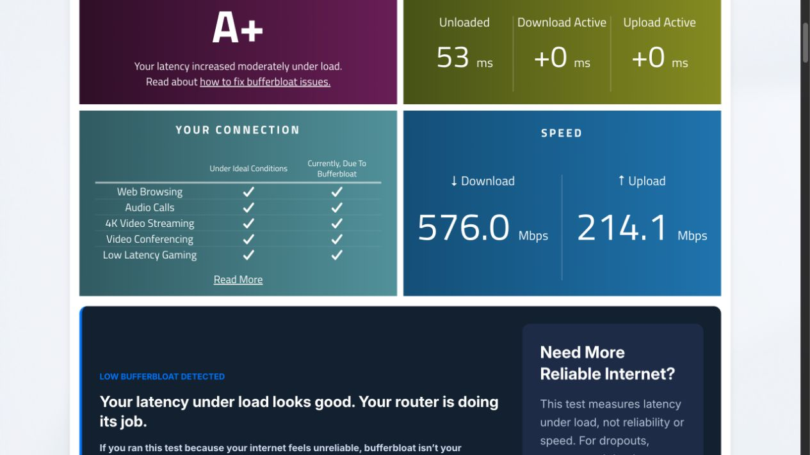

# W6x: Waveform correlacionado com CPU, CAKE e sondas independentes

29/10/2026, America/Sao_Paulo. Janela do monitor: aproximadamente **14:23:53–14:25:34**, com coleta complementar somente leitura depois. Nenhum ajuste de configuração, serviço, pacote ou firmware.

Continuação: [sondas originadas no W6x e captura WAN sem carga](DIAGNOSTICO_W6X_SONDAS_WAN_2026_10_29.md) reproduziram dois eventos externos com CPU baixa, carrier ativo e requisições observadas na saída sem resposta correspondente. Isso restringe a incerteza de localização descrita abaixo; a causa física/driver/ONT/operadora ainda não foi determinada.

## 1. Estado confirmado ao vivo

| Item | Observação |
|---|---|
| Equipamento | Acer Predator Connect W6x, Stock Layout |
| Sistema | OpenWrt 25.12.6, r33311-981c978eff, kernel 6.12.112 |
| ARK | 2.1.6 |
| Mac → gateway | Ethernet USB `en6`, 1000baseT full-duplex, MTU 1500 |
| WAN | PPPoE em `pppoe-wan`, pai `eth1`, link 1000 Mb/s full-duplex |
| CAKE upload | 744 Mb/s, diffserv4, dual-srchost, nat, wash, no-ack-filter, split-gso, RTT 100 ms, overhead 44, memlimit 64 MiB |
| CAKE download | IFB `ifb4pppoe-wan`, 700 Mb/s, besteffort, dual-dsthost, nat, wash, ingress, no-ack-filter, split-gso, RTT 50 ms, overhead 44, memlimit 64 MiB |
| Flow offload | Software=0; hardware=0 no firewall |
| WED | Parâmetro `wed_enable=Y`; utilização dos fluxos pelo dispositivo não foi comprovada |
| Packet steering | Opção UCI=2; RPS `f` em RX de eth0/eth1 |
| GRO/GSO | `on` em eth0/eth1, incluindo rx-udp-gro-forwarding e rx-gro-list |
| RAM reconhecida | MemTotal 1010036 kB; MemAvailable 681936 kB na leitura complementar |
| Temperatura | 49,925 °C em uma leitura anterior à carga; não é série de temperatura sob carga |

Esses dados substituem a incerteza documental sobre versão e direção de 700M/744M dos estudos anteriores. Não demonstram, por si, que esses sejam os melhores parâmetros.

## 2. Método e evidências

- Uma sessão SSH persistente coletou 100 amostras de `/proc/stat`, qdiscs WAN/IFB e bytes, com aproximadamente 1 s de intervalo. Somente leituras; resultados foram gravados no Mac.
- CPU calculada por diferenças dos contadores entre amostras, por núcleo, sem contar idle/iowait como ocupado.
- `fping` enviou 500 sondas a cada destino: gateway, 1.1.1.1 e 8.8.8.8; intervalo 200 ms e timeout 1000 ms.
- Sonda UDP STUN Binding para `stun.l.google.com:19302`, independente do navegador, com intervalo nominal 200 ms e timeout 800 ms. Apenas RTT/timeout/atraso de agendamento foram registrados, sem gravar o endereço mapeado retornado pelo servidor.
- Waveform foi iniciado durante a coleta. Fases de carga do relatório do roteador foram inferidas de taxas >100 Mb/s e predominância por direção; suas fronteiras são aproximadas.
- O teste não isolou os demais clientes/processos; taxas e contadores do roteador são agregados. A coleta também tem pequeno custo de CPU/tráfego.

Dados finitos preservados em [measurements/w6x-2026-10-29-monitorado](../measurements/w6x-2026-10-29-monitorado/): `router.log`, `udp.jsonl`, `icmp.log`, `meta.json` e `parsed.json`. Os percentis calculados para sondas usam a amostra ordenada; não são a definição interna do Waveform.

## 3. Resultado Waveform

[Resultado desta rodada](https://www.waveform.com/tools/bufferbloat?test-id=32bc9547-f158-41b8-b506-7002149b344e): **A+**, 576,0 Mb/s de download e 214,1 Mb/s de upload, acréscimos arredondados +0/+0 ms.

| Fase | Média RTT | p95 | Máximo | Jitter exibido |
|---|---:|---:|---:|---:|
| Ocioso | 53,0 ms | 32,7 ms | **1132 ms** | 70,1 ms |
| Download | 16,2 ms | 19,5 ms | 26,8 ms | 1,1 ms |
| Upload | 16,0 ms | 18,0 ms | 27,7 ms | 0,9 ms |

**A nota não é homologação de estabilidade:** um evento elevou a média ociosa para 53 ms, acima das médias carregadas. Assim, acréscimo exibido zero e nota A+ podem coexistir com a interrupção observada. A carga também ficou abaixo do link nominal e não foi bidirecional simultânea.

## 4. Evento externo sem fila ou CPU altas

Por volta de **14:24:02–14:24:05**, houve:

- Ausência de respostas no prazo para os mesmos dez números de sequência (49–58) em **ambos** os destinos ICMP externos, correspondendo a cerca de 2 s de sondas consecutivas.
- Três timeouts UDP, com envios às 14:24:02,860, 14:24:03,661 e 14:24:04,463, compatíveis com a mesma janela.
- Todas as 500 sondas ao gateway respondidas na coleta completa.
- Na janela correspondente, CPU máxima por núcleo próxima de 3%; atraso `pk_delay` IFB na ordem de dezenas de microssegundos e tráfego baixo.
- Nenhuma queda/reconexão PPPoE ou de link físico encontrada para esse horário nos eventos filtrados disponíveis. Os eventos WAN exibidos eram do boot, por volta de 08h14.

Isso demonstra que o evento **não ficou restrito à renderização/medição do Waveform** e não coincidiu com saturação de CPU ou uma fila CAKE longa. Não identifica o elemento causador: filtro/caminho externo do Mac, processamento/encaminhamento do W6x, ONT, operadora ou outro ponto comum ainda precisam ser separados.

“Timeout” significa falta de resposta dentro do prazo, não prova de descarte físico: um atraso longo também pode provocá-lo. O tempo exato do pico individual do Waveform não foi exportado; a correspondência é por fase/janela, sem afirmar que se trata do mesmo pacote/evento.

## 5. Sob download: pressão de CPU e fila real

| Medida na coleta | Resultado |
|---|---:|
| Maior uso amostrado CPU0/1/2/3 | 88,0% / 92,6% / 46,9% / 76,0% |
| Média de uso por núcleo na fase inferida de download | 74,1% / 76,9% / 9,7% / 56,9% |
| Média de softirq por núcleo nessa fase | 34,3% / 71,3% / 3,6% / 51,2% |
| Maior uso de núcleo na fase inferida de upload | 62,4% |
| Maior `pk_delay` amostrado no CAKE de entrada | **134 ms** |
| Backlog IFB na amostra dos 134 ms | 3773931 bytes, 2970 pacotes |
| Maior `pk_delay` amostrado no CAKE de saída, entre classes | 5,01 ms |
| Aumento de drops do CAKE de entrada | 82171 |
| Aumento de drops do CAKE de saída | 31 |

Há pressão real de processamento e filas em parte da fase de download. Isso merece investigação, mas 92,6% numa amostra não prova saturação contínua, nem identifica qual alteração de IRQ/RPS/CAKE seria superior. Não há evidência aqui de CPU como causa do upload de apenas 214 Mb/s.

O `pk_delay` do CAKE é estatística interna do qdisc; não é o RTT de todos os fluxos. Justiça por fluxo e prioridade podem manter uma sonda rápida enquanto fluxos volumosos experimentam mais espera. Drops AQM sob carga não equivalem à perda ponta a ponta de todas as aplicações, e os contadores agregados também incluem outros tráfegos.

## 6. Sondas independentes na janela completa

| Destino | Recebidas/enviadas | Mediana RTT | p95 | p99 | Máximo |
|---|---:|---:|---:|---:|---:|
| W6x pela LAN | 500/500 | 0,808 ms | 3,00 ms | 7,31 ms | 83,3 ms |
| 1.1.1.1 | 490/500 | 4,865 ms | 7,00 ms | 9,79 ms | 43,7 ms |
| 8.8.8.8 | 490/500 | 15,00 ms | 17,00 ms | 24,20 ms | 33,8 ms |
| UDP STUN | 489/492 no prazo | 16,03 ms | 18,84 ms | 25,85 ms | 75,13 ms |

Os dez timeouts de cada destino ICMP externo se concentraram na mesma janela, não se distribuíram uniformemente pela carga. Percentis/max da tabela são das respostas recebidas, excluindo timeouts; interpretá-los junto com a coluna de respostas. O atraso máximo observado de agendamento do coletor UDP foi 63,72 ms, inferior à janela de timeouts, sem descartar toda interferência do hospedeiro.

## 7. Próxima decisão

1. **Não reduzir upload nem reconfigurar Wi-Fi com base nessa rodada:** o teste é Ethernet e não demonstrou CPU limitando o upload.
2. **Separar os eventos externos:** numa próxima coleta, sondar também a partir do gateway, ao mesmo tempo que do Mac, e correlacionar logs/counters WAN. Isso diferencia parte do caminho do cliente da saída do roteador. Uma comparação com outro cliente Ethernet também ajuda.
3. **Confirmar vazão com outro servidor/ferramenta de carga**, mantendo sondas independentes, antes de culpar a taxa contratada ou alterar o shaper.
4. **Investigar processamento do download em ensaio próprio:** comparar distribuição e custos de CPU/filas, com referência estável. Mudanças de IRQ/RPS/taxa exigem teste isolado, preservação de estado e fluxo de laboratório/autorizações do projeto.
5. Não confundir o evento ocioso com os 134 ms internos da fila durante download: ocorreram em momentos e condições diferentes.

Este diagnóstico mede o estado atual; não altera parâmetros nem declara encontrada a causa-raiz definitiva. A leitura física não substitui teste virtual de futuras mudanças.
